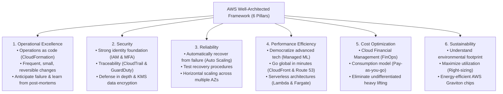

# Master Architecture Blueprint: Well-Architected Framework 6 Pillars

> **Category:** Cloud Architecture Best Practices  
> **Course:** AWS Certified Cloud Practitioner (CLF-C02)  
> **Tags:** `#diagram` `#well-architected` `#architecture`

