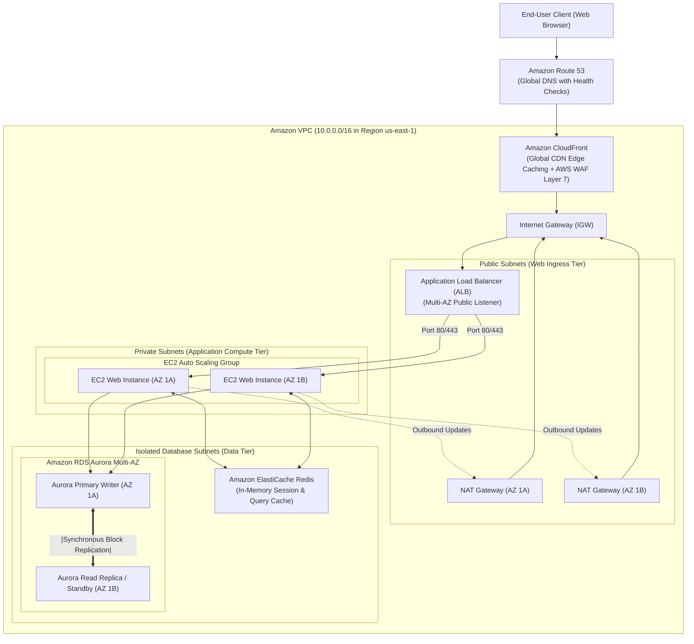

# Master Architecture Blueprint: Resilient 3-Tier Enterprise Web Application

> **Category:** High Availability, Fault Tolerance & Scalability  
> **Course:** AWS Certified Cloud Practitioner (CLF-C02) / SAA-C03  
> **Tags:** `#diagram` `#vpc` `#ha` `#three-tier`

### Architectural Highlights:
- **No Direct Internet Access to Servers:** EC2 instances sit in private subnets; only the ALB has a public IP.
- **Multi-AZ Redundancy:** If Availability Zone 1A experiences an outage, ALB routes 100% of traffic to AZ 1B, and Aurora automatically promotes the standby replica to primary writer in under 30 seconds.
- **In-Memory Caching:** ElastiCache offloads frequent read queries from Aurora, dropping read latency to sub-millisecond speeds.
