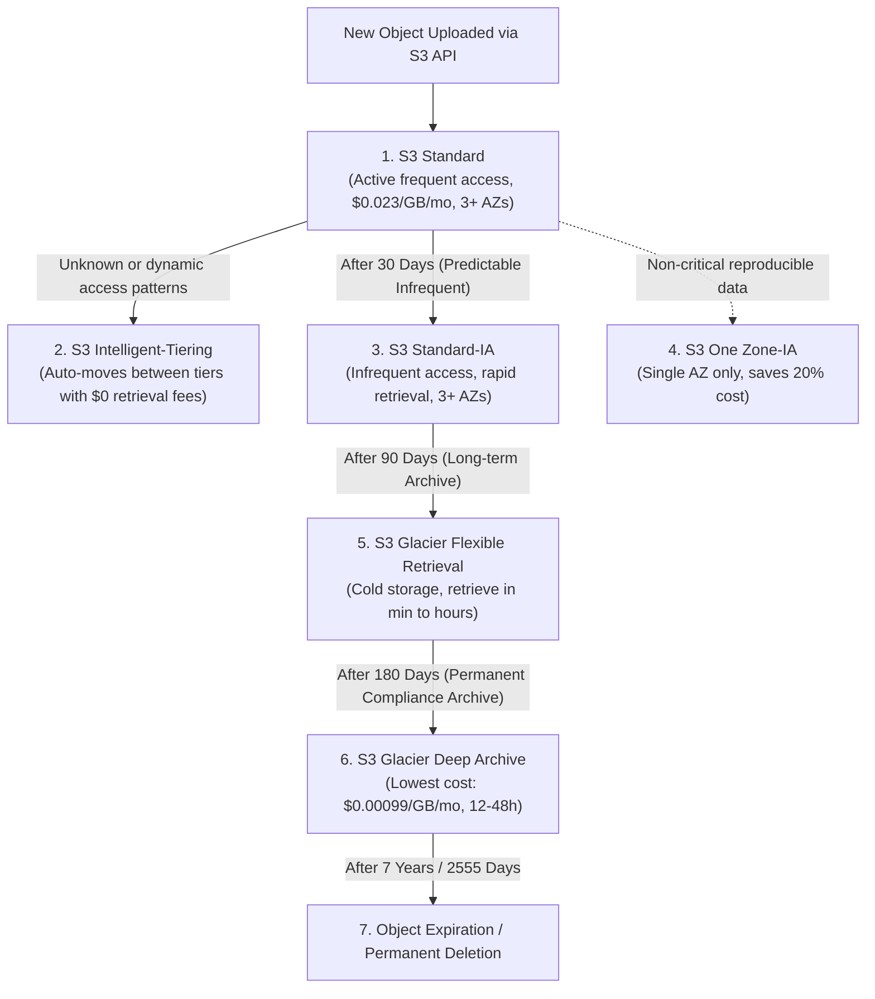

# Master Architecture Blueprint: Amazon S3 Storage Lifecycle & Tiers

> **Category:** Cloud Storage & Cost Optimization  
> **Course:** AWS Certified Cloud Practitioner (CLF-C02)  
> **Tags:** `#diagram` `#s3` `#storage` `#lifecycle`

### Exam Decision Matrix:
- **Immediate access, active website images:** `S3 Standard`
- **Unknown or fluctuating patterns:** `S3 Intelligent-Tiering`
- **Disaster recovery secondary backups:** `S3 Standard-IA`
- **Replaceable thumbnails / non-critical:** `S3 One Zone-IA`
- **Archived financial records (1-3 times/year):** `S3 Glacier Flexible Retrieval`
- **Legal hold / compliance data kept for 10 years, rarely accessed:** `S3 Glacier Deep Archive`
