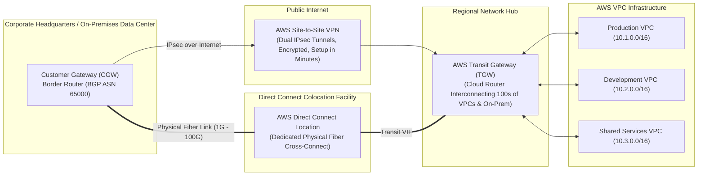

# Master Architecture Blueprint: Hybrid Enterprise Networking Topology

> **Category:** Networking, Transit Gateway & Direct Connect  
> **Course:** AWS Certified Cloud Practitioner (CLF-C02)  
> **Tags:** `#diagram` `#networking` `#direct-connect` `#vpn`

### High-Yield Comparison:
- **Site-to-Site VPN:** Fast setup, encrypted over public internet, bandwidth capped at 1.25 Gbps per tunnel, variable internet latency.
- **Direct Connect:** Weeks to provision physical cross-connect, dedicated private fiber bypassing public internet, ultra-consistent sub-millisecond latency, discounted data egress.
- **Transit Gateway:** Hub-and-spoke router eliminating complex point-to-point VPC peering meshes.
