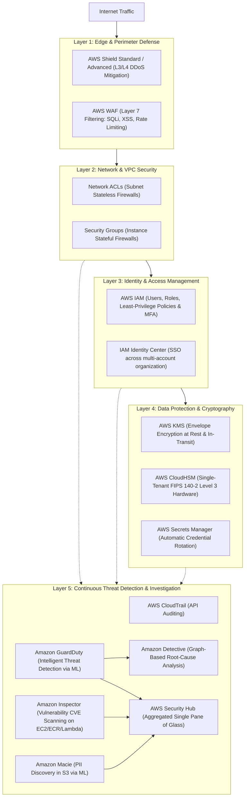

# Master Architecture Blueprint: Multi-Layered Security & Threat Detection

> **Category:** Security, Identity, Governance & Compliance  
> **Course:** AWS Certified Cloud Practitioner (CLF-C02)  
> **Tags:** `#diagram` `#security` `#defense-in-depth`

