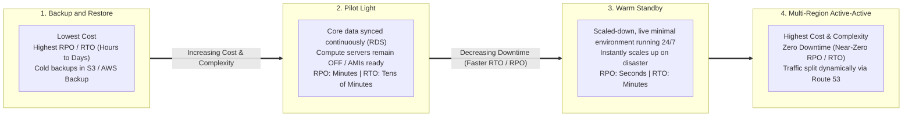

# Master Architecture Blueprint: Disaster Recovery Strategies Spectrum

> **Category:** Business Continuity & Disaster Recovery  
> **Course:** AWS Certified Cloud Practitioner (CLF-C02)  
> **Tags:** `#diagram` `#disaster-recovery` `#rpo-rto`

### Definitions:
- **Recovery Point Objective (RPO):** Maximum acceptable data loss measured in time (e.g., losing 1 hour of database transactions).
- **Recovery Time Objective (RTO):** Maximum acceptable system downtime before application is back online.
