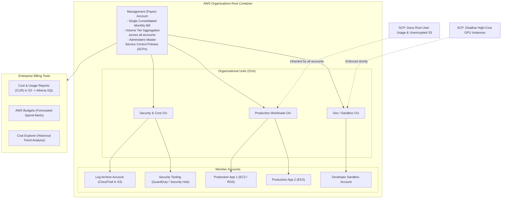

# Master Architecture Blueprint: Enterprise Organizations & Consolidated Billing

> **Category:** Cloud Financial Management & Governance  
> **Course:** AWS Certified Cloud Practitioner (CLF-C02)  
> **Tags:** `#diagram` `#organizations` `#billing` `#finops`

