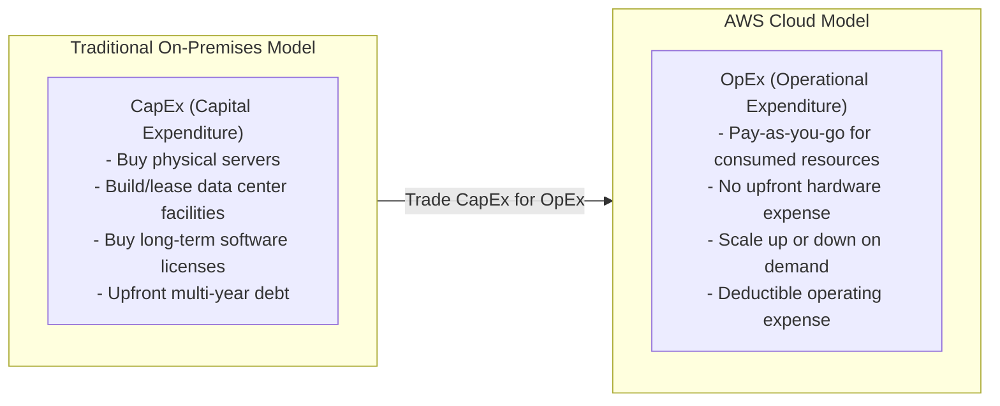
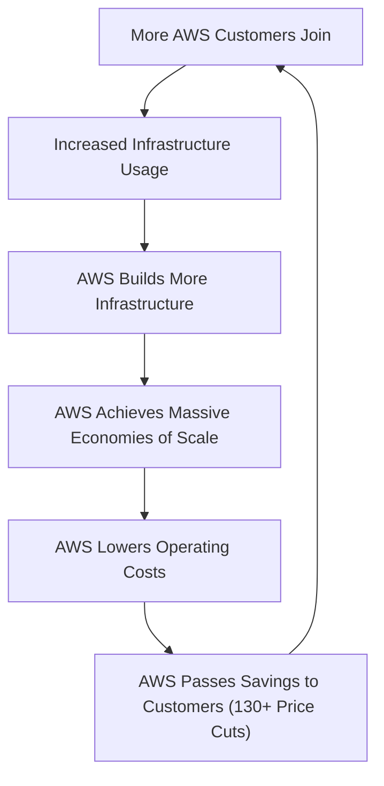
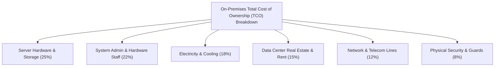
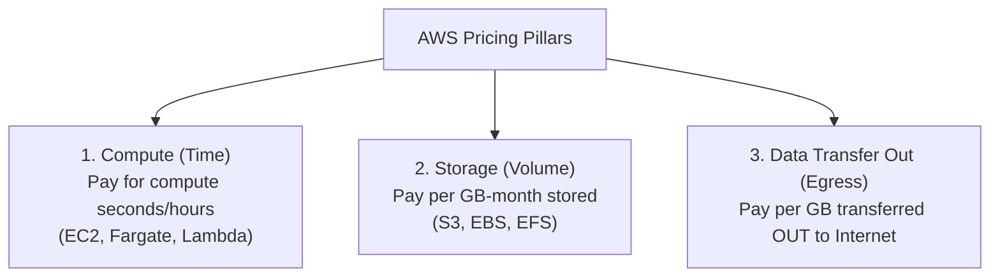

# Cloud Economics and AWS Pricing Principles

> **Knowledge Area:** Cloud Concepts (Domain 1.4) & Billing and Pricing (Domain 4.1)  
> **Relevant Certifications:** [[CLF-C02_Master_Blueprint|CLF-C02]], SAA-C03  
> **Tags:** `#aws/economics` `#aws/billing` `#clf-c02`

---

## 1. Fundamental Financial Shift: CapEx vs. OpEx

Cloud computing transforms corporate finance by shifting IT spending from upfront capital investments to ongoing operational expenses:

| Dimension | Capital Expenditure (CapEx) | Operational Expenditure (OpEx) |
|---|---|---|
| **Payment Timing** | Heavy upfront payment before any business value is realized. | Pay as you consume; billed monthly based on usage. |
| **Capacity Risk** | High: Risk of over-provisioning (wasted money) or under-provisioning (crashed sites). | Zero: Scale compute resources in real time to match exact demand. |
| **Tax Treatment** | Depreciated as an asset over 3 to 7 years. | Fully deductible operating expense in the current tax year. |
| **Commitment** | Locked into physical hardware for years. | Terminate resources anytime with zero lingering penalties. |

---

## 2. Economies of Scale & The AWS Virtuous Cycle

Because AWS aggregates the usage of millions of customers globally, it achieves massive economies of scale that no single company can replicate.

* **Key Takeaway:** As AWS grows, purchasing and operational efficiencies allow AWS to continually reduce retail pricing for compute, storage, and networking services.

---

## 3. Total Cost of Ownership (TCO): Direct vs. Indirect Costs

When comparing on-premises IT costs with AWS Cloud costs, organizations must look beyond just server hardware prices:

### On-Premises Hidden Costs Eliminated by AWS:
1. **Facility Costs:** Land purchase, building construction, data center lease, fire suppression, diesel generators, UPS backup batteries.
2. **Environmental Costs:** Electricity consumption, heavy air conditioning / HVAC cooling units.
3. **Operational Overhead (Undifferentiated Heavy Lifting):** Server racking, physical cabling, failed disk replacements, motherboard swaps, firmware updates.
4. **Maintenance Staffing:** 24/7 on-site physical security guards, facility engineering personnel.

---

## 4. AWS 3 Fundamental Pricing Pillars

Across all AWS services, pricing adheres to three core charging rules:

### Data Transfer Rules (Critical Exam Rule):
* **Inbound Data Transfer:** **Always FREE!** (Transferring data INTO AWS from the internet costs \$0.00).
* **Outbound Data Transfer (Internet Egress):** **Charged per GB** (Aggregated and tiered monthly).
* **Intra-Region Data Transfer:** Data transferred between AWS services within the **same Region and same AZ** is generally **FREE**.
* **Cross-AZ Data Transfer:** Data transferred across AZs within the same Region incurs a small fee (\$0.01 per GB each way).
* **Cross-Region Data Transfer:** Data transferred from one AWS Region to another incurs standard inter-region transfer rates.

---

## 5. Software Licensing in the Cloud

AWS provides flexible licensing models to accommodate enterprise software:

| Licensing Model | Description | Best For | Supported Services |
|---|---|---|---|
| **License Included** | The software license (Windows Server, SQL Server, Red Hat) is bundled directly into the hourly/secondly AWS rate. No separate license purchase is required. | New workloads, dynamic auto-scaling fleets, testing. | Amazon EC2, Amazon RDS |
| **Bring Your Own License (BYOL)** | Customers use their existing on-premises software agreements (e.g., Microsoft Software Assurance) on AWS without paying for redundant licenses. | Long-standing enterprise contracts; saving software licensing costs. | Amazon EC2 (Dedicated Hosts / Dedicated Instances), AWS License Manager |

* **AWS License Manager:** Centrally manages, tracks, and automates software licenses (from Microsoft, SAP, Oracle, IBM) across AWS and on-premises environments, preventing licensing non-compliance fines.

---

## 6. Exam Tip Matrix

| Question Scenario | Correct Financial Concept |
|---|---|
| *"Trading large upfront hardware expenditures for low, variable monthly costs"* | **Trading CapEx for OpEx** |
| *"Why can AWS offer lower prices than a private on-premises data center?"* | **Massive Economies of Scale** |
| *"Customer wants to migrate existing Microsoft SQL Server licenses to EC2 to reduce costs"* | **Bring Your Own License (BYOL)** via **AWS License Manager** |
| *"Is there a charge for uploading 50 TB of data from an on-prem server to Amazon S3?"* | **No (Inbound Data Transfer into AWS is always free)** |
| *"Which costs are included in on-prem TCO that are eliminated when moving to AWS?"* | **Power, cooling, data center real estate, and hardware maintenance** |
