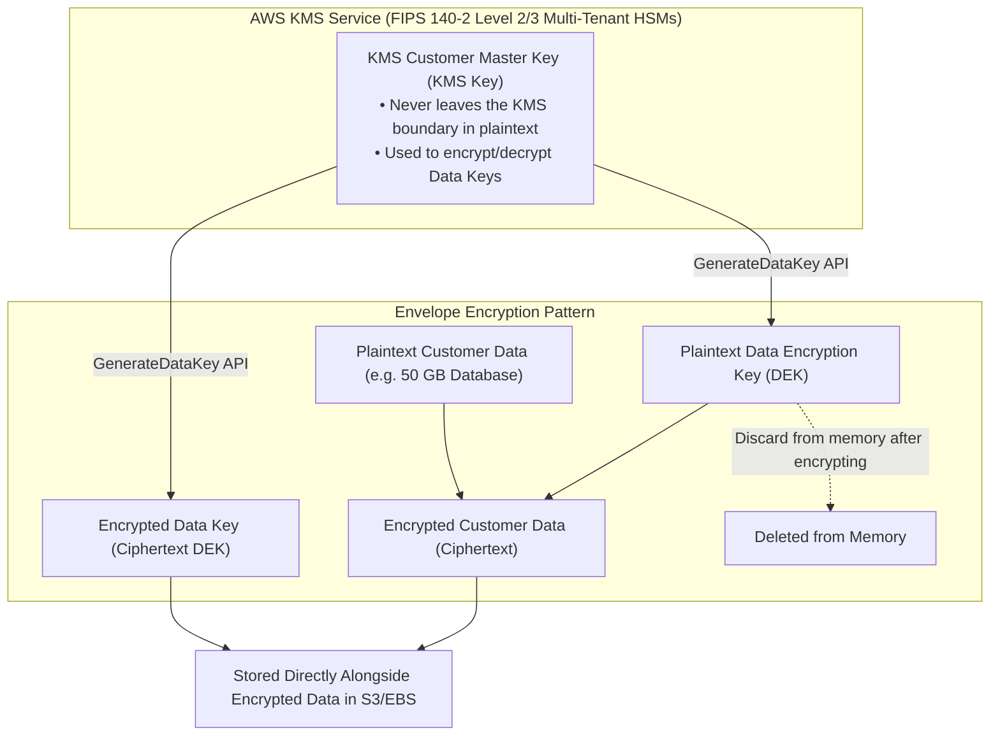

# AWS KMS (Key Management Service)

> **Service Category:** Security, Identity & Compliance (Cryptography)  
> **Service Role:** Fully managed service that makes it easy to create and control cryptographic keys used to protect your data across 100+ AWS services and in your own applications.  
> **Relevant Certifications:** [[01_Certifications/Cloud_Practitioner_CLF-C02/CLF-C02_Master_Blueprint|CLF-C02]], SAA-C03, SCS-C02  
> **Tags:** `#aws/services` `#aws/security` `#kms` `#encryption` `#keys` `#clf-c02`

---

## 1. What is AWS KMS?

**AWS Key Management Service (AWS KMS)** is a managed service that enables you to easily create, rotate, and manage cryptographic keys. AWS KMS uses Hardware Security Modules (HSMs) validated under **FIPS 140-2 Cryptographic Module Validation Program** to protect the security of your keys.

AWS KMS is deeply integrated with over 100 AWS services (such as [[Amazon_S3|Amazon S3]], [[Amazon_EBS|Amazon EBS]], [[Amazon_RDS|Amazon RDS]], [[Amazon_DynamoDB|DynamoDB]]) and integrates with [[AWS_CloudTrail|AWS CloudTrail]] to provide detailed audit logs of every key usage.

---

## 2. Key Categories: AWS Owned vs. AWS Managed vs. Customer Managed

| Key Type | Managed By | Rotation Policy | Custom Key Policy? | Monthly Fee | Primary Use Case |
|:---|:---:|:---:|:---:|:---:|:---|
| **AWS Owned Keys** | AWS | Managed by AWS | **NO** | **Free** | Default internal encryption in services like DynamoDB and S3. |
| **AWS Managed Keys** (e.g. `aws/s3`, `aws/ebs`) | AWS on your behalf | Automatically every 1 year | **NO** | **Free** | Out-of-the-box encryption when you don't require custom key policies. |
| **Customer Managed Keys (CMK)** | **Customer** | **Configurable** (Auto every 1 year, or custom 90-360 days, or manual) | **YES (Full IAM & Key Policy control)** | **\$1.00/month** per key | **Enterprise Best Practice:** Required when compliance demands strict key access audit and rotation control. |

---

## 3. Cryptography Master Comparison: KMS vs. CloudHSM vs. Secrets Manager vs. Parameter Store

| Feature / Dimension | AWS Key Management Service (KMS) | AWS CloudHSM | AWS Secrets Manager | AWS Systems Manager Parameter Store |
|:---|:---|:---|:---|:---|
| **Primary Role** | Cryptographic key lifecycle & envelope encryption. | Dedicated physical hardware security module appliance. | Secret lifecycle with automated credential rotation. | Configuration storage & hierarchical parameter store. |
| **Tenancy Model** | **Multi-tenant shared physical hardware** (FIPS 140-2 Level 2/3). | **Single-tenant dedicated physical hardware** (FIPS 140-2 Level 3). | Managed service (uses KMS for encryption). | Managed service (uses KMS for SecureString). |
| **Automated Rotation** | Annual automatic key rotation (or 90-360 days custom). | Customer-managed scripts/software. | **Built-in automated rotation** for RDS, Redshift, DocumentDB via Lambda. | No native automated database credential rotation. |
| **Pricing Model** | \$1.00/month per active CMK + API request fees. | Hourly appliance fee (~$1.45/hr = ~$1,050/mo). | \$0.40/month per secret + \$0.05 per 10,000 API calls. | **Free tier available** (Standard parameters); nominal fee for Advanced. |
| **Best Used For** | Encrypting S3 buckets, EBS volumes, RDS databases, Lambda vars. | Strict corporate/government compliance requiring dedicated hardware. | Database passwords, OAuth tokens needing scheduled rotation. | App config strings, license keys, AMI IDs, environment variables. |

---

## 4. Exam Tips & Distinction Criteria

> [!IMPORTANT]
> - **KMS Keys Never Leave the HSM:** The raw plaintext master key **never leaves the KMS boundary**. Data is encrypted using **Envelope Encryption** via Data Encryption Keys (DEKs).
> - **Auditing Every Single Key Decryption:** Every time an authorized user or AWS service calls `kms:Decrypt`, the event is logged immutably in **AWS CloudTrail**.
> - **Multi-Tenant vs Dedicated:**
>   - **AWS KMS:** Shared, multi-tenant hardware (standard choice for 99% of workloads).
>   - **AWS CloudHSM:** Dedicated, single-tenant hardware appliance inside your VPC.

---

## 5. Cross-Service Links
- [[AWS_CloudHSM|AWS CloudHSM (Dedicated Hardware)]]
- [[AWS_Security_Services|AWS Secrets Manager]]
- [[AWS_Config_and_Systems_Manager|SSM Parameter Store]]
- [[AWS_CloudWatch_and_CloudTrail|AWS CloudTrail Auditing]]
