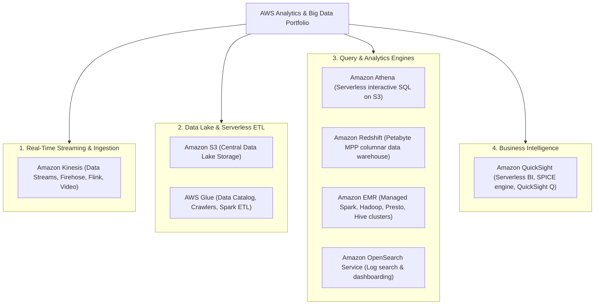

# AWS Analytics & Big Data — Map of Content (MOC)

> **Domain:** 03_Services / Analytics & Big Data  
> **Parent MOC:** [[AWS_Brain_MOC]]  
> **Certifications:** [[CLF-C02_Master_Blueprint|CLF-C02]], Data Analytics, Solutions Architect

---

## 1. Architectural Taxonomy of AWS Analytics

AWS provides an end-to-end analytics stack covering the complete lifecycle: **Ingestion & Streaming**, **Data Lake & Catalogs**, **Data Warehousing**, **Big Data Frameworks**, **Interactive SQL**, **Log Analytics**, and **Business Intelligence**:

---

## 2. Decision Matrix: Selecting Analytics Services

| Scenario / Need | Best AWS Service | Why |
| :--- | :--- | :--- |
| **Ad-hoc SQL queries on S3 files without servers** | **[[Amazon_Athena]]** | Serverless, pay per TB scanned, uses Glue schema. |
| **Complex analytical joins across enterprise historical data** | **[[Amazon_Redshift]]** | Columnar storage, MPP architecture, OLAP engine. |
| **Run Apache Spark, Hadoop, or Hive big data jobs** | **[[Amazon_EMR]]** | Managed distributed cluster nodes; Spot instance integration. |
| **Collect and process real-time clickstreams / IoT** | **[[Amazon_Kinesis]]** | Sub-second latency streaming ingestion; Firehose delivery. |
| **Discover metadata and automate serverless ETL** | **[[AWS_Glue]]** | Glue Data Catalog + automated schema inference crawlers. |
| **Operational log search and interactive heatmaps** | **[[Amazon_OpenSearch_Service]]** | Real-time indexing, full-text search, OpenSearch Dashboards. |
| **Executive financial dashboards with ML insights** | **[[Amazon_QuickSight]]** | In-memory SPICE calculations; natural language queries with Q. |

---

## 3. Atomic Notes in this Domain

| Atomic Note | Description | Key Focus / Keywords |
| :--- | :--- | :--- |
| **[[Amazon_Athena]]** | Serverless SQL Engine | Query S3 directly, pay per TB scanned, Parquet/ORC optimization. |
| **[[Amazon_EMR]]** | Managed Big Data Platform | Apache Spark, Hadoop, Hive, Presto, Master/Core/Task nodes. |
| **[[Amazon_Redshift]]** | Cloud Data Warehouse | OLAP, columnar storage, MPP, Redshift Spectrum, Serverless. |
| **[[Amazon_Kinesis]]** | Real-Time Streaming Data | Kinesis Data Streams (real-time) vs. Data Firehose (near real-time). |
| **[[AWS_Glue]]** | Serverless ETL & Metadata | Glue Data Catalog, Crawlers, Glue Studio, schema-on-read. |
| **[[Amazon_OpenSearch_Service]]** | Search & Log Analytics | OpenSearch / Elasticsearch, log indexing, OpenSearch Dashboards. |
| **[[Amazon_QuickSight]]** | Cloud Business Intelligence | SPICE engine, pay-per-session pricing, QuickSight Q natural language. |
