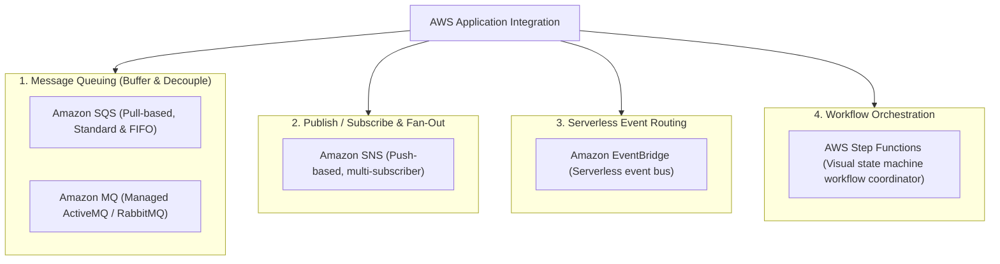
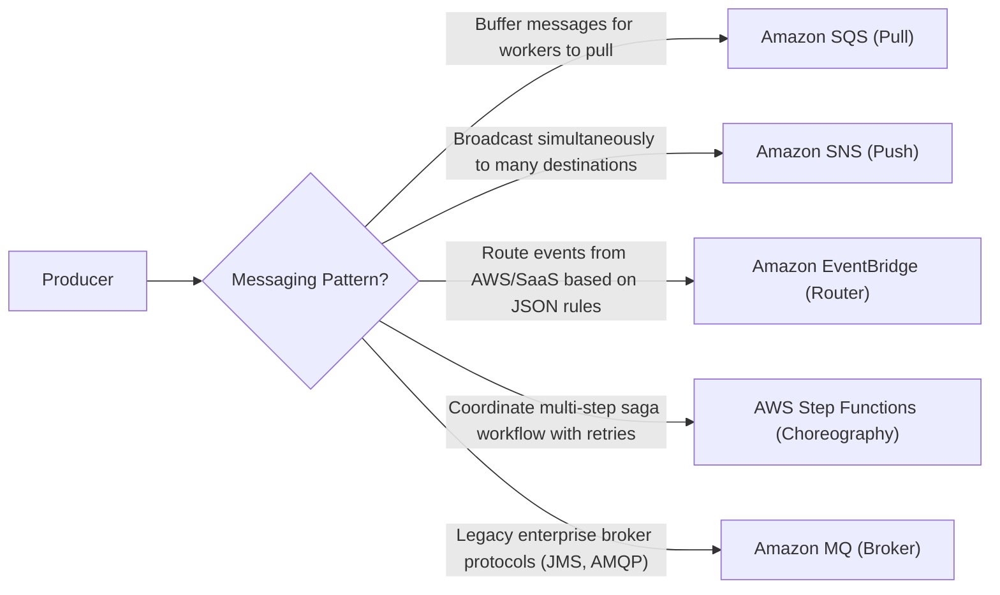

# AWS Application Integration — Map of Content (MOC)

> **Domain:** 03_Services / Application Integration  
> **Parent MOC:** [[AWS_Brain_MOC]]  
> **Certifications:** [[CLF-C02_Master_Blueprint|CLF-C02]], Developer Associate, Solutions Architect

---

## 1. Architectural Taxonomy of AWS Application Integration

Application integration services enable decoupled, asynchronous communication, choreography, and event distribution across microservices and distributed cloud architectures:

---

## 2. High-Yield Architectural Comparison

| Service | Protocol / Pattern | Delivery Model | Primary Exam Trigger |
| :--- | :--- | :--- | :--- |
| **[[Amazon_SQS]]** | Queuing (point-to-point) | **Pull-based** (consumers poll queue) | *"Decouple components and absorb traffic spikes without message loss."* |
| **[[Amazon_SNS]]** | Pub/Sub Topic | **Push-based** (immediate fan-out) | *"Send a single message to multiple subscribers (email, SMS, SQS) at once."* |
| **[[Amazon_EventBridge]]** | Serverless Event Bus | **Content-based routing** | *"React to AWS service state changes or third-party SaaS events (Shopify, Zendesk)."* |
| **[[AWS_Step_Functions]]** | State Machine Workflow | **Visual coordination** | *"Coordinate multiple Lambda functions and human approvals into a multi-step workflow."* |
| **[[Amazon_MQ]]** | Open-source Broker (ActiveMQ/RabbitMQ) | Traditional broker protocols | *"Migrate existing enterprise messaging using JMS, AMQP, MQTT without rewriting code."* |

---

## 3. Atomic Notes in this Domain

| Atomic Note | Description | Key Focus / Keywords |
| :--- | :--- | :--- |
| **[[Amazon_SQS]]** | Distributed Message Queuing | Standard vs. FIFO, Visibility Timeout, Long Polling, Dead-Letter Queues (DLQ). |
| **[[Amazon_SNS]]** | Pub/Sub Notification Service | Topics, Fan-out pattern, SMS, Mobile Push, Email, Subscription filter policies. |
| **[[Amazon_EventBridge]]** | Serverless Event Bus | Default, Custom, and Partner Event Buses, declarative JSON pattern filtering. |
| **[[AWS_Step_Functions]]** | Serverless Workflow Orchestrator | State machines, Amazon States Language (ASL), error handling, sagas. |
| **[[Amazon_MQ]]** | Managed Message Broker | Apache ActiveMQ, RabbitMQ, legacy protocol migration (JMS, AMQP). |
