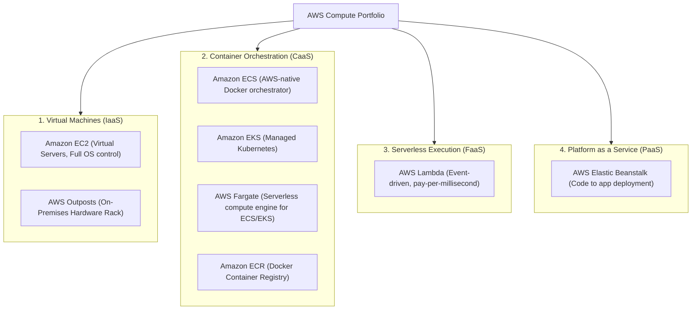
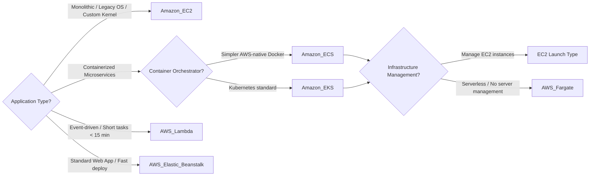

# AWS Compute Services — Map of Content (MOC)

> **Domain:** 03_Services / Compute  
> **Parent MOC:** [[AWS_Brain_MOC]]  
> **Certifications:** [[CLF-C02_Master_Blueprint|CLF-C02]], SAA-C03, DVA-C02

---

## 1. Architectural Taxonomy of AWS Compute

AWS compute services span four distinct operational models, ranging from direct virtual server control to serverless function execution:

---

## 2. Decision Tree: Choosing the Right Compute Service

---

## 3. Atomic Notes in this Domain

| Atomic Note | Description | Key Focus / Keywords |
| :--- | :--- | :--- |
| **[[Amazon_EC2]]** | Elastic Compute Cloud | Instances, AMIs, Pricing Models (On-Demand, Spot, Reserved), EBS. |
| **[[AWS_Lambda]]** | Serverless Compute Engine | Event-driven, 15-minute max execution, 0 to 10k auto-scale, pay per ms. |
| **[[Amazon_ECS]]** | Elastic Container Service | AWS-native Docker container orchestration, Task Definitions, Services. |
| **[[Amazon_EKS]]** | Elastic Kubernetes Service | Managed upstream Kubernetes clusters, Pods, control plane HA. |
| **[[AWS_Fargate]]** | Serverless Container Compute | Run containers without managing EC2 instances, per-vCPU/GB pricing. |
| **[[Amazon_ECR]]** | Elastic Container Registry | Managed private/public Docker registries, vulnerability scanning. |
| **[[AWS_Outposts]]** | Hybrid On-Premises Compute | Physical AWS racks deployed directly into customer data centers. |
| **[[Containers_ECS_EKS_Fargate]]** | Container Comparison Guide | Comprehensive architectural distinction matrix for containers. |
