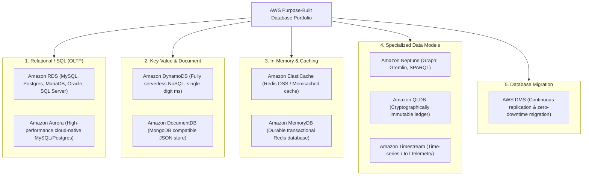

# AWS Database Services — Map of Content (MOC)

> **Domain:** 03_Services / Database  
> **Parent MOC:** [[AWS_Brain_MOC]]  
> **Certifications:** [[CLF-C02_Master_Blueprint|CLF-C02]], SAA-C03, DVA-C02

---

## 1. Architectural Taxonomy of AWS Databases

AWS rejects the single "one-size-fits-all" database approach in favor of **purpose-built databases** engineered for specific workload access patterns and data models:

---

## 2. Decision Matrix: Selecting the Target Database

| Workload Need | Target Engine | Key Characteristics |
| :--- | :--- | :--- |
| **Traditional SQL, Foreign Keys, Joins, ACID** | **[[Amazon_RDS]]** / **[[Amazon_Aurora]]** | Automated backup, Multi-AZ failover, read replicas. |
| **Massive Scale Web/Mobile, Predictable Latency** | **[[Amazon_DynamoDB]]** | Serverless, horizontal scaling, partition keys, DAX. |
| **Sub-Millisecond Read Acceleration (Caching)** | **[[Amazon_ElastiCache]]** | In-memory key-value cache, Redis/Memcached. |
| **Primary In-Memory DB with Multi-AZ Durability**| **[[Amazon_MemoryDB]]** | Redis-compatible with transactional write-ahead transaction log. |
| **Connected Graphs (Social, Fraud Networks)** | **[[Amazon_Specialty_Databases|Amazon Neptune]]** | Graph nodes & edges, TinkerPop Gremlin. |
| **MongoDB Document Workloads** | **[[Amazon_Specialty_Databases|Amazon DocumentDB]]** | Fully managed BSON document engine. |
| **Tamper-Proof Audit & Financial Log** | **[[Amazon_Specialty_Databases|Amazon QLDB]]** | Immutable append-only cryptographic ledger. |
| **Sensor / IoT Time Sequences** | **[[Amazon_Specialty_Databases|Amazon Timestream]]** | Auto-scaling time-series with built-in analytics. |

---

## 3. Atomic Notes in this Domain

| Atomic Note | Description | Key Focus / Keywords |
| :--- | :--- | :--- |
| **[[Amazon_RDS]]** | Relational Database Service | Multi-AZ vs. Read Replicas, automated patching, engines. |
| **[[Amazon_Aurora]]** | Cloud-Native Relational Engine | 6-way storage replication across 3 AZs, Aurora Serverless. |
| **[[Amazon_DynamoDB]]** | Serverless NoSQL Database | Tables, Items, Attributes, Partition/Sort Keys, TTL, Streams. |
| **[[Amazon_ElastiCache]]** | Managed In-Memory Cache | Redis OSS vs. Memcached, read caching, session stores. |
| **[[Amazon_MemoryDB]]** | In-Memory Database for Redis | Primary transactional database, sub-millisecond reads, single-digit ms writes. |
| **[[Amazon_Specialty_Databases]]** | Purpose-Built Specialty DBs | DocumentDB, Neptune, QLDB, and Timestream details. |
| **[[AWS_Database_Migration_Service_DMS]]** | Database Migration Service | CDC (Change Data Capture), homogenous and heterogeneous migrations. |
