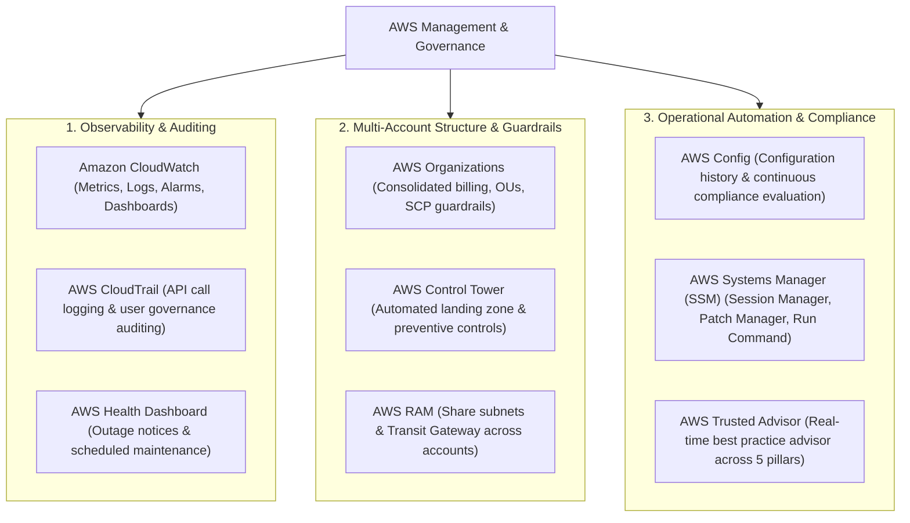
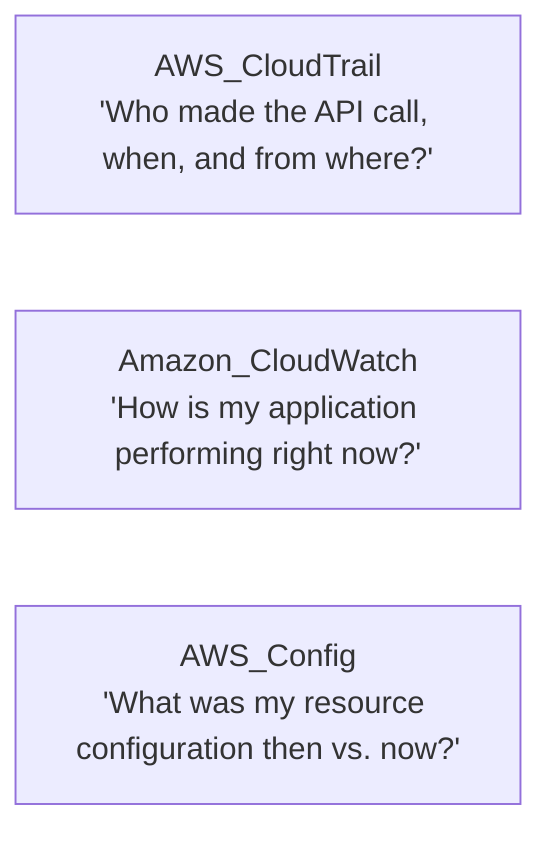

# AWS Management & Governance — Map of Content (MOC)

> **Domain:** 03_Services / Management & Governance  
> **Parent MOC:** [[AWS_Brain_MOC]]  
> **Certifications:** [[CLF-C02_Master_Blueprint|CLF-C02]], SysOps Administrator, Solutions Architect

---

## 1. Architectural Taxonomy of AWS Management & Governance

AWS management and governance services provide continuous visibility, centralized multi-account guardrails, operational automation, and compliance auditing:

---

## 2. High-Yield "The Big Three" Observability Comparison

| Service | Primary Question Answered | Data Artifacts | Target Audience |
| :--- | :--- | :--- | :--- |
| **[[AWS_CloudTrail]]** | *"Who made the API call, when, and from where?"* | Event logs, user identities, source IPs, AWS KMS encryption. | Security, Auditing, Compliance |
| **[[Amazon_CloudWatch]]** | *"How is my application performing right now?"* | Metrics, CloudWatch Logs, Alarms, Container Insights. | DevOps, SysAdmins, SREs |
| **[[AWS_Config]]** | *"What was my resource configuration then vs. now?"* | Configuration Items (CIs), timeline history, rule evaluations. | Governance, Compliance, SecOps |

---

## 3. Atomic Notes in this Domain

| Atomic Note | Description | Key Focus / Keywords |
| :--- | :--- | :--- |
| **[[Amazon_CloudWatch]]** | Monitoring & Observability | Metrics (15 months retention), Alarms (EC2 action, SNS), Logs Insights. |
| **[[AWS_CloudTrail]]** | API Governance & Auditing | Multi-region trail, Management vs. Data events, immutable S3 log storage. |
| **[[AWS_Organizations]]** | Centralized Multi-Account Governance | Consolidated Billing, Organizational Units (OUs), Service Control Policies (SCPs). |
| **[[AWS_Control_Tower]]** | Automated Multi-Account Landing Zone | Well-Architected multi-account baseline, Account Factory, Guardrails. |
| **[[AWS_Config]]** | Configuration Management & Rules | Track configuration drift, point-in-time state, automatic remediation. |
| **[[AWS_Systems_Manager]]** | Operations Hub & Node Management | Session Manager (no port 22/bastion), Patch Manager, Parameter Store. |
| **[[AWS_Trusted_Advisor]]** | Cloud Best Practice Advisor | 5 pillars (Cost, Security, Fault Tolerance, Performance, Quotas). |
| **[[AWS_Health_Dashboard]]** | Service Availability & Account Impact | Global service events vs. personal impact alerts on your specific resources. |
| **[[AWS_Resource_Access_Manager_RAM]]** | Cross-Account Resource Sharing | Share VPC subnets, Transit Gateways, Route 53 rules without duplication. |
