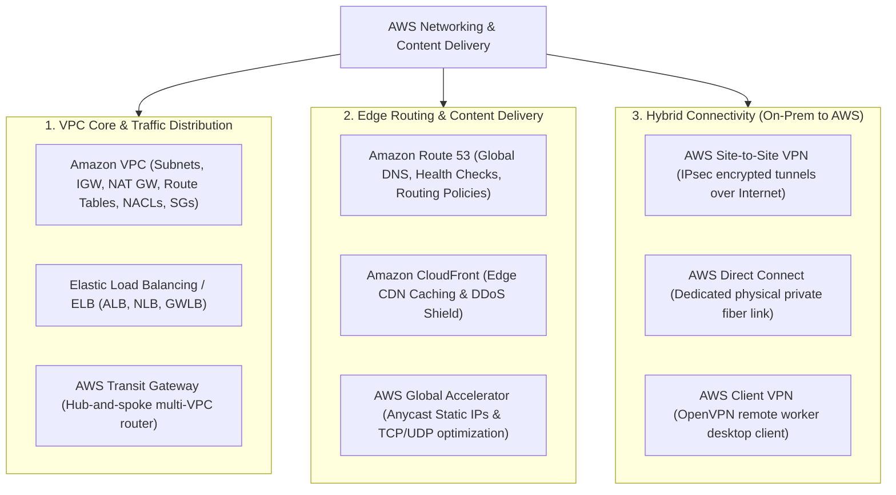
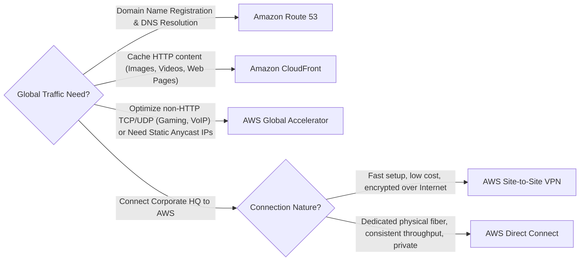

# AWS Networking & Content Delivery — Map of Content (MOC)

> **Domain:** 03_Services / Networking & Content Delivery  
> **Parent MOC:** [[AWS_Brain_MOC]]  
> **Certifications:** [[CLF-C02_Master_Blueprint|CLF-C02]], SAA-C03, Advanced Networking

---

## 1. Architectural Taxonomy of AWS Networking

AWS networking services provide the foundational connectivity, isolation, traffic routing, edge acceleration, and hybrid bridges for all cloud workloads:

---

## 2. Decision Tree: Global Edge Acceleration & Routing

---

## 3. Atomic Notes in this Domain

| Atomic Note | Description | Key Focus / Keywords |
| :--- | :--- | :--- |
| **[[Amazon_VPC]]** | Virtual Private Cloud | Subnets, Internet Gateway, NAT Gateway, Security Groups vs. NACLs. |
| **[[AWS_Elastic_Load_Balancing_ELB]]** | Elastic Load Balancing | ALB (Layer 7 HTTP), NLB (Layer 4 static IP/ultra-low latency), GWLB. |
| **[[Amazon_Route53]]** | Highly Available DNS Service | Latency, Geolocation, Failover, Weighted, Multivalue, Alias Records. |
| **[[Amazon_CloudFront]]** | Content Delivery Network (CDN) | Edge Locations, Caching, Origin Access Control (OAC), DDoS protection. |
| **[[AWS_Global_Accelerator]]** | Global Traffic Accelerator | Anycast static IPs, AWS global fiber backbone, 60% latency reduction. |
| **[[AWS_Transit_Gateway]]** | Centralized Cloud Router | Hub-and-spoke topology, eliminates complex VPC peering meshes. |
| **[[AWS_Site_to_Site_VPN]]** | IPsec VPN Connection | Fast, secure encrypted tunnel over the public internet. |
| **[[AWS_Direct_Connect]]** | Dedicated Private Connection | Bypasses public internet entirely; consistent throughput, lower data egress costs. |
| **[[AWS_Client_VPN]]** | Managed Remote Access VPN | Secure OpenVPN client for remote employees accessing VPC resources. |
