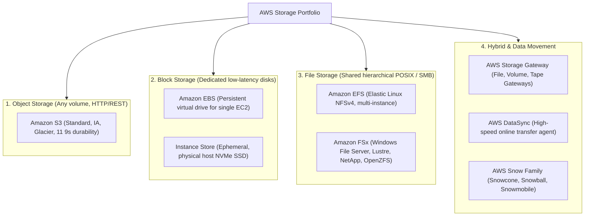
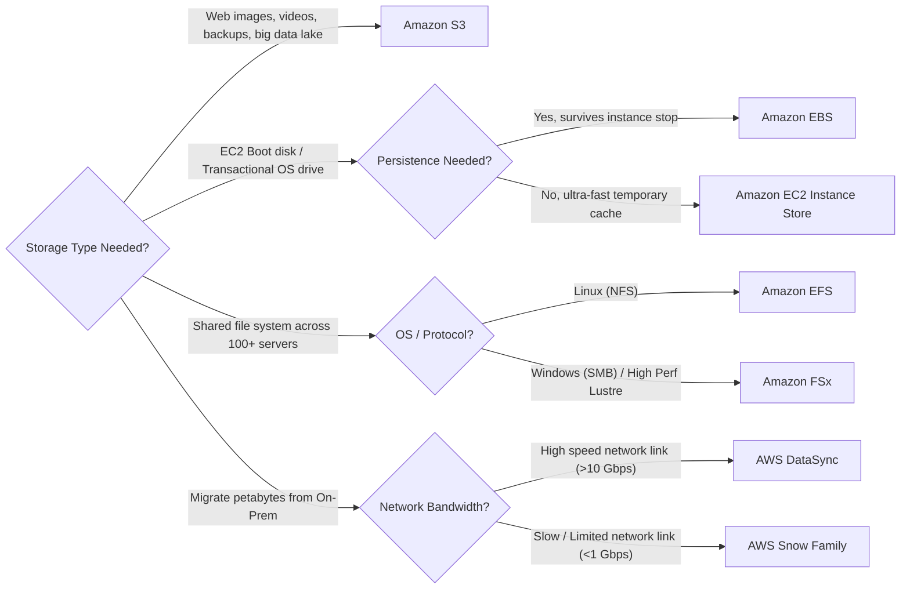

# AWS Storage Services — Map of Content (MOC)

> **Domain:** 03_Services / Storage  
> **Parent MOC:** [[AWS_Brain_MOC]]  
> **Certifications:** [[CLF-C02_Master_Blueprint|CLF-C02]], SAA-C03, SysOps

---

## 1. Architectural Taxonomy of AWS Storage

AWS divides storage services across three fundamental paradigms—**Object Storage**, **Block Storage**, and **File Storage**—alongside hybrid and data transfer appliances:

---

## 2. Decision Tree: Choosing the Right Storage Service

---

## 3. Atomic Notes in this Domain

| Atomic Note | Description | Key Focus / Keywords |
| :--- | :--- | :--- |
| **[[Amazon_S3]]** | Simple Storage Service | Buckets, Storage Classes, Lifecycle Rules, Versioning, S3 Object Lock. |
| **[[Amazon_EBS]]** | Elastic Block Store | `gp3`, `io2`, `st1`, `sc1`, Snapshots, Multi-Attach, single AZ. |
| **[[Amazon_EC2_Instance_Store]]** | Ephemeral Host Storage | Maximum IOPS/performance, data lost on instance stop/termination. |
| **[[Amazon_EFS]]** | Elastic File System | Managed Linux NFS, multi-AZ, scales automatically, concurrent mount. |
| **[[Amazon_FSx]]** | Specialized File Systems | FSx for Windows File Server (SMB), FSx for Lustre (HPC/ML). |
| **[[AWS_Storage_Gateway]]** | Hybrid Storage Bridge | S3 File Gateway, Volume Gateway (Stored/Cached), Tape Gateway. |
| **[[AWS_DataSync]]** | Automated Data Transfer | 10x faster online transfer between on-prem storage and S3/EFS/FSx. |
| **[[AWS_Snow_Family]]** | Physical Data Migration Devices | Snowcone (8 TB), Snowball Edge (80 TB), Snowmobile (up to 100 PB). |
| **[[Block_and_File_Storage_EBS_EFS]]** | Comparison Guide | Detailed architectural breakdown comparing EBS vs. EFS. |
