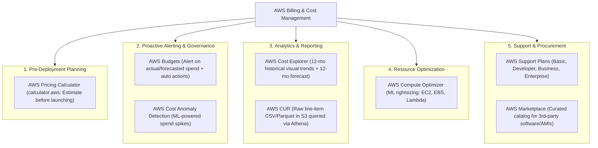
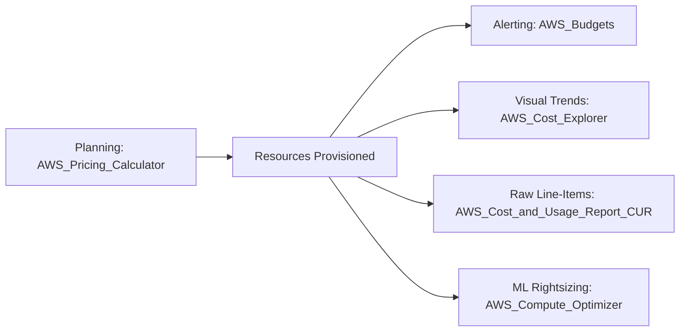

# AWS Billing & Cost Management — Map of Content (MOC)

> **Domain:** 03_Services / Billing & Cost Management  
> **Parent MOC:** [[AWS_Brain_MOC]]  
> **Certifications:** [[CLF-C02_Master_Blueprint|CLF-C02]], Cloud Operations, Solutions Architect

---

## 1. Architectural Taxonomy of AWS Billing & FinOps

AWS billing and cost management tools guide organizations through the full lifecycle of cloud financial governance—from initial architectural estimation through proactive alerting, visual analysis, machine learning optimization, and executive reporting:

---

## 2. High-Yield Tool Comparison (CLF-C02 Cheat Sheet)

| Tool | When to Use | Key Differentiator |
| :--- | :--- | :--- |
| **[[AWS_Pricing_Calculator]]** | **Before** launching resources. | Estimate expected monthly bill; no AWS account required (`calculator.aws`). |
| **[[AWS_Budgets]]** | **During** the billing cycle. | Set hard thresholds; alert via email/SNS; execute automated shutdown actions. |
| **[[AWS_Cost_Explorer]]** | **Monthly/Weekly** reviews. | Interactive visual charts; group by tag/service; 12-month historical + 12-month forecast. |
| **[[AWS_Cost_and_Usage_Report_CUR]]** | **Enterprise FinOps**. | Most granular raw line-item dataset; delivered to S3; queried using SQL via Athena. |
| **[[AWS_Compute_Optimizer]]** | **Optimization** sprints. | ML analysis of CloudWatch metrics to recommend downsizing or upsizing instances. |
| **[[AWS_Support_Plans]]** | **Operational planning**. | SLA response times (< 15 min for Enterprise); TAM assignment; 24/7 phone access. |
| **[[AWS_Marketplace]]** | **Software procurement**. | Buy 3rd-party software and AMIs; consolidated billing onto regular AWS invoice. |

---

## 3. Atomic Notes in this Domain

| Atomic Note | Description | Key Focus / Keywords |
| :--- | :--- | :--- |
| **[[AWS_Budgets]]** | Cost & Usage Budgets | Actual vs. Forecasted thresholds, auto-stop EC2 actions, SNS alerts. |
| **[[AWS_Cost_Explorer]]** | Historical Analytics & Forecasting | Visual graphs, breakdown by tag/service, Savings Plans recommendations. |
| **[[AWS_Cost_and_Usage_Report_CUR]]** | Raw Line-Item Data | Ultimate billing granularity, S3 delivery, Amazon Athena SQL integration. |
| **[[AWS_Pricing_Calculator]]** | Pre-Deployment Estimator | Estimate architectures before building, shareable links, CSV export. |
| **[[AWS_Compute_Optimizer]]** | ML Resource Rightsizing | Identify over-provisioned and under-provisioned EC2, EBS, Lambda, Fargate. |
| **[[AWS_Support_Plans]]** | Support Tier Comparison | Basic, Developer, Business, Enterprise; TAM, Concierge, response SLAs. |
| **[[AWS_Marketplace]]** | Digital Software Catalog | 3rd-party AMIs and SaaS, consolidated monthly billing, Private Marketplace. |
