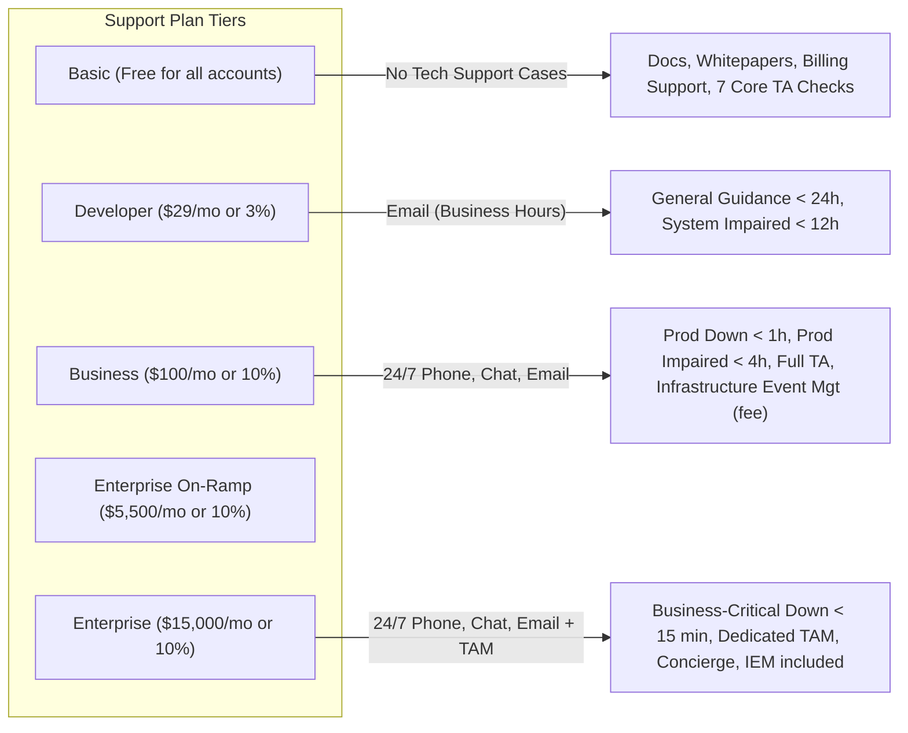

# AWS Support Plans

> **Category:** Billing & Cost Management / Customer Support  
> **Service Type:** Technical Assistance, SLA Response Times & Architectural Guidance  
> **Key Certifications:** AWS Certified Cloud Practitioner (CLF-C02) — High Yield Topic!

---

## 1. Overview & Comparison Matrix

AWS provides four primary commercial support tiers designed to meet varying business needs, from hobbyists and experimenters to mission-critical global enterprises.

---

## 2. Detailed Breakdown of Each Plan

| Feature | Basic | Developer | Business | Enterprise On-Ramp | Enterprise |
| :--- | :--- | :--- | :--- | :--- | :--- |
| **Monthly Cost** | Free ($0) | Starting at $29/mo (or 3% of spend) | Starting at $100/mo (or sliding %: 10% to 3%) | Starting at $5,500/mo (or 10% of spend) | Starting at $15,000/mo (or sliding %: 10% to 3%) |
| **Technical Support Access** | **None** (Customer service & billing inquiries only) | Cloud Support Associates (Business hours via email) | Cloud Support Engineers (24/7 via phone, web chat, and email) | Cloud Support Engineers (24/7 via phone, web chat, and email) | Cloud Support Engineers (24/7 via phone, web chat, and email) |
| **Number of Case Contacts** | Unlimited billing contacts | 1 primary contact | Unlimited contacts / IAM users | Unlimited contacts | Unlimited contacts |
| **AWS Trusted Advisor** | 7 core security & quota checks | 7 core security & quota checks | **Full checks** (500+ checks across all 5 pillars) | **Full checks** | **Full checks** |
| **Technical Account Manager (TAM)** | None | None | None | **Pool of TAMs** | **Designated TAM** (Named individual) |
| **Concierge Support Team** | None | None | None | **Yes** (Billing & account specialists) | **Yes** (Billing & account specialists) |
| **Infrastructure Event Management (IEM)** | None | None | Available for additional fee | 1 event included per year | **Included** (Architecture planning for launches) |

---

## 3. SLA Case Severity Response Times

| Severity Level | Definition | Basic | Developer | Business | Enterprise On-Ramp | Enterprise |
| :--- | :--- | :--- | :--- | :--- | :--- | :--- |
| **General Guidance** | How-to questions, service recommendations. | N/A | **< 24 hours** | **< 24 hours** | **< 24 hours** | **< 24 hours** |
| **System Impaired** | Non-critical functions abnormal. | N/A | **< 12 hours** | **< 12 hours** | **< 12 hours** | **< 12 hours** |
| **Production System Impaired** | Core business application partially degraded. | N/A | N/A | **< 4 hours** | **< 4 hours** | **< 4 hours** |
| **Production System Down** | Workload completely offline for users. | N/A | N/A | **< 1 hour** | **< 1 hour** | **< 1 hour** |
| **Business-Critical System Down** | Mission-critical operations stopped; business revenue lost. | N/A | N/A | N/A | **< 30 minutes** | **< 15 minutes** |

---

## 4. Specialized Roles in Support Plans

### Technical Account Manager (TAM)
- **Role:** Direct technical advisor and advocate within AWS.
- **Activities:** Conducts architectural reviews, coordinates Well-Architected Framework reviews, oversees incident escalation, and assists with proactive operational planning.
- **Availability:** Only included in **Enterprise Support** (Dedicated/Designated) and **Enterprise On-Ramp** (Pool of TAMs).

### AWS Concierge Support
- A specialized team of billing and account experts assigned to Enterprise and Enterprise On-Ramp customers to answer billing inquiries, consolidate invoicing, and assist with account migrations.

### Infrastructure Event Management (IEM)
- Structured program where AWS engineers and TAMs prepare your architecture for high-traffic events (e.g., Black Friday, Super Bowl, national product launches), ensuring capacity reservations and active 24/7 monitoring.

---

## 5. Exam Essentials (CLF-C02 Tips)

> [!IMPORTANT]
> - *Who provides 24/7 access to Cloud Support Engineers via phone?* **Business Support** and higher (Developer is business hours email only).
> - *What is the response time for a Production System Down?* **< 1 hour** (Business & Enterprise).
> - *What is the response time for Business-Critical System Down?* **< 15 minutes** (Enterprise Support only; 30 min for Enterprise On-Ramp).
> - *Which plan includes a designated Technical Account Manager (TAM)?* **Enterprise Support**.
> - *Can you open technical support cases on the Basic Plan?* **NO**. Only billing, account management, and service quota requests.
