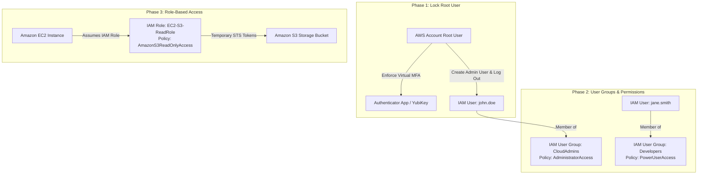

# Lab 1: Enforcing Least Privilege Access & Multi-Factor Authentication (MFA)

> **Course:** AWS Certified Cloud Practitioner (CLF-C02)  
> **Domain Focus:** Domain 2 (Security & Compliance)  
> **Estimated Duration:** 30–45 minutes  
> **Level:** Foundational (Student Hands-On)  
> **Cost to Student:** **\$0.00 (100% Free Tier Compliant)**

---

## 🎯 Lab Objectives

In this hands-on lab, students will learn how to secure an AWS account following official AWS security best practices:
1. Lock down the **AWS Account Root User** and configure virtual **Multi-Factor Authentication (MFA)**.
2. Create an **Administrative User Group** with least-privilege permissions.
3. Create individual **IAM Users** and assign them to User Groups.
4. Enforce an enterprise-grade **Password Policy**.
5. Create and assume an **IAM Role** to access resources securely without permanent credentials.

---

## 🏗️ Architecture Diagram

---

## 📋 Prerequisites
* An active AWS Account (Free Tier).
* A smartphone with an authenticator application installed (e.g., Google Authenticator, Microsoft Authenticator, or 1Password).

---

## 🛠️ Step-by-Step Instructions

### Step 1: Secure the Root User with MFA
1. Sign in to the AWS Management Console as the **Root User** using your root email address.
2. In the top navigation bar, click on your account name in the top right corner and select **Security credentials**.
3. Under **Multi-factor authentication (MFA)**, click **Assign MFA device**.
4. Enter an **MFA device name** (e.g., `MyMobilePhone`).
5. Select **Authenticator app** and click **Next**.
6. Open your mobile authenticator app, scan the displayed QR code, and enter two consecutive 6-digit MFA codes.
7. Click **Add MFA**.
> *Verification:* You should now see a green confirmation badge: *"MFA device assigned successfully"*.

---

### Step 2: Configure an Account Password Policy
1. In the IAM console left-hand navigation pane, select **Account settings**.
2. Under **Password policy**, click **Edit**.
3. Enforce the following baseline enterprise rules:
   * Minimum password length: **12 characters**.
   * Require at least one uppercase letter, one lowercase letter, one number, and one non-alphanumeric character.
   * Enable password expiration: **90 days**.
   * Prevent password reuse: **Remember last 5 passwords**.
4. Click **Save changes**.

---

### Step 3: Create User Groups and Individual IAM Users
1. In the left navigation pane, click **User groups** -> **Create group**.
2. Set **User group name** to `CloudAdmins`.
3. In the **Attach permissions policies** table, search for and select `AdministratorAccess`.
4. Click **Create group**.
5. Now, in the left navigation pane, click **Users** -> **Create user**.
6. Enter **User name**: `student-admin`.
7. Select **Provide user access to the AWS Management Console**.
8. Select **I want to create an IAM user**, choose a custom password, and check **Users must create a new password at next sign-in**.
9. Click **Next**, add the user to the `CloudAdmins` group, and click **Create user**.
10. Copy and bookmark your unique **Console sign-in URL** (e.g., `https://<account-id>.signin.aws.amazon.com/console`).

---

### Step 4: Test IAM Least-Privilege & Log Out Root
1. **Sign out** of the AWS Console as the Root User.
2. Navigate to your custom Console sign-in URL.
3. Sign in using the newly created `student-admin` credentials.
4. You will be prompted to change your temporary password.
5. Once signed in, verify in the top right corner that you are logged in as `student-admin@<account-id>`.

---

## 🧹 Clean-Up (After Student Lab Session)
1. Delete the test IAM user `student-admin`.
2. Delete the test IAM User Group `CloudAdmins`.
3. *Note:* Keep MFA enabled on your root account for permanent security!
