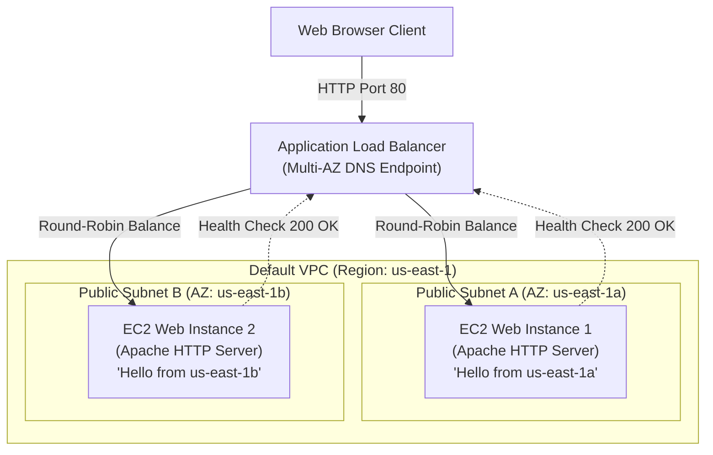

# Lab 3: Deploying a Fault-Tolerant Multi-AZ Web Tier with ALB and EC2

> **Course:** AWS Certified Cloud Practitioner (CLF-C02)  
> **Domain Focus:** Domain 1 (Cloud Concepts) & Domain 3 (Cloud Technology)  
> **Estimated Duration:** 45–60 minutes  
> **Level:** Foundational (Student Hands-On)  
> **Cost to Student:** **\$0.00 (Free Tier Compliant - `t2.micro` / `t3.micro`)**

---

## 🎯 Lab Objectives

In this hands-on lab, students will build a resilient, multi-Availability Zone web architecture:
1. Create a **Custom Security Group** permitting HTTP (port 80) web traffic.
2. Launch two **Amazon EC2 instances** running Apache Web Server across **two different Availability Zones**.
3. Configure user-data bootstrap bash scripts to display instance metadata and AZ location dynamically.
4. Deploy an **Application Load Balancer (ALB)** and configure **Target Group Health Checks**.
5. Test high availability and traffic balancing by refreshing the web browser and terminating an instance to watch automatic failover.

---

## 🏗️ Architecture Diagram



---

## 📋 Prerequisites
* An active AWS Account.

---

## 🛠️ Step-by-Step Instructions

### Step 1: Create a Security Group for Web Traffic
1. Open the **Amazon EC2 Console**.
2. In the left navigation pane, under **Network & Security**, click **Security Groups**.
3. Click **Create security group**.
4. Configure basic details:
   * **Security group name:** `web-alb-sg`
   * **Description:** `Allow inbound HTTP traffic`
   * **VPC:** Select your Default VPC.
5. Under **Inbound rules**, click **Add rule**:
   * **Type:** `HTTP`
   * **Port range:** `80`
   * **Source:** `Anywhere-IPv4` (`0.0.0.0/0`)
6. Click **Create security group**.

---

### Step 2: Launch EC2 Instance 1 in Availability Zone A
1. In the EC2 console left navigation pane, click **Instances** -> **Launch instances**.
2. **Name:** `WebServer-AZ-A`.
3. **Application and OS Images:** Select **Amazon Linux 2023 AMI** (Free tier eligible).
4. **Instance type:** Select `t2.micro` (or `t3.micro` depending on region).
5. **Key pair:** Select **Proceed without a key pair** (we will use automated user-data script).
6. Under **Network settings**, click **Edit**:
   * **Subnet:** Explicitly choose the first available subnet (e.g., `us-east-1a`).
   * **Auto-assign public IP:** `Enable`.
   * **Firewall (security groups):** Select **Select existing security group** and pick `web-alb-sg`.
7. Scroll down, expand **Advanced details**, and scroll to the bottom **User data** box. Paste this script:

```bash
#!/bin/bash
dnf update -y
dnf install -y httpd
systemctl start httpd
systemctl enable httpd
EC2_AZ=$(curl -s http://169.254.169.254/latest/meta-data/placement/availability-zone)
echo "<h1>Hello from Amazon EC2 Web Server!</h1><p>Running in Availability Zone: <b style='color:green;'>$EC2_AZ</b></p>" > /var/www/html/index.html
```
8. Click **Launch instance**.

---

### Step 3: Launch EC2 Instance 2 in Availability Zone B
1. Repeat Step 2 to launch a second instance with:
   * **Name:** `WebServer-AZ-B`.
   * **Subnet:** Explicitly choose a **different subnet** in a second AZ (e.g., `us-east-1b`).
   * **Security Group:** `web-alb-sg`.
   * **User data:** Paste the exact same bash script as above.
2. Click **Launch instance**.

---

### Step 4: Create a Target Group & Application Load Balancer (ALB)
1. In the EC2 left navigation pane, under **Load Balancing**, click **Target Groups** -> **Create target group**.
   * Target type: **Instances**.
   * Target group name: `web-target-group`.
   * Protocol / Port: `HTTP` on port `80`.
   * Click **Next**, select both `WebServer-AZ-A` and `WebServer-AZ-B`, click **Include as pending below**, and click **Create target group**.
2. In the left navigation pane, click **Load Balancers** -> **Create load balancer**.
3. Under **Application Load Balancer**, click **Create**.
   * **Load balancer name:** `multi-az-web-alb`.
   * **Scheme:** `Internet-facing`.
   * **Network mapping:** Select your VPC and check at least two Availability Zones (the ones where your instances reside).
   * **Security groups:** Select `web-alb-sg`.
   * **Listeners and routing:** For `HTTP:80`, forward to `web-target-group`.
4. Click **Create load balancer**.

---

### Step 5: Verify High Availability & Round-Robin Balancing
1. In the Load Balancers dashboard, select `multi-az-web-alb`.
2. Wait 2–3 minutes for the State to become **Active**.
3. Copy the **DNS name** (e.g., `multi-az-web-alb-12345678.us-east-1.elb.amazonaws.com`).
4. Paste the DNS name into a new browser tab.
5. Refresh the page several times.
> *Verification:* You should observe the webpage dynamically alternating between:
> `Running in Availability Zone: us-east-1a` and `Running in Availability Zone: us-east-1b`!
> Congratulations! You have successfully built a load-balanced, fault-tolerant Multi-AZ web tier.

---

## 🧹 Clean-Up (To Prevent Accidental AWS Charges)
1. In the EC2 console, under **Load Balancers**, select `multi-az-web-alb` and click **Actions** -> **Delete load balancer**.
2. Under **Target Groups**, delete `web-target-group`.
3. Under **Instances**, select both `WebServer-AZ-A` and `WebServer-AZ-B`, click **Instance state** -> **Terminate instance**.
4. Delete the security group `web-alb-sg`.
