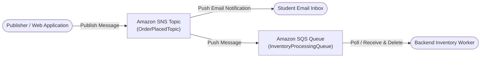

# Lab 5: Building a Decoupled Messaging Architecture with Amazon SNS & Amazon SQS

> **Course:** AWS Certified Cloud Practitioner (CLF-C02)  
> **Domain Focus:** Domain 3 (Cloud Technology and Services)  
> **Estimated Duration:** 30–45 minutes  
> **Level:** Foundational (Student Hands-On)  
> **Cost to Student:** **$0.00 (100% Free Tier Compliant)**

---

## 🎯 Lab Objectives

In this hands-on lab, students will learn how to decouple distributed systems using asynchronous pub/sub messaging and message queuing:
1. Create a standard **Amazon SNS Topic** to act as a central notification broadcast channel.
2. Subscribe both an **Email address** and an **Amazon SQS Queue** to the SNS topic (implementing the **Fan-Out Architecture**).
3. Publish test messages to the SNS topic and observe immediate multi-channel delivery.
4. Inspect, receive, and delete buffered messages in the Amazon SQS queue.
5. Demonstrate how downstream consumers can safely go offline without dropping messages.

---

## 🏗️ Architecture Diagram



---

## 📋 Prerequisites
- An active AWS Account (Free Tier).
- Access to an active personal email inbox to confirm the SNS subscription.

---

## 🛠️ Step-by-Step Instructions

### Step 1: Create an Amazon SQS Queue
1. In the AWS Management Console search bar, search for and open **Simple Queue Service (SQS)**.
2. Choose **Create queue**.
3. Under **Type**, select **Standard** (delivers maximum throughput and at-least-once delivery).
4. **Name:** `InventoryProcessingQueue`.
5. Configuration settings: Leave default settings:
   - *Visibility timeout:* `30 seconds`.
   - *Message retention period:* `4 days`.
   - *Receive message wait time:* `0 seconds`.
6. Choose **Create queue**. Note the **URL** and **ARN** of your new queue.

### Step 2: Create an Amazon SNS Topic
1. In the AWS search bar, navigate to **Simple Notification Service (SNS)**.
2. Choose **Topics** in the left menu, then click **Create topic**.
3. **Type:** Select **Standard**.
4. **Name:** `OrderNotificationTopic`.
5. **Display name:** `Orders`.
6. Leave other settings at their defaults and click **Create topic**.

### Step 3: Subscribe Email & SQS Queue to the Topic
1. Inside `OrderNotificationTopic`, select **Create subscription**.
2. **Subscription 1: Email Subscriber**
   - **Protocol:** Select **Email**.
   - **Endpoint:** Enter your email address.
   - Click **Create subscription**.
   - *Action Required:* Open your email inbox, look for the email from *AWS Notifications*, and click the link **Confirm subscription**.
3. **Subscription 2: SQS Queue Subscriber (Fan-Out)**
   - Click **Create subscription** again.
   - **Protocol:** Select **Amazon SQS**.
   - **Endpoint:** Select `InventoryProcessingQueue` from the dropdown list.
   - Click **Create subscription**.
   - *(Note: Amazon SNS automatically updates the SQS Access Policy so the topic has permission to send messages to your queue!).*

### Step 4: Publish a Test Message to the Topic
1. In the `OrderNotificationTopic` console, choose **Publish message**.
2. **Subject:** `New Order #1001 Placed`.
3. **Message body:**
   ```json
   {
     "orderId": "1001",
     "customer": "Mohamed",
     "item": "AWS Cloud Practitioner Exam Voucher",
     "amount": 100.00,
     "timestamp": "2026-11-12T14:30:00Z"
   }
   ```
4. Click **Publish message**.

### Step 5: Verify Delivery Across Channels
1. **Check Email:** Check your personal email inbox. You should receive an email with the subject *"New Order #1001 Placed"* and the JSON body within seconds!
2. **Check SQS Queue:**
   - Navigate back to the **Amazon SQS** console.
   - Select `InventoryProcessingQueue`.
   - Under **Details**, observe that **Messages available** shows `1`.
   - Click **Send and receive messages**.
   - In the **Receive messages** section, click **Poll for messages**.
   - The message appears in the list! Click on it to inspect the payload.
   - Click **Delete** to simulate a worker application successfully finishing its job.

---

## 🧹 Resource Clean Up
To ensure your account incurs $0.00 in charges:
1. In the Amazon SNS console, delete the subscriptions and delete `OrderNotificationTopic`.
2. In the Amazon SQS console, select `InventoryProcessingQueue` -> choose **Delete**.
