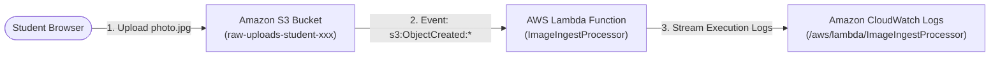

# Lab 6: Event-Driven Serverless Compute with Amazon S3 & AWS Lambda

> **Course:** AWS Certified Cloud Practitioner (CLF-C02)  
> **Domain Focus:** Domain 3 (Cloud Technology and Services)  
> **Estimated Duration:** 30–45 minutes  
> **Level:** Foundational (Student Hands-On)  
> **Cost to Student:** **$0.00 (100% Free Tier Compliant)**

---

## 🎯 Lab Objectives

In this hands-on lab, students will build a serverless event-driven image processing trigger:
1. Create an **Amazon S3 Ingestion Bucket** to receive raw user uploads.
2. Author an **AWS Lambda function** in Python to handle file upload events.
3. Configure an **S3 Event Notification** trigger that automatically executes the Lambda function whenever a new file is uploaded.
4. Inspect execution telemetry and print statements using **Amazon CloudWatch Logs**.
5. Understand the serverless pay-per-use execution model ($0 cost when idle).

---

## 🏗️ Architecture Diagram



---

## 📋 Prerequisites
- An active AWS Account (Free Tier).
- Any image or text file on your local machine to upload as a test.

---

## 🛠️ Step-by-Step Instructions

### Step 1: Create the Amazon S3 Bucket
1. Open the **Amazon S3** Console -> **Create bucket**.
2. **Bucket name:** `raw-uploads-student-<your-initials>-<random-digits>` (must be globally unique and lowercase).
3. **AWS Region:** Select `us-east-1` (N. Virginia).
4. Leave **Block all public access** enabled (best practice).
5. Choose **Create bucket**.

### Step 2: Create the AWS Lambda Function
1. In the console search bar, search for and open **Lambda**.
2. Choose **Create function**.
3. Select **Author from scratch**:
   - **Function name:** `ImageIngestProcessor`
   - **Runtime:** `Python 3.12`
   - **Architecture:** `x86_64`
4. Under **Permissions**, leave *Create a new role with basic Lambda permissions* selected.
5. Click **Create function**.

### Step 3: Add S3 Read Permissions to the Lambda IAM Role
By default, Lambda only has permission to write logs to CloudWatch. We need to grant it read access to S3:
1. In the Lambda console, select the **Configuration** tab -> **Permissions**.
2. Under **Execution role**, click on the Role Name link (opens in the IAM Console).
3. In the IAM console, select **Add permissions** -> **Attach policies**.
4. Search for `AmazonS3ReadOnlyAccess`, select its checkbox, and click **Add permissions**.
5. Close the IAM tab and return to the Lambda console.

### Step 4: Write and Deploy Function Code
1. In the Lambda function console, select the **Code** tab.
2. Replace `lambda_function.py` with the following Python code:
   ```python
   import json
   import urllib.parse
   import boto3

   s3 = boto3.client('s3')

   def lambda_handler(event, context):
       print("=== New S3 Event Triggered ===")
       
       for record in event['Records']:
           bucket_name = record['s3']['bucket']['name']
           object_key = urllib.parse.unquote_plus(record['s3']['object']['key'])
           object_size = record['s3']['object']['size']
           
           print(f"File uploaded: {object_key}")
           print(f"Source Bucket: {bucket_name}")
           print(f"File Size: {object_size} bytes")
           
           # Simulated processing logic (e.g. metadata extraction, thumbnailing)
           print(f"Status: Successfully registered {object_key} for processing!")
           
       return {
           'statusCode': 200,
           'body': json.dumps('Serverless processing finished successfully!')
       }
   ```
3. Click **Deploy** to save and publish your code.

### Step 5: Configure the S3 Event Trigger
1. In the **Function overview** section at the top of the Lambda page, choose **Add trigger**.
2. Trigger configuration:
   - Select **S3**.
   - **Bucket:** Select your bucket created in Step 1 (`raw-uploads-student-xxx`).
   - **Event types:** Select **All object create events**.
   - Check the recursive invocation acknowledgment checkbox.
3. Click **Add**.

### Step 6: Test and Verify with CloudWatch Logs
1. Navigate back to the **Amazon S3** Console and open your bucket.
2. Click **Upload** -> **Add files**, choose any test image or document from your computer, and click **Upload**.
3. Now verify the serverless execution:
   - Return to the **AWS Lambda** Console -> `ImageIngestProcessor`.
   - Select the **Monitor** tab, then click **View CloudWatch logs**.
   - Under **Log streams**, click on the most recent stream.
   - Look at the log statements: You will see your print statements displaying the exact filename and file size in bytes!

---

## 🧹 Resource Clean Up
1. In the **Amazon S3** console, select your bucket, choose **Empty**, type `permanently delete`, and then choose **Delete bucket**.
2. In the **AWS Lambda** console, select `ImageIngestProcessor` -> **Actions** -> **Delete function**.
