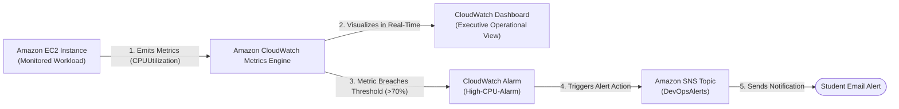

# Lab 7: Monitoring System Health with Amazon CloudWatch Metrics, Alarms & Dashboards

> **Course:** AWS Certified Cloud Practitioner (CLF-C02)  
> **Domain Focus:** Domain 2 (Security & Compliance) & Domain 3 (Cloud Technology)  
> **Estimated Duration:** 30–45 minutes  
> **Level:** Foundational (Student Hands-On)  
> **Cost to Student:** **$0.00 (100% Free Tier Compliant)**

---

## 🎯 Lab Objectives

In this hands-on lab, students will configure proactive monitoring, alerting, and operational visualization:
1. Launch an Amazon EC2 instance to generate system telemetry.
2. Explore default Amazon CloudWatch metrics (CPU Utilization, Network In/Out, Disk I/O).
3. Create an **Amazon CloudWatch Alarm** to alert when CPU utilization breaches a set threshold.
4. Integrate the alarm with an **Amazon SNS Topic** to receive email notifications when performance degrades.
5. Build an operational **CloudWatch Dashboard** with custom metric graphs.

---

## 🏗️ Architecture Diagram

---

## 📋 Prerequisites
- An active AWS Account (Free Tier).
- Access to an active personal email inbox.

---

## 🛠️ Step-by-Step Instructions

### Step 1: Launch a Monitored EC2 Instance
1. Open the **Amazon EC2** Console -> **Launch instance**.
2. **Name:** `CloudWatch-Test-Server`.
3. **AMI:** Amazon Linux 2023.
4. **Instance type:** `t3.micro` (or `t2.micro` for Free Tier).
5. **Key pair:** Proceed without a key pair (not needed for this lab).
6. Under **Advanced details**, ensure **Detailed CloudWatch monitoring** is left disabled (Basic monitoring every 5 minutes is 100% free).
7. Click **Launch instance**.

### Step 2: Create an Amazon SNS Topic for Alert Notifications
1. Open the **Amazon SNS** Console -> **Topics** -> **Create topic**.
2. **Type:** Standard.
3. **Name:** `CloudWatchAlertsTopic`.
4. Click **Create topic**.
5. Inside the topic, click **Create subscription**:
   - **Protocol:** Email.
   - **Endpoint:** Enter your personal email address.
   - Click **Create subscription**.
6. Check your email inbox and click **Confirm subscription** in the AWS confirmation message.

### Step 3: Create the CloudWatch Metric Alarm
1. Open the **Amazon CloudWatch** Console -> in the left menu, select **Alarms** -> **All alarms** -> **Create alarm**.
2. Click **Select metric**.
3. Under **Browse**, choose **EC2** -> **Per-Instance Metrics**.
4. Find your instance `CloudWatch-Test-Server` and select the metric **CPUUtilization**. Click **Select metric**.
5. Configure conditions:
   - **Statistic:** `Average`.
   - **Period:** `1 minute` (or `5 minutes`).
   - **Threshold type:** Static.
   - **Whenever CPUUtilization is...:** `Greater > threshold`.
   - **Threshold value:** `70` (means 70%).
6. Click **Next**.
7. Configure actions:
   - **Alarm state trigger:** `In alarm`.
   - **Send a notification to:** Select an existing SNS topic -> choose `CloudWatchAlertsTopic`.
8. Click **Next**.
9. **Alarm name:** `EC2-High-CPU-Alarm`.
10. Review and click **Create alarm**.

### Step 4: Build a Custom CloudWatch Dashboard
1. In the left navigation pane of CloudWatch, choose **Dashboards** -> **Create dashboard**.
2. **Dashboard name:** `Production-Health-Overview`.
3. Choose **Create dashboard**.
4. Add a widget:
   - Widget type: **Line graph**.
   - Data source: **Metrics**.
   - Browse to **EC2** -> **Per-Instance Metrics** -> select `CPUUtilization` for your instance.
   - Click **Create widget**.
5. Add a second widget:
   - Click the **+** (Add widget) icon.
   - Widget type: **Number**.
   - Select **EC2** -> `NetworkIn` and `NetworkOut`.
   - Click **Create widget**.
6. Click **Save** in the top right corner. You now have a persistent, real-time operational dashboard!

---

## 🧹 Resource Clean Up
1. In the **Amazon EC2** console, select `CloudWatch-Test-Server` -> **Instance state** -> **Terminate instance**.
2. In the **Amazon CloudWatch** console, select `EC2-High-CPU-Alarm` -> **Actions** -> **Delete**.
3. Under **Dashboards**, select `Production-Health-Overview` -> **Delete**.
4. In the **Amazon SNS** console, delete `CloudWatchAlertsTopic` and its subscription.
