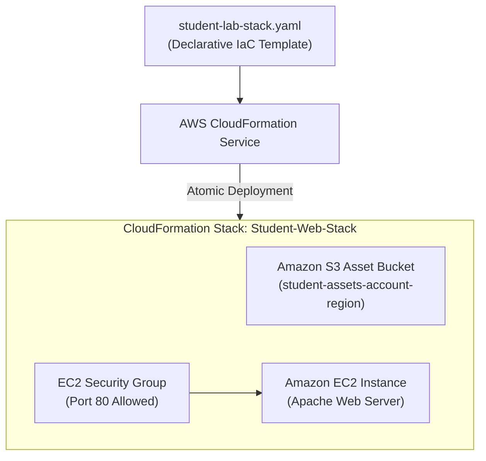

# Lab 8: Provisioning Repeatable Infrastructure with AWS CloudFormation

> **Course:** AWS Certified Cloud Practitioner (CLF-C02)  
> **Domain Focus:** Domain 3 (Cloud Technology and Services)  
> **Estimated Duration:** 30–45 minutes  
> **Level:** Foundational (Student Hands-On)  
> **Cost to Student:** **$0.00 (100% Free Tier Compliant)**

---

## 🎯 Lab Objectives

In this hands-on lab, students will experience declarative Infrastructure as Code (IaC):
1. Understand the anatomy of an AWS CloudFormation template (Format Version, Parameters, Resources, Outputs).
2. Deploy an **Amazon S3 Storage Bucket** and an **Amazon EC2 Web Server** inside a dedicated **Security Group** using a single YAML template.
3. Observe stack creation events, dependencies, and automated rollbacks.
4. Perform an infrastructure update using a **CloudFormation Change Set** to preview modifications before execution.
5. Execute an atomic single-click teardown of the entire stack.

---

## 🏗️ Architecture Diagram



---

## 📋 Prerequisites
- An active AWS Account (Free Tier).
- A text editor on your computer (VS Code, Notepad, or similar) to save a YAML file.

---

## 🛠️ Step-by-Step Instructions

### Step 1: Create the CloudFormation Template File
1. On your computer, open a text editor and paste the following YAML code:
   ```yaml
   AWSTemplateFormatVersion: '2010-09-09'
   Description: 'Student Lab 8: Repeatable S3 Bucket and EC2 Web Server Stack'

   Parameters:
     StudentIdentifier:
       Description: 'Your initials or name to ensure unique resource names'
       Type: String
       Default: 'student'
       AllowedPattern: '^[a-z0-9]+$'

   Resources:
     # Resource 1: Encrypted S3 Bucket
     StudentStorageBucket:
       Type: 'AWS::S3::Bucket'
       Properties:
         BucketName: !Sub '${StudentIdentifier}-lab8-bucket-${AWS::AccountId}'
         BucketEncryption:
           ServerSideEncryptionConfiguration:
             - ServerSideEncryptionByDefault:
                 SSEAlgorithm: 'AES256'

     # Resource 2: Web Server Security Group
     LabWebServerSecurityGroup:
       Type: 'AWS::EC2::SecurityGroup'
       Properties:
         GroupDescription: 'Allow inbound public HTTP traffic on port 80'
         SecurityGroupIngress:
           - IpProtocol: 'tcp'
            FromPort: 80
            ToPort: 80
            CidrIp: '0.0.0.0/0'

     # Resource 3: EC2 Web Server
     LabWebServerInstance:
       Type: 'AWS::EC2::Instance'
       Properties:
         InstanceType: 't3.micro'
         ImageId: 'resolve:ssm:/aws/service/ami-amazon-linux-latest/al2023-ami-kernel-default-x86_64'
         SecurityGroupIds:
           - !GetAtt LabWebServerSecurityGroup.GroupId
         UserData:
           Fn::Base64: !Sub |
             #!/bin/bash
             dnf update -y
             dnf install -y httpd
             systemctl start httpd
             systemctl enable httpd
             echo "<h1>Welcome to AWS CloudFormation Lab 8!</h1>" > /var/www/html/index.html
             echo "<p>Student: ${StudentIdentifier} | Bucket: ${StudentStorageBucket}</p>" >> /var/www/html/index.html
         Tags:
           - Key: 'Name'
             Value: !Sub '${StudentIdentifier}-lab8-server'

   Outputs:
     WebUrl:
       Description: 'Public URL of the newly created web server'
       Value: !Sub 'http://${LabWebServerInstance.PublicDnsName}'
     BucketNameOut:
       Description: 'Name of the created S3 bucket'
       Value: !Ref StudentStorageBucket
   ```
2. Save this file on your computer as `lab8-stack.yaml`.

### Step 2: Deploy the Stack via CloudFormation Console
1. In the AWS Management Console search bar, search for and open **CloudFormation**.
2. Click **Create stack** -> **With new resources (standard)**.
3. Under **Prerequisite - Prepare template**, select **Choose an existing template**.
4. Under **Specify template**, select **Upload a template file**, choose `lab8-stack.yaml`, and click **Next**.
5. **Specify stack details:**
   - **Stack name:** `Student-Web-Stack`.
   - **StudentIdentifier:** Type your lowercase initials or first name (e.g. `alex`).
   - Click **Next**.
6. **Configure stack options:** Leave default settings and click **Next**.
7. In the **Review** screen, scroll to the bottom and click **Submit**.

### Step 3: Observe Stack Events & Verify Resources
1. Switch to the **Events** tab. Click the refresh button periodically.
2. Watch as CloudFormation automatically orchestrates resource creation in parallel:
   - Notice that `LabWebServerSecurityGroup` and `StudentStorageBucket` create first.
   - Once the security group exists, `LabWebServerInstance` begins provisioning.
3. Wait approximately 2 minutes until the status transitions to **CREATE_COMPLETE**.
4. Switch to the **Outputs** tab:
   - Copy the value of the `WebUrl` output into a new browser tab.
   - You should see your live webpage displaying: *"Welcome to AWS CloudFormation Lab 8!"* along with your bucket name!

### Step 4: Preview Updates Using a Change Set
1. In the stack overview, choose **Stack actions** -> **Create change set for current stack**.
2. Select **Use current template**, then click **Next**.
3. In parameters, change `StudentIdentifier` to `studentv2`. Click **Next** -> **Next**.
4. Name the change set: `PreviewParamChange`. Click **Submit**.
5. Inspect the generated **Changes** table: CloudFormation informs you exactly which properties will update and whether any resource replacement is required.

---

## 🧹 Resource Clean Up (One-Click Teardown)
This step demonstrates the power of Infrastructure as Code:
1. First, navigate to the **Amazon S3** console. If any objects were uploaded to your lab bucket, empty the bucket.
2. Return to the **AWS CloudFormation** console.
3. Select `Student-Web-Stack`, and choose **Delete** -> **Delete stack**.
4. CloudFormation automatically terminates the EC2 instance, revokes and deletes the security group, and deletes the S3 bucket!
