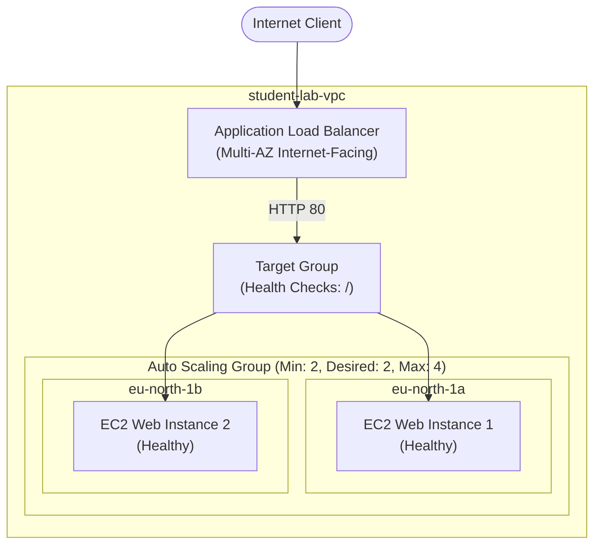
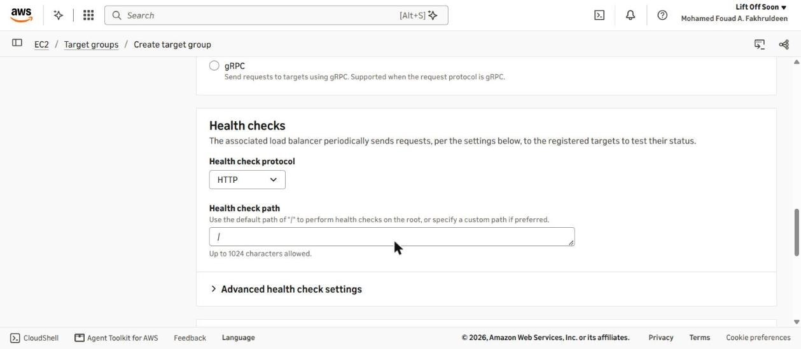
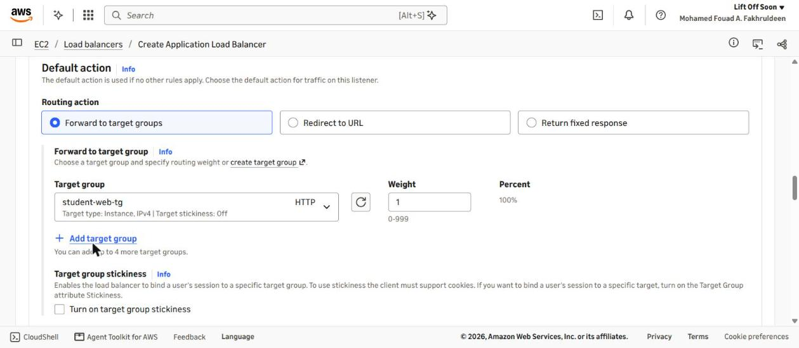
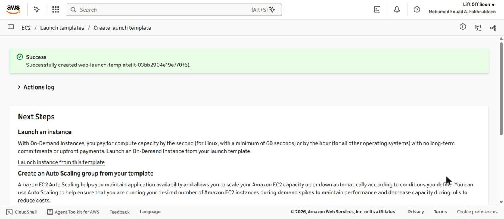
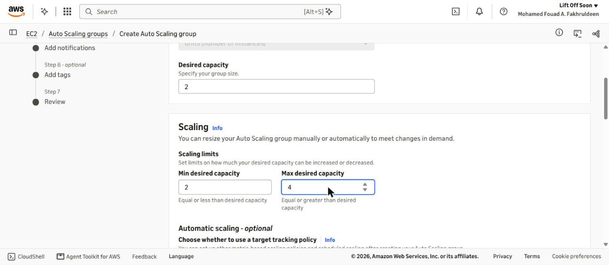
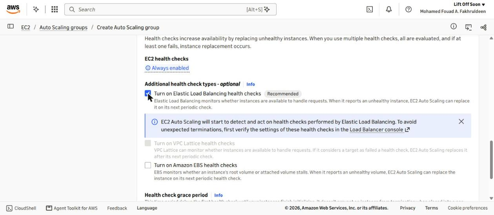
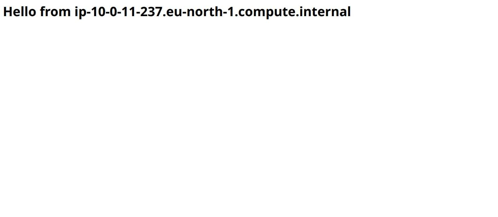
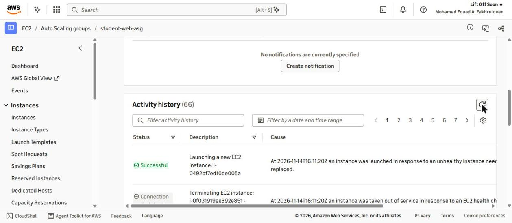

# Lab 04: High Availability (ALB & Auto Scaling Groups)

> **Focus:** Application Load Balancers (ALB), Target Groups, Launch Templates, Auto Scaling Groups (ASG), and Automatic Self-Healing  
> **Region:** `eu-north-1` (Stockholm)  
> **Course Domain:** Domain 3: Cloud Technology & Services  
> **Associated Vault Notes:** [[Amazon_EC2]]  

---

## 🧭 Prerequisite Concept Refresher: High Availability & Elasticity

### 1. Vertical Scaling (Scaling Up) vs. Horizontal Scaling (Scaling Out)
- **Vertical Scaling (Scaling Up/Down):** Upgrading an individual instance to a larger size (e.g., from `t3.micro` with 2 vCPUs to `m5.4xlarge` with 16 vCPUs). *Limitation:* Requires downtime/reboot, reaches hard physical ceilings, and creates a single point of failure (SPOF).
- **Horizontal Scaling (Scaling Out/In):** Adding or removing identical smaller instances across multiple Availability Zones. This is the **cloud-native best practice**: it eliminates single points of failure, adapts dynamically to demand, and provides seamless zero-downtime elasticity.

### 2. The Roles of ALB and ASG
- **Application Load Balancer (ALB):** Distributes incoming web traffic evenly across healthy target instances across multiple Availability Zones.
- **Auto Scaling Group (ASG):** Monitors fleet capacity and instance health. If an instance crashes or fails health checks, the ASG automatically terminates the failed instance and launches a fresh replacement (self-healing).
- **Capacity Triangle:**
  $$\mathbf{Min \le Desired \le Max}$$
  - *Minimum Capacity:* The baseline floor (never scales below this).
  - *Desired Capacity:* The current active operating target.
  - *Maximum Capacity:* The safety ceiling to prevent unexpected budget runaways.

---

## 🏗️ Lab Architecture



---

## 🛠️ Step-by-Step Console Walkthrough

### Step 1: Create an ALB Target Group
1. In the EC2 Console, scroll down the left navigation pane to **Load Balancing** and click **Target Groups**.
2. Click **Create target group**.
3. Configure the following:
   - **Target type:** `Instances`
   - **Target group name:** `web-target-group`
   - **Protocol:** `HTTP`, **Port:** `80`, **IP address type:** `IPv4`
   - **VPC:** Select `student-lab-vpc`.
   - **Health check path:** `/`
4. Click **Next**, leave targets unassigned for now (the ASG will register them automatically), and click **Create target group**.


*Figure 4.1: Target Group configuration targeting instance HTTP port 80.*

---

### Step 2: Create the Application Load Balancer (ALB)
1. In the left navigation pane under **Load Balancing**, click **Load Balancers**.
2. Click **Create load balancer**, find **Application Load Balancer**, and click **Create**.
3. Configure:
   - **Load balancer name:** `student-web-alb`
   - **Scheme:** `Internet-facing`
   - **IP address type:** `IPv4`
   - **Network mapping (VPC):** `student-lab-vpc`
   - **Mappings:** Select **both Availability Zones** (`eu-north-1a` and `eu-north-1b`), and map each to its respective **Public Subnet**.
   - **Security groups:** Select `web-tier-sg` (allowing port 80).
   - **Listeners and routing:** Protocol `HTTP`, Port `80`, Default action: Forward to **`web-target-group`**.
4. Click **Create load balancer**.


*Figure 4.2: ALB listener forwarding traffic across multi-AZ public subnets to the target group.*

---

### Step 3: Create an EC2 Launch Template
1. In the left navigation pane under **Instances**, click **Launch Templates**.
2. Click **Create launch template**:
   - **Template name:** `web-server-template`
   - **AMI:** Amazon Linux 2023 AMI
   - **Instance type:** `t3.micro` (or `t4g.micro`)
   - **Security groups:** `web-tier-sg`
3. Expand **Advanced details**, scroll to **User data**, and insert the bootstrap script (from Lab 03 installing Apache and displaying Instance ID / AZ).
4. Click **Create launch template**.


*Figure 4.3: Launch Template encapsulating AMI, instance type, security group, and user data.*

---

### Step 4: Configure the Auto Scaling Group (ASG)
1. In the left navigation pane under **Auto Scaling**, click **Auto Scaling Groups**.
2. Click **Create Auto Scaling group**:
   - **Name:** `web-asg`
   - **Launch template:** Select `web-server-template`.
3. In **Network**, select `student-lab-vpc` and choose both **Public Subnets** (or private subnets if routing through NAT).
4. Under **Group size**, configure the capacity triangle:
   - **Desired capacity:** `2`
   - **Minimum capacity:** `2`
   - **Maximum capacity:** `4`


*Figure 4.4: Defining the capacity bounds for the Auto Scaling Group.*

---

### Step 5: Attach ASG to the ALB Target Group
1. In the **Load balancing** step of the ASG wizard:
   - Select **Attach to an existing load balancer**.
   - Choose **Choose from your load balancer target groups** and select **`web-target-group`**.
   - Under **Health checks**, check **Turn on Elastic Load Balancing health checks**. This ensures that if the ALB detects a web application error, the ASG will replace the instance.
2. Complete the wizard and click **Create Auto Scaling group**.


*Figure 4.5: Binding the Auto Scaling Group to the ALB target group with ELB health checks.*

---

### Step 6: Test Load Balancing via ALB DNS Name
1. Navigate back to **Load Balancers** and select `student-web-alb`.
2. Copy the **DNS name** (e.g., `student-web-alb-123456789.eu-north-1.elb.amazonaws.com`).
3. Open a browser tab and paste the DNS name. Refresh the page several times.
4. You will observe the displayed **Instance ID** and **Availability Zone** alternating between instances as the ALB balances traffic across `eu-north-1a` and `eu-north-1b`!


*Figure 4.6: Client traffic actively distributed across instances in different Availability Zones.*

---

### Step 7: Demonstrate Automatic Self-Healing Recovery
1. Navigate to **Instances** -> Select one of the instances launched by the ASG -> Click **Instance state** -> **Terminate instance**.
2. Navigate to **Auto Scaling groups** -> Select `web-asg` -> Click the **Activity** tab.
3. Observe how the ASG immediately detects that capacity dropped below the desired count of 2, triggers an activity: *"Launching a new EC2 instance"*, and automatically restores full health!


*Figure 4.7: Auto Scaling Group activity log demonstrating automated self-healing replacement.*

---

## 💻 AWS CLI Verification Commands

```bash
# 1. Inspect ALB state and DNS endpoint
aws elbv2 describe-load-balancers \
  --names "student-web-alb" \
  --query "LoadBalancers[*].{Name:LoadBalancerName,DNS:DNSName,State:State.Code}" \
  --output table \
  --region eu-north-1 \
  --profile aws-notes

# 2. Check health of instances registered to the target group
aws elbv2 describe-target-health \
  --target-group-arn $(aws elbv2 describe-target-groups --names "web-target-group" --query "TargetGroups[0].TargetGroupArn" --output text --region eu-north-1 --profile aws-notes) \
  --region eu-north-1 \
  --profile aws-notes

# 3. View ASG activity history
aws autoscaling describe-scaling-activities \
  --auto-scaling-group-name "web-asg" \
  --max-items 3 \
  --region eu-north-1 \
  --profile aws-notes
```

---

## 🧹 Free Tier Cleanup & Cost Safeguard

> [!WARNING]
> Active Application Load Balancers incur hourly charges. Always delete the ASG and ALB after completing the exercise.

1. Navigate to **Auto Scaling groups** -> Select `web-asg` -> Click **Delete** (this automatically terminates all running instances launched by the ASG).
2. Navigate to **Load Balancers** -> Select `student-web-alb` -> Click **Actions** -> **Delete load balancer**.
3. Navigate to **Target Groups** -> Select `web-target-group` -> Click **Actions** -> **Delete**.
4. Navigate to **Launch Templates** -> Select `web-server-template` -> Click **Actions** -> **Delete template**.
