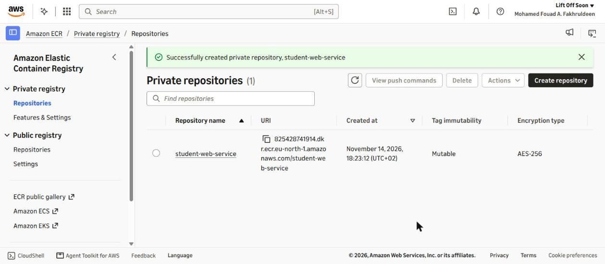
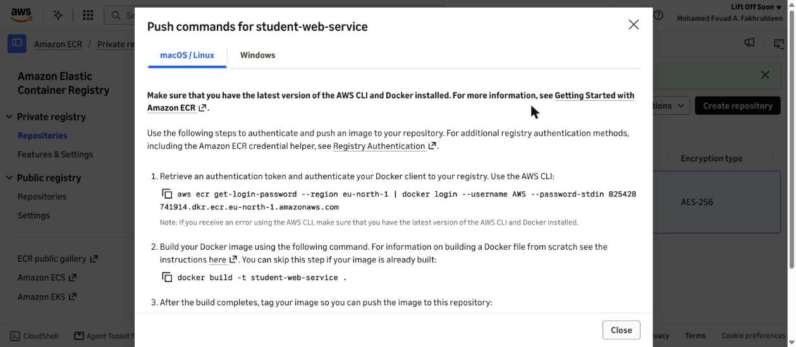
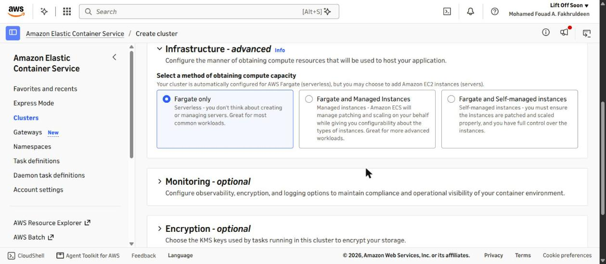
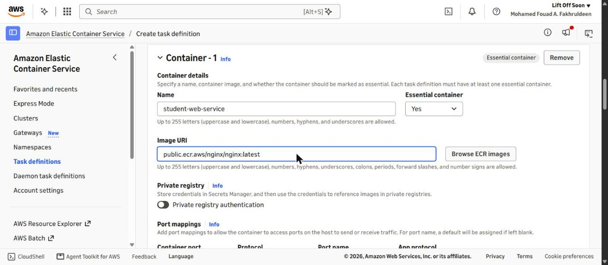
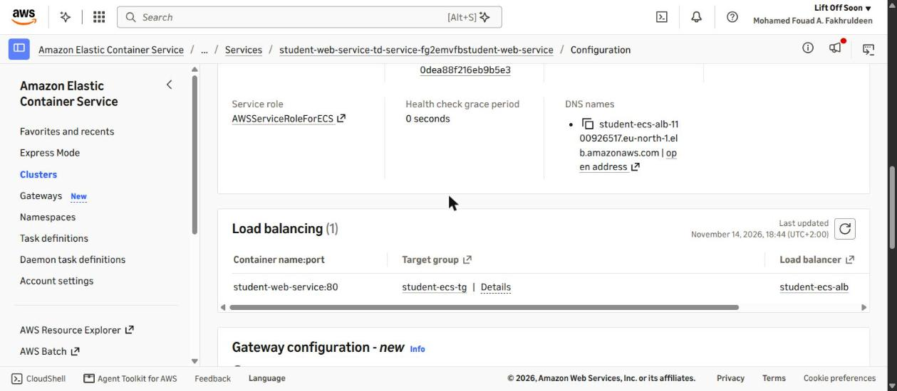
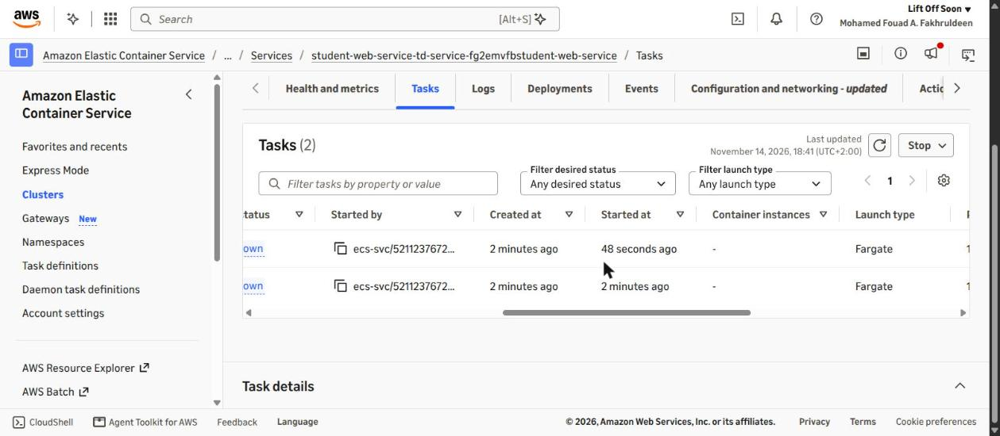

# Lab 06: Containerized Microservices (Amazon ECR & ECS Fargate)

> **Focus:** Containers vs. VMs, Amazon Elastic Container Registry (ECR), Amazon Elastic Container Service (ECS), Serverless AWS Fargate, and Task Definitions  
> **Region:** `eu-north-1` (Stockholm)  
> **Course Domain:** Domain 3: Cloud Technology & Services  
> **Associated Vault Notes:** [[Containers_ECS_EKS_Fargate]]  

---

## 🧭 Prerequisite Concept Refresher: Containers & Microservices

### 1. Containers vs. Virtual Machines (EC2)
- **Virtual Machines (EC2):** Virtualize the physical hardware. Each VM runs a complete guest operating system (kernel, userland, system libraries), which consumes gigabytes of storage and takes minutes to boot.
- **Containers (Docker):** Virtualize the operating system kernel. Multiple containers run isolated userland processes on a single shared OS kernel. They package the application and its dependencies into lightweight artifacts (megabytes in size) that launch in seconds.

### 2. The AWS Container Suite Architecture
- **Amazon ECR (Elastic Container Registry):** A fully managed, highly available Docker container registry used to securely store, manage, and deploy container images.
- **Amazon ECS (Elastic Container Service):** AWS's native container orchestration service designed to run, stop, and manage Docker containers at scale across a cluster.
- **AWS Fargate (Serverless Compute for Containers):**
  - Eliminates the need to configure, patch, or size EC2 instances for your container clusters.
  - You define the container image, vCPU, and memory; AWS provisions and isolates the underlying compute automatically. You pay strictly per second for the resources consumed by your container tasks.

### 3. Task Definitions vs. ECS Services
- **Task Definition:** The blueprint (JSON schema) describing one or more containers (e.g., container image URL, CPU allocation, memory limits, environment variables, port mappings).
- **Service:** The supervisor that maintains a specified number of running task instances across multiple Availability Zones, automatically replacing failed tasks and registering them with load balancers.

---

## 🛠️ Step-by-Step Console Walkthrough

### Step 1: Create an Amazon ECR Private Container Repository
1. In the AWS Management Console, navigate to **Elastic Container Registry (ECR)** in `eu-north-1`.
2. Under **Repositories**, click **Create repository**.
3. Choose **Private**.
4. Set **Repository name:** `student-web-service`.
5. Enable **Tag immutability** (best practice to prevent overwriting existing image tags like `v1.0`).
6. Click **Create repository**.


*Figure 6.1: Private Amazon ECR repository created in eu-north-1.*

---

### Step 2: Inspect Docker Push Commands
1. Select `student-web-service` from the repository list.
2. Click the **View push commands** button in the top right.
3. Review the standard 4-step workflow:
   - `aws ecr get-login-password` (authenticating the local Docker daemon to AWS).
   - `docker build` (building the container image from a Dockerfile).
   - `docker tag` (tagging the local image with the remote ECR repository URI).
   - `docker push` (uploading the image layers into Amazon ECR).


*Figure 6.2: ECR authentication and Docker image push instructions.*

---

### Step 3: Create an AWS Fargate ECS Cluster
1. Navigate to **Elastic Container Service (ECS)**.
2. In the left navigation pane, click **Clusters** -> Click **Create cluster**.
3. Set **Cluster name:** `microservices-fargate-cluster`.
4. Under **Infrastructure**, ensure **AWS Fargate (serverless)** is selected.
5. Click **Create**. Within seconds, your serverless container cluster is active.


*Figure 6.3: Serverless AWS Fargate ECS cluster configuration.*

---

### Step 4: Define an ECS Task Definition
1. In the left navigation pane, click **Task definitions** -> Click **Create new task definition** (with JSON or UI).
2. Configure task attributes:
   - **Task definition family:** `web-task-def`
   - **Launch type:** `AWS Fargate`
   - **CPU:** `0.25 vCPU` (cost-optimized minimum)
   - **Memory:** `0.5 GB`
3. Under **Container - 1**:
   - **Name:** `nginx-container`
   - **Image URI:** `public.ecr.aws/nginx/nginx:latest` (or your private ECR image URI)
   - **Port mappings:** Container port: `80`, Protocol: `TCP`.
4. Click **Create**.


*Figure 6.4: Defining container resources, port mappings, and image URI in the Task Definition.*

---

### Step 5: Deploy an ECS Service with Load Balancing
1. Navigate back to **Clusters** -> Select `microservices-fargate-cluster` -> Click **Create** under the **Services** tab.
2. Configure:
   - **Compute configuration:** `Launch type: FARGATE`
   - **Task definition family:** `web-task-def` (latest revision)
   - **Service name:** `web-microservice`
   - **Desired tasks:** `2` (runs 2 redundant containers across multiple AZs)
   - **Networking:** Select `student-lab-vpc`, select public subnets, and attach `web-tier-sg` (port 80).
   - **Public IP:** `Turned on`.
3. Click **Create**.


*Figure 6.5: Creating the ECS Service to maintain 2 desired tasks on AWS Fargate.*

---

### Step 6: Verify Running Tasks & Public Connectivity
1. Inside the service, click on the **Tasks** tab.
2. Observe two active tasks displaying **Last status: RUNNING** across distinct Availability Zones (`eu-north-1a` and `eu-north-1b`).
3. Click on the first task ID, copy its **Public IP**, open a browser tab, and navigate to `http://<Public-IP>`.
4. The Nginx default landing page will render immediately, confirming your serverless container is live!


*Figure 6.6: Active serverless container tasks running across multiple Availability Zones.*

---

## 💻 AWS CLI Verification Commands

```bash
# 1. List active ECS clusters
aws ecs list-clusters \
  --region eu-north-1 \
  --profile aws-notes

# 2. List running tasks in the Fargate cluster
aws ecs list-tasks \
  --cluster "microservices-fargate-cluster" \
  --region eu-north-1 \
  --profile aws-notes

# 3. Describe task details and extract public network interface IP
aws ecs describe-tasks \
  --cluster "microservices-fargate-cluster" \
  --tasks $(aws ecs list-tasks --cluster "microservices-fargate-cluster" --query "taskArns[0]" --output text --region eu-north-1 --profile aws-notes) \
  --region eu-north-1 \
  --profile aws-notes
```

---

## 🧹 Free Tier Cleanup & Cost Safeguard
1. In the **ECS Console**, open `microservices-fargate-cluster` -> Select `web-microservice` -> Click **Delete service** (confirm with "delete").
2. Select `microservices-fargate-cluster` -> Click **Delete cluster**.
3. In the **ECR Console**, select `student-web-service` -> Click **Delete** (confirm with "delete").
