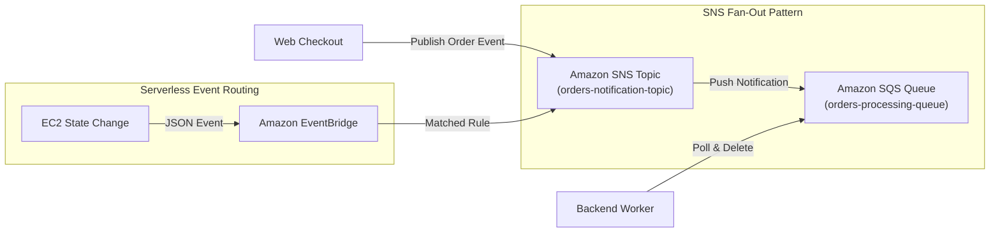
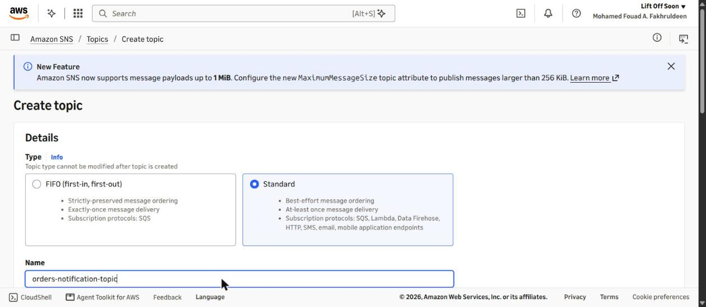
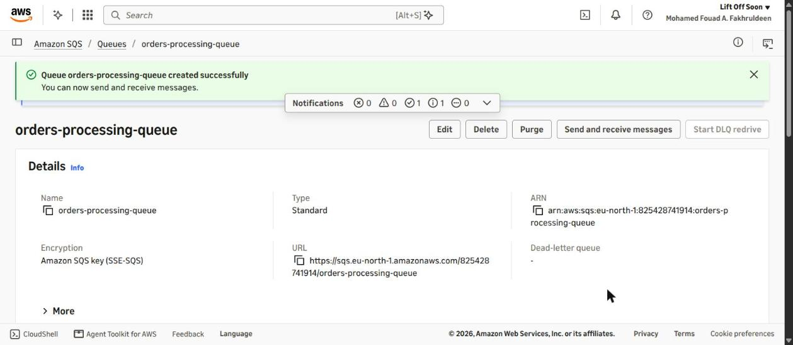
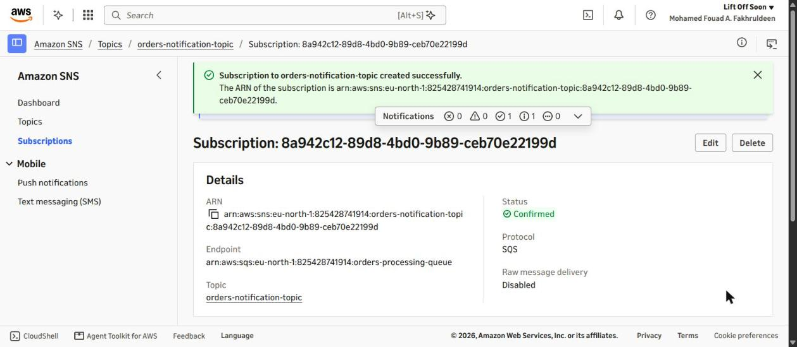
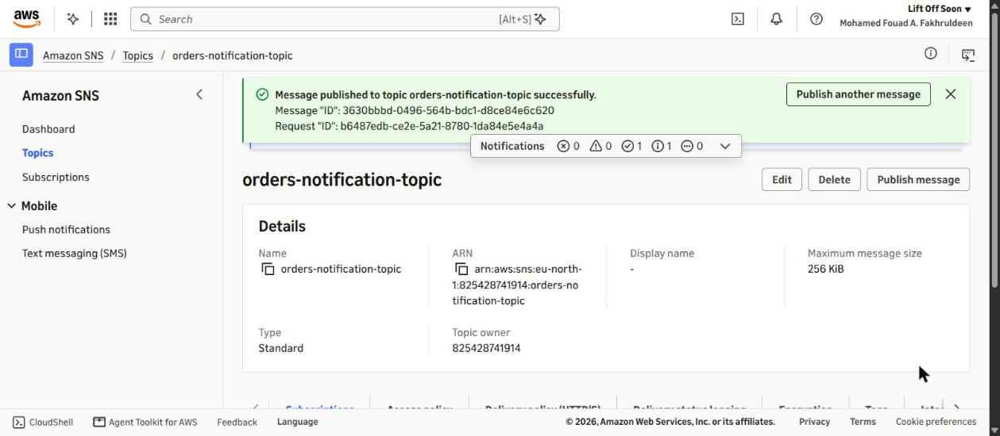
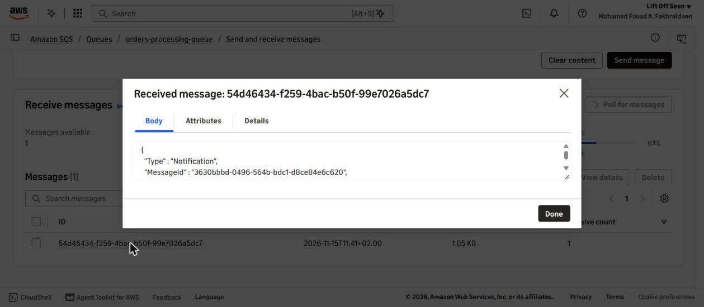
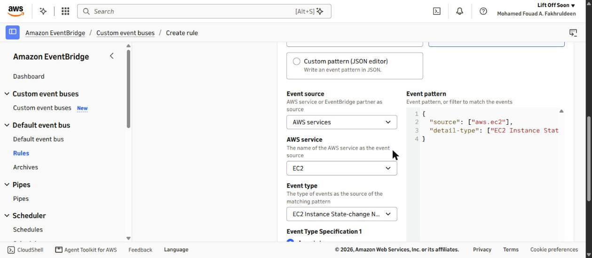

# Lab 12: Application Decoupling (SQS, SNS & EventBridge)

> **Focus:** Amazon Simple Notification Service (SNS), Amazon Simple Queue Service (SQS), Pub/Sub Fan-Out Architecture, and Amazon EventBridge Rules  
> **Region:** `eu-north-1` (Stockholm)  
> **Course Domain:** Domain 3: Cloud Technology & Services  
> **Associated Vault Notes:** [[Amazon_SQS]], [[Amazon_SNS]], [[Amazon_EventBridge]]  

---

## 🧭 Prerequisite Concept Refresher: Decoupling Distributed Microservices

### 1. Tight Coupling vs. Loose Coupling
- **Tightly Coupled System:** Microservice A makes a synchronous, direct HTTP call to Microservice B. If Microservice B crashes, runs out of memory, or experiences network latency, Microservice A immediately halts, causing cascading failures throughout the entire enterprise.
- **Loosely Coupled System:** Microservice A writes a message to an asynchronous queue or event bus and immediately moves on. Microservice B pulls and processes messages at its own pace. If Microservice B goes down for maintenance, messages safely buffer in the queue with **zero data loss**.

### 2. SQS (Pull Queuing) vs. SNS (Push Pub/Sub)
- **Amazon SQS (Pull-Based):** Consumers poll the queue to retrieve messages, process them, and delete them. Acts as a shock absorber/buffer during traffic surges.
- **Amazon SNS (Push-Based):** Publishers publish a message to a **Topic**, and SNS immediately pushes it out to thousands of subscribers (SQS queues, Lambda, HTTP webhooks, Email, SMS).

### 3. The Classic SNS-to-SQS Fan-Out Pattern
When an event occurs (e.g., *Customer Places Order*), publishing once to an SNS topic replicates the message simultaneously across multiple independent SQS queues (e.g., `Billing-Queue`, `Inventory-Queue`, `Shipping-Queue`), allowing each downstream microservice to process the event independently.

---

## 🏗️ Lab Architecture



---

## 🛠️ Step-by-Step Console Walkthrough

### Step 1: Create an Amazon SNS Standard Topic
1. In the AWS Management Console, navigate to **Amazon SNS** in `eu-north-1`.
2. In the left navigation pane, click **Topics** -> Click **Create topic**.
3. Configure the topic:
   - **Type:** **Standard** (high-throughput, best-effort ordering).
   - **Name:** `orders-notification-topic`.
   - **Display name:** `OrderEvents`.
4. Click **Create topic**. Note the generated **Topic ARN**.


*Figure 12.1: Creating an Amazon SNS standard pub/sub topic in eu-north-1.*

---

### Step 2: Create an Amazon SQS Message Queue
1. Navigate to the **Amazon SQS Console**.
2. Click **Create queue**.
3. Configure:
   - **Type:** **Standard** (virtually unlimited throughput).
   - **Name:** `orders-processing-queue`.
   - **Visibility timeout:** `30 seconds` (the duration a message remains hidden from other workers after being picked up).
   - **Message retention period:** `4 days` (can store up to 14 days).
4. Click **Create queue**.


*Figure 12.2: Standard SQS queue configuration with 30-second visibility timeout.*

---

### Step 3: Implement the SNS-to-SQS Fan-Out Subscription
1. In the `orders-processing-queue` dashboard, click the **SNS subscriptions** tab.
2. Click **Subscribe to Amazon SNS topic**.
3. Select `orders-notification-topic` from the dropdown list.
4. Click **Save**.
5. SQS automatically updates its **Access Policy** to allow the SNS topic principal to execute `sqs:SendMessage` into the queue!


*Figure 12.3: Subscribing the SQS queue to the SNS topic for automated fan-out.*

---

### Step 4: Publish a Test Message to the SNS Topic
1. Navigate back to **Amazon SNS** -> Select `orders-notification-topic`.
2. Click the **Publish message** button.
3. In the **Message body**, enter a sample JSON order payload:

```json
{
  "orderId": "ORD-55412",
  "customerId": "CUST-9921",
  "totalAmount": 149.99,
  "currency": "USD",
  "itemCount": 3,
  "status": "PAID"
}
```

4. Click **Publish message**.


*Figure 12.4: Publishing an asynchronous JSON event payload into the SNS topic.*

---

### Step 5: Poll and Inspect Messages in the SQS Queue
1. Navigate back to **Amazon SQS** -> Select `orders-processing-queue`.
2. Click **Send and receive messages**.
3. In the **Receive messages** section, click **Poll for messages**.
4. Observe the message appear in the list. Click on the message ID to inspect its body:
   - Notice how SNS wrapped the payload in a standardized notification envelope with timestamps and Topic ARN!
5. After processing, click **Delete** to simulate worker acknowledgment.


*Figure 12.5: Polling and inspecting the received message payload in SQS.*

---

### Step 6: Create an Amazon EventBridge Reactive Rule
1. Navigate to **Amazon EventBridge** in `eu-north-1`.
2. In the left navigation pane, click **Rules** -> Click **Create rule**:
   - **Name:** `EC2StateChangeMonitor`
   - **Event bus:** `default`
   - **Rule type:** `Rule with an event pattern`
3. Under **Event pattern**:
   - **Event source:** `AWS services`
   - **AWS service:** `EC2`
   - **Event type:** `EC2 Instance State-change Notification`
   - **Specific state:** Check `shutting-down` and `terminated`.
4. In **Select target(s)**:
   - **Target:** `SNS topic`
   - **Topic:** Select `orders-notification-topic`.
5. Click **Create rule**. Any terminated EC2 instance will now automatically trigger an SNS notification!


*Figure 12.6: EventBridge pattern matching EC2 termination events and routing them to SNS.*

---

## 💻 AWS CLI Verification Commands

```bash
# 1. Publish a message to SNS via CLI
aws sns publish \
  --topic-arn $(aws sns list-topics --query "Topics[?contains(TopicArn, 'orders-notification-topic')].TopicArn" --output text --region eu-north-1 --profile aws-notes) \
  --message '{"event": "CLI_ORDER_TEST", "amount": 99.00}' \
  --region eu-north-1 \
  --profile aws-notes

# 2. Receive message from SQS queue via CLI
QUEUE_URL=$(aws sqs get-queue-url --queue-name "orders-processing-queue" --query "QueueUrl" --output text --region eu-north-1 --profile aws-notes)
aws sqs receive-message \
  --queue-url "$QUEUE_URL" \
  --region eu-north-1 \
  --profile aws-notes
```

---

## 🧹 Free Tier Cleanup & Cost Safeguard
> [!NOTE]
> Amazon SNS (1 million requests/mo) and Amazon SQS (1 million requests/mo) are part of the Always Free tier.

1. In the **EventBridge Console**, select `EC2StateChangeMonitor` -> Click **Delete**.
2. In the **SQS Console**, select `orders-processing-queue` -> Click **Delete**.
3. In the **SNS Console**, select `orders-notification-topic` -> Click **Delete**.
