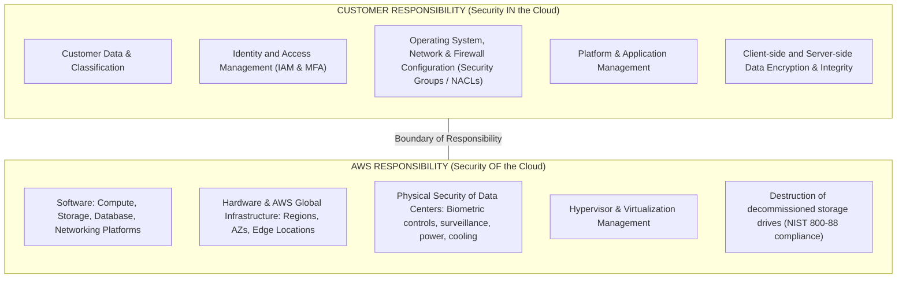
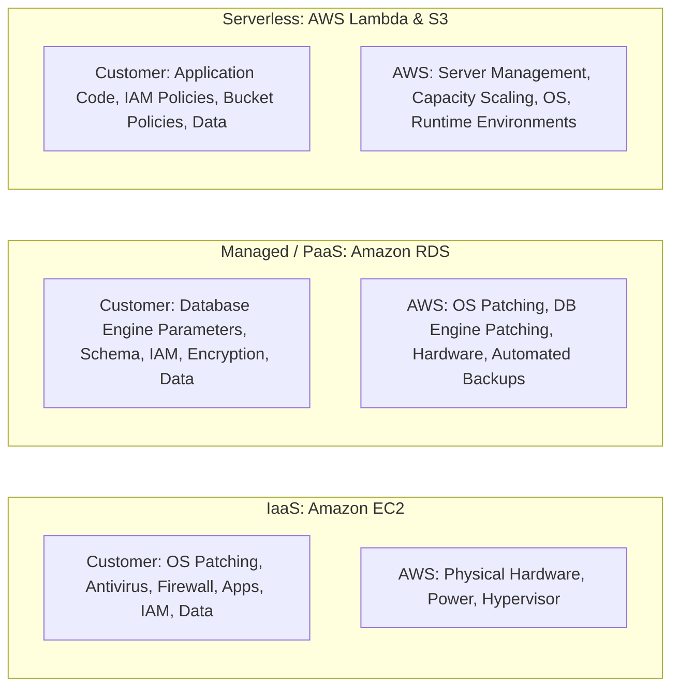

# AWS Shared Responsibility Model

> **Knowledge Area:** Security and Compliance (Domain 2.1)  
> **Relevant Certifications:** [[CLF-C02_Master_Blueprint|CLF-C02]], SAA-C03, AIF-C01  
> **Tags:** `#aws/security` `#aws/compliance` `#clf-c02`

---

## 1. Core Principle: Security OF the Cloud vs. Security IN the Cloud

Security and compliance are a **shared effort** between AWS and the customer:

* **AWS is responsible for "Security OF the Cloud":** Protecting the global infrastructure that runs all services offered in the AWS Cloud (hardware, software, networking, and physical facilities).
* **Customer is responsible for "Security IN the Cloud":** The security measures that the customer chooses to implement and configure for the services they launch (customer data, operating system updates, firewall configurations, IAM permissions, network routing).

---

## 2. How Responsibility Shifts Across Service Models (Crucial Exam Concept)

The level of customer responsibility depends on the type of service selected: **IaaS (EC2)** vs **PaaS/Managed (RDS)** vs **Serverless/Abstracted (S3 / Lambda)**.

### Detailed Responsibility Comparison:

| Responsibility Layer | Amazon EC2 (IaaS) | Amazon RDS (Managed) | AWS Lambda / S3 (Serverless) |
|---|:---:|:---:|:---:|
| **Physical Data Center & Hardware** | **AWS** | **AWS** | **AWS** |
| **Hypervisor & Virtualization** | **AWS** | **AWS** | **AWS** |
| **Operating System Patching** | **CUSTOMER** | **AWS** | **AWS** |
| **Database Engine Patching** | N/A (Customer if on EC2) | **AWS** | **AWS** |
| **Serverless Runtime Environment** | N/A | N/A | **AWS** |
| **Network Configuration (Subnets/Route Tables)**| **CUSTOMER** | **CUSTOMER** | **AWS** (Lambda handles VPC if configured) |
| **Firewall (Security Groups / NACLs)** | **CUSTOMER** | **CUSTOMER** | N/A (Bucket Policies / IAM) |
| **Identity & Access Management (IAM)** | **CUSTOMER** | **CUSTOMER** | **CUSTOMER** |
| **Application Code & Logic** | **CUSTOMER** | **CUSTOMER** | **CUSTOMER** |
| **Data Encryption & Customer Data** | **CUSTOMER** | **CUSTOMER** | **CUSTOMER** |

> [!IMPORTANT]
> **Golden Rule of Shared Responsibility:** Customer data and IAM permissions are **ALWAYS** 100% the customer's responsibility, regardless of whether you are using EC2, RDS, S3, or Lambda!

---

## 3. Shared Controls Classification

AWS categorizes controls into three distinct groups:

1. **Inherited Controls:** Controls that the customer fully inherits from AWS.
   - *Examples:* Physical security of facilities, environmental controls (cooling, fire suppression), biometric entry to data centers, hardware disposal.
2. **Shared Controls:** Controls that apply to both the infrastructure layer (managed by AWS) and customer-facing configurations (managed by the customer).
   - *Patch Management:* AWS is responsible for patching flaws on physical infrastructure and managed services; the customer is responsible for patching their EC2 guest operating systems and application code.
   - *Configuration Management:* AWS maintains the configuration of its cloud infrastructure; the customer maintains the configuration of their own guest operating systems, subnets, and applications.
   - *Awareness & Training:* AWS trains AWS employees; the customer trains their own staff on cloud security and compliance policies.
3. **Customer-Specific Controls:** Controls that are solely the responsibility of the customer based on application and regulatory needs.
   - *Examples:* Service and communications protection (e.g., zone security, network routing rules, VPC security groups), data classification, data retention policies.

---

## 4. Exam Scenarios & Trap Questions

| Question Statement | Who is Responsible? | Rationale |
|---|:---:|---|
| *"Who is responsible for updating the Linux kernel on an Amazon EC2 instance?"* | **Customer** | EC2 is IaaS; the customer manages the guest operating system. |
| *"Who is responsible for applying security updates to the MySQL database engine on Amazon RDS?"* | **AWS** | Amazon RDS is a managed service; AWS handles OS and database engine patch management. |
| *"Who is responsible for decommissioning and degaussing broken hard drives?"* | **AWS** | Physical media destruction (NIST 800-88 standard) is an inherited physical control managed by AWS. |
| *"Who is responsible for enabling Multi-Factor Authentication (MFA) on the root user?"* | **Customer** | Account credentials and access control belong entirely to the customer. |
| *"Who is responsible for configuring firewall rules for Amazon EC2 instances?"* | **Customer** | Security Groups and Network ACLs are customer-managed virtual firewalls. |
| *"Who is responsible for ensuring employee laptops connecting to AWS have antivirus installed?"* | **Customer** | Endpoint device security and client network connections are customer-specific controls. |
| *"Who is responsible for physical facility certifications such as SOC 1/2/3, ISO 27001, and PCI DSS compliance of data centers?"* | **AWS** | AWS maintains physical data center compliance; audit reports are downloadable via **AWS Artifact**. |
