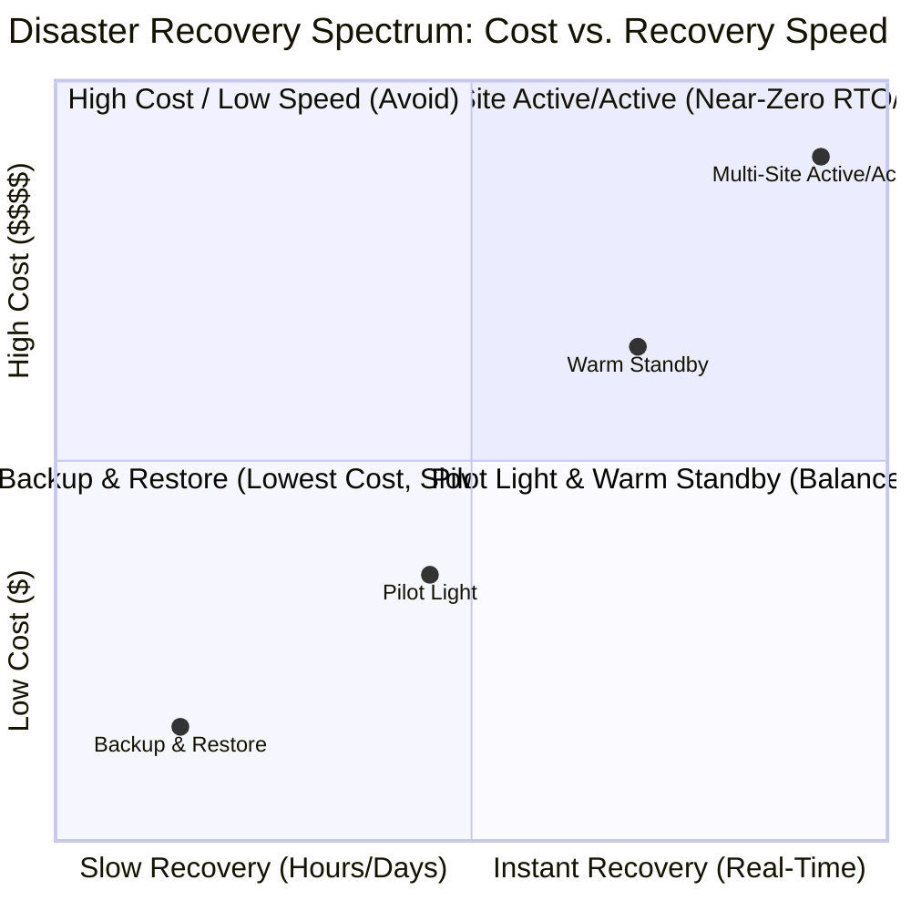

# Exam Distinction Cheat Sheet: Disaster Recovery Strategies (The 4 Tiers)

> **Core Topic:** Cloud Architecture, Resiliency & Disaster Recovery  
> **Target Exam:** AWS Certified Cloud Practitioner (CLF-C02)  
> **Source Origin:** Classroom - Manara Course Revision Notes & AWS Well-Architected Framework

---

## 1. Core Metrics: RTO vs. RPO

Disaster recovery strategies are defined by two key recovery metrics:
- **Recovery Time Objective (RTO):** The maximum acceptable **downtime** before the system is restored to operational status (*"How quickly do we need the application back online?"*).
- **Recovery Point Objective (RPO):** The maximum acceptable **data loss** measured in time (*"How much data can we afford to lose between the last backup and the disaster?"*).

---

## 2. The 4 Disaster Recovery Tiers: Spectrum of Cost vs. Recovery Time

| Strategy | Standby Environment State | RTO (Downtime) | RPO (Data Loss) | Cost Tier |
| :--- | :--- | :--- | :--- | :--- |
| **1. Backup & Restore** | **Zero infrastructure running** in the DR region. Data and snapshots are replicated periodically. | **Hours to Days** (Must provision VPCs, servers, and restore databases from scratch). | **Hours to Days** (Limited by backup frequency). | **Lowest Cost ($)** (Only pay for S3 backup storage until a disaster occurs). |
| **2. Pilot Light** | **Core minimal infrastructure running:** Only the database or critical stateful layer is running in standby (kept synchronized via live replication). Web and app servers are NOT running. | **Minutes to Tens of Minutes** (Compute instances are launched via AMIs/Auto Scaling upon failover). | **Minutes** (Limited only by continuous database replication lag). | **Low to Moderate Cost ($$)** (Pay for small running database + S3 storage). |
| **3. Warm Standby** | **Scaled-down version of the full stack is ALWAYS running** in the DR region (e.g., 1 small EC2 instance behind a load balancer and a standby database). | **Minutes** (Traffic is redirected immediately via Route 53; Auto Scaling scales the fleet to full production capacity). | **Seconds to Minutes** (Continuous live database replication). | **Medium to High Cost ($$$)** (Pay for running compute, networking, and database instances 24/7). |
| **4. Multi-Site Active/Active** | **Full production capacity running in two or more AWS Regions simultaneously**, actively serving production traffic. | **Near Zero (Real-Time)** (Route 53 DNS failover or Global Accelerator routes traffic instantly around the degraded region). | **Near Zero** (Synchronous or near-instant asynchronous data replication). | **Highest Cost ($$$$)** (Running full double infrastructure across multiple regions continuously). |

---

## 🎯 Exam Trigger Scenarios & Keywords

### Scenario 1:
> *"A company wants the lowest cost disaster recovery strategy for non-critical development workloads and can tolerate several hours of downtime and data loss in the event of a regional outage. Which strategy should they choose?"*  
> **Correct Answer:** **Backup & Restore** (lowest cost, acceptable for non-critical workloads).

### Scenario 2:
> *"An organization requires a disaster recovery solution that keeps a minimal version of its core database running and continuously replicated in a secondary region, while application and web servers are turned off and only launched when failover occurs. Which strategy does this describe?"*  
> **Correct Answer:** **Pilot Light** (maintains only the core data tier running in standby, scaling up compute only when failover is triggered).

### Scenario 3:
> *"A financial services firm requires a disaster recovery strategy where a functional, scaled-down duplicate of its production stack is running in a secondary region at all times, capable of handling live traffic and scaling up immediately if the primary region fails. Which strategy does this describe?"*  
> **Correct Answer:** **Warm Standby** (a scaled-down version of the full stack always running).

### Scenario 4:
> *"A global payments platform requires zero downtime and near-zero data loss across multiple AWS Regions, with customer traffic distributed dynamically across all regions during normal operations. Which strategy should they choose?"*  
> **Correct Answer:** **Multi-Site Active/Active** (traffic served actively from multiple regions simultaneously).

---

## 💡 Quick Memory Hook
- **Backup & Restore** = **Cold Ashes** (Nothing running; build the fire from scratch).
- **Pilot Light** = **The Tiny Flame** (Only the core database pilot light is burning; ignite the full fire on failover).
- **Warm Standby** = **The Small Fire** (A smaller fire is already burning; add logs to make it full size).
- **Multi-Site Active/Active** = **Two Full Fires** (Both full-sized fireplaces burning at full heat simultaneously).
