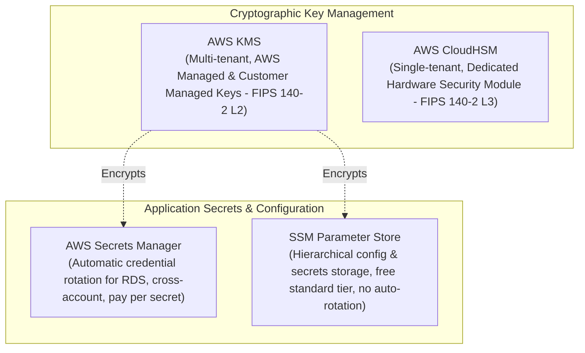

# Distinction Cheat Sheet: Secrets & Encryption (KMS vs. CloudHSM vs. Secrets Manager vs. Parameter Store)

> **Role:** High-yield distinction guide for cryptographic keys, database credentials, and secrets management.  
> **Course:** AWS Certified Cloud Practitioner (CLF-C02)  
> **Tags:** `#exam-prep` `#security` `#encryption` `#distinction`

---

## 🎯 Architectural Overview

---

## 🔍 Feature Comparison Matrix

| Feature | AWS KMS | AWS CloudHSM | AWS Secrets Manager | SSM Parameter Store |
|:---|:---|:---|:---|:---|
| **Primary Asset** | Cryptographic Keys (KMS keys) | Hardware Security Modules | Passwords, API keys, DB credentials | App configuration parameters, license strings, passwords |
| **Multi-Tenancy** | Shared multitenant AWS fleet | **Dedicated single-tenant** physical appliance | Multitenant managed service | Multitenant managed service |
| **FIPS Compliance**| FIPS 140-2 Level 2 (overall) | **FIPS 140-2 Level 3** | Uses KMS for encryption | Uses KMS for SecureString parameters |
| **Automatic Rotation**| Yes (annual KMS key rotation) | Customer-managed rotation | **Yes (automatic rotation via built-in Lambda for RDS)** | **No** (Must build custom Lambda if rotation needed) |
| **Pricing Model** | \$1.00/key/month + API request cost | High hourly hardware cost (~hourly per HSM) | \$0.40/secret/month + API calls | **Standard parameters are FREE!** Advanced tier incurs fee |
| **Integration** | Native across almost all AWS services | PKCS#11, JCE, CNG industry cryptographic standards | Native integration with RDS, Redshift, DocumentDB | Native integration with EC2, Lambda, ECS, CloudFormation |

---

## ⚡ High-Yield Exam Clues

* **"Encrypt S3 buckets with minimal operational overhead":**
  👉 **AWS KMS (SSE-KMS)**
* **"Regulatory requirement for dedicated hardware security module under exclusive customer control", "FIPS 140-2 Level 3":**
  👉 **AWS CloudHSM**
* **"Store database passwords and automatically rotate them every 30 days without application downtime":**
  👉 **AWS Secrets Manager**
* **"Store plain text or encrypted configuration strings and feature flags at no cost":**
  👉 **AWS Systems Manager Parameter Store**
* **"Store secrets where cost is primary factor and automatic rotation is not needed":**
  👉 **AWS Systems Manager Parameter Store (Standard)**
