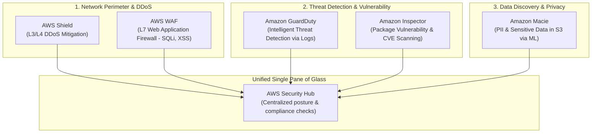

# Distinction Cheat Sheet: AWS Security Services (Shield, WAF, GuardDuty, Inspector, Macie)

> **Role:** High-yield pairwise comparison to eliminate confusion on security exam questions.  
> **Course:** AWS Certified Cloud Practitioner (CLF-C02)  
> **Tags:** `#exam-prep` `#security` `#distinction`

---

## 🎯 The Five Security Pillars At a Glance

---

## 🔍 Feature Comparison Matrix

| Feature | AWS Shield | AWS WAF | Amazon GuardDuty | Amazon Inspector | Amazon Macie |
|:---|:---|:---|:---|:---|:---|
| **OSI Layer / Domain** | Layer 3 / 4 (Network & Transport) | Layer 7 (Application) | Account & VPC Log Analysis | Workload OS & Container Packages | Amazon S3 Storage Buckets |
| **Primary Threat Handled**| SYN floods, UDP reflection, DDoS attacks | SQL Injection (SQLi), Cross-Site Scripting (XSS), bots | Compromised credentials, bitcoin mining, malware communication | Known software vulnerabilities (CVEs), unintended public access | Unprotected PII, credit card numbers, secret keys |
| **Data Sources Inspected**| Network packet volume at CloudFront & Route 53 | Inbound HTTP/HTTPS requests | CloudTrail logs, VPC Flow Logs, DNS logs, EKS audit logs | EC2 instances (SSM Agent), ECR container images, Lambda code | Amazon S3 objects and bucket metadata |
| **Action Taken** | Automatic traffic absorption | Allows, blocks, or rate-limits requests | Generates findings and triggers EventBridge alerts | Reports vulnerability score and suggested patch | Alerts on unencrypted or exposed sensitive data |

---

## ⚡ High-Yield Exam Clues

* **"Layer 7", "SQL injection", "Cross-site scripting (XSS)", "Block IP list":**
  👉 **AWS WAF**
* **"DDoS attack", "SYN flood", "UDP reflection", "DDoS Response Team (SRT)":**
  👉 **AWS Shield (Advanced)**
* **"Intelligent threat detection", "Analyzes CloudTrail and DNS logs", "Cryptocurrency mining detected":**
  👉 **Amazon GuardDuty**
* **"Scan EC2 instances for software vulnerabilities", "Common Vulnerabilities and Exposures (CVE)", "Scans ECR container images":**
  👉 **Amazon Inspector**
* **"Discover sensitive data", "PII in S3 buckets", "Credit card numbers in objects", "GDPR compliance for storage":**
  👉 **Amazon Macie**
* **"Single dashboard aggregating security alerts across multiple AWS accounts":**
  👉 **AWS Security Hub**
