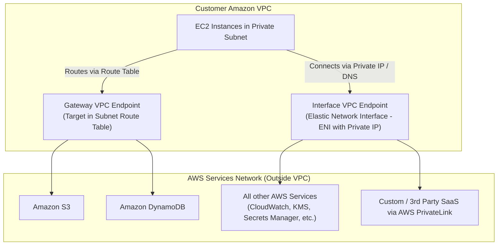

# Distinction Cheat Sheet: VPC Endpoints (Gateway vs. Interface vs. AWS PrivateLink)

> **Role:** Master the difference between Gateway Endpoints and Interface Endpoints for secure private access to AWS services.  
> **Course:** AWS Certified Cloud Practitioner (CLF-C02)  
> **Tags:** `#exam-prep` `#networking` `#vpc` `#distinction`

---

## 🎯 Architecture Diagram

---

## 🔍 Detailed Comparison Table

| Dimension | Gateway Endpoint | Interface Endpoint (AWS PrivateLink) |
|:---|:---|:---|
| **Underlying Mechanism** | A routing entry added to the subnet **Route Table** | An **Elastic Network Interface (ENI)** with a private IP in your subnet |
| **Supported AWS Services** | **ONLY TWO Services:** 1. **Amazon S3** 2. **Amazon DynamoDB** | **140+ AWS Services** (CloudWatch, KMS, Secrets Manager, SNS, SQS, API Gateway, etc.) + S3 |
| **Cost** | **100% FREE!** No hourly or data processing charges | **Hourly charge per ENI** + charge per GB processed |
| **On-Premises Access** | Cannot be accessed from on-premises over VPN or Direct Connect | **Can be accessed from on-premises** over VPN or Direct Connect |
| **DNS Requirements** | No DNS changes; standard AWS endpoint URLs resolve normally | Generates private DNS names or uses private DNS feature |
| **Security Mechanism** | Endpoint Policy attached to the endpoint | **Security Groups** attached to the ENI + Endpoint Policy |

---

## ⚡ High-Yield Exam Clues

* **"Access Amazon S3 or DynamoDB from a private subnet without an Internet Gateway or NAT Gateway at NO additional cost":**
  👉 **Gateway VPC Endpoint**
* **"Private connection to AWS services or customer SaaS application without traversing the internet, requires a private IP and security group":**
  👉 **Interface VPC Endpoint (AWS PrivateLink)**
* **"Access an S3 bucket securely from on-premises servers via AWS Direct Connect":**
  👉 **Interface VPC Endpoint for Amazon S3** *(Gateway endpoints cannot route from on-premises!)*
