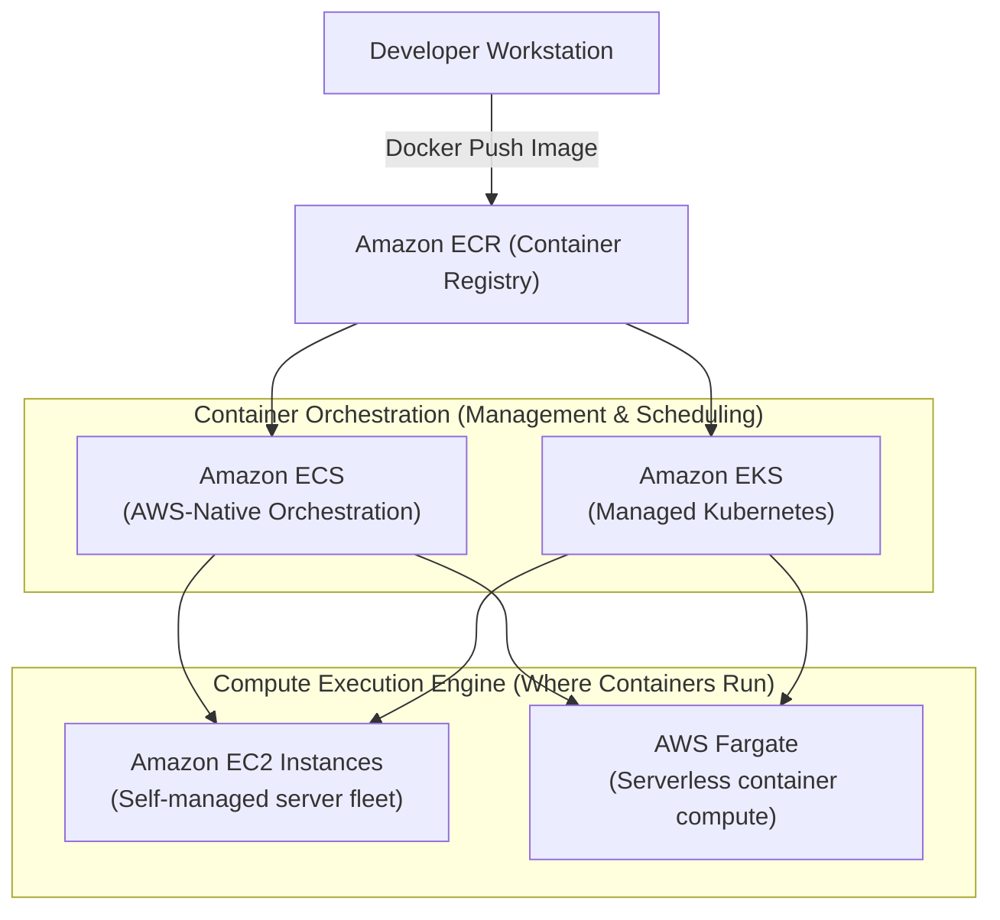
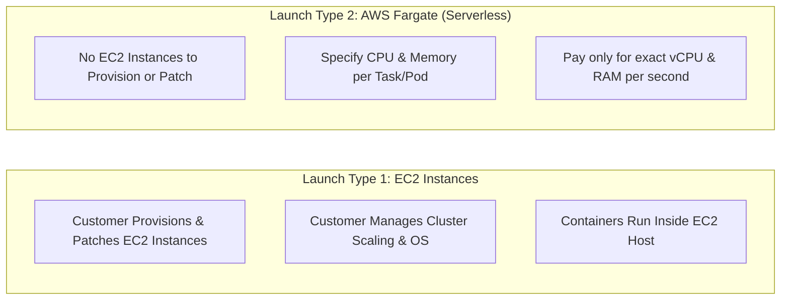

# Containers on AWS: ECS, EKS, Fargate & ECR

> **Service Category:** Compute & Containers  
> **Relevant Certifications:** [[CLF-C02_Master_Blueprint|CLF-C02]], SAA-C03, DVA-C02  
> **Tags:** `#aws/services` `#aws/containers` `#clf-c02`

---

## 1. Container Concepts & Architecture on AWS

Containers package application code, configurations, and runtime dependencies together into a standardized image, guaranteeing consistent execution across local development and production cloud environments.

On AWS, container architecture separates **Image Storage**, **Orchestration**, and **Execution Engine**:

---

## 2. Amazon Elastic Container Registry (Amazon ECR)

* **What it is:** A fully managed, highly available, and secure Docker container registry that makes it easy to store, manage, share, and deploy container images.
* **Key Features:**
  - *Public & Private Repositories:* Supports private enterprise repositories (integrated with IAM) and **Amazon ECR Public Gallery** for sharing open-source images globally.
  - *Vulnerability Image Scanning:* Automatically scans container images for software vulnerabilities using Common Vulnerabilities and Exposures (CVE) databases.
  - *Encryption:* Repositories are encrypted at rest using **AWS KMS** and in transit using TLS.

---

## 3. Container Orchestrators: ECS vs. EKS

An orchestrator manages the lifecycle of containers: launching, stopping, monitoring health, service discovery, and auto-scaling.

| Feature / Criteria | Amazon ECS | Amazon EKS |
|---|---|---|
| **Underlying Technology** | Proprietary AWS-native container engine. | Open-source Kubernetes (K8s) certified. |
| **Complexity** | Simple, intuitive, fast learning curve. | Higher complexity, requires Kubernetes knowledge (kubectl, YAML manifests). |
| **AWS Integration** | Deep native integration with IAM roles, CloudWatch, ALB, Secrets Manager. | Integrates with AWS services, but preserves Kubernetes-native paradigms. |
| **Portability** | Optimized for AWS workloads. | Multi-cloud and hybrid; portable between on-prem Kubernetes and AWS. |
| **Best Used When** | Team wants simple Docker orchestration without managing Kubernetes complexity. | Organization already standardizes on Kubernetes or needs multi-cloud portability. |

---

## 4. Compute Engines: EC2 vs. AWS Fargate (Serverless Containers)

Both ECS and EKS can run containers on either **Amazon EC2** or **AWS Fargate**:

| Dimension | EC2 Launch Type | AWS Fargate Launch Type (Serverless) |
|---|---|---|
| **Server Management** | Customer manages, configures, and patches the EC2 host servers. | **Zero server management.** AWS provisions and patches the underlying compute. |
| **Pricing Model** | Pay for the EC2 instance hours, regardless of whether containers utilize 10% or 100% of capacity. | **Pay only for the exact vCPU and memory consumed** by each container task per second. |
| **Control** | Full access to guest OS, kernel parameters, and hardware instance types. | Managed environment; no access to underlying operating system. |

---

## 5. Exam Tip Matrix

| Question Scenario | Correct Choice |
|---|---|
| *"Deploy Docker containers on AWS without provisioning or managing any underlying EC2 servers"* | **AWS Fargate** |
| *"A company wants an open-source, Kubernetes-compatible container platform on AWS"* | **Amazon EKS** |
| *"Store and automatically scan container images for known security vulnerabilities"* | **Amazon ECR** |
| *"A simple, AWS-native container orchestrator deeply integrated with IAM and ALB"* | **Amazon ECS** |
| *"Which launch type offers the lowest operational management overhead for containers?"* | **AWS Fargate** |
