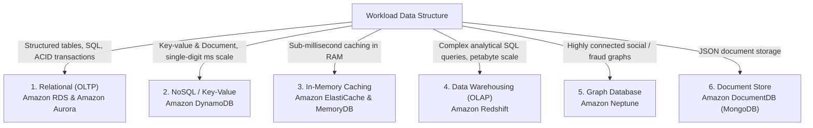
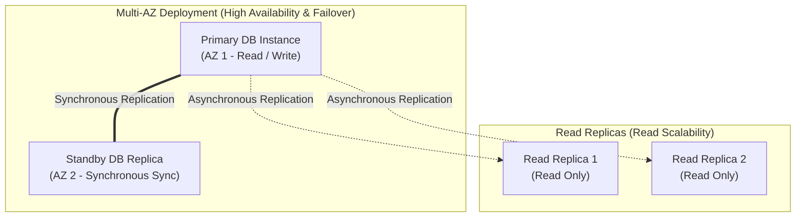

# AWS Databases: RDS, Aurora, DynamoDB, Redshift & In-Memory

> **Service Category:** Database  
> **Relevant Certifications:** [[CLF-C02_Master_Blueprint|CLF-C02]], SAA-C03, DVA-C02  
> **Tags:** `#aws/services` `#aws/database` `#clf-c02`

---

## 1. Overview: Purpose-Built Database Strategy

AWS rejects the "one-size-fits-all" database approach, providing purpose-built engines tailored for specific data access patterns:

---

## 2. Amazon RDS (Relational Database Service)

**Amazon RDS** is a fully managed service that makes it easy to set up, operate, and scale relational databases in the cloud. It automates hardware provisioning, OS installation and patching, database software patching, automated backups, and point-in-time recovery.

### 6 Supported Relational Database Engines:
1. **Amazon Aurora** (AWS-developed cloud-native engine)
2. **PostgreSQL** (Open-source)
3. **MySQL** (Open-source)
4. **MariaDB** (Open-source)
5. **Oracle Database** (Commercial)
6. **Microsoft SQL Server** (Commercial)

### Multi-AZ vs. Read Replicas (Essential Exam Distinction):

| Dimension | Multi-AZ Deployment | Read Replicas |
|---|---|---|
| **Primary Purpose** | **High Availability & Disaster Recovery** | **Read Performance & Scalability** |
| **Replication Type** | **Synchronous** (zero data loss) | **Asynchronous** (slight replication lag) |
| **Can Application Read from it?**| **NO** (Standby instance is inactive until failover) | **YES** (Offloads read queries from primary DB) |
| **Failover Behavior** | **Automatic failover** in 1–2 minutes if primary fails | Manual or automated promotion to standalone DB |
| **Location** | Another AZ in the **same Region** | Same AZ, cross-AZ, or **cross-Region** |

---

## 3. Amazon Aurora (Cloud-Native Enterprise Relational Engine)

* **What it is:** AWS’s proprietary, high-performance relational database engine compatible with MySQL and PostgreSQL.
* **Speed:** Delivers up to **5x the throughput of standard MySQL** and **3x the throughput of standard PostgreSQL**.
* **Storage Resiliency:** Replicates **6 copies of your data across 3 Availability Zones** automatically.
* **Self-Healing Storage:** Continuously scans data blocks and disks for errors and automatically repairs them without interrupting client traffic.
* **Storage Auto-Scaling:** Storage automatically grows in 10 GB increments up to **128 TB** as needed.
* **Aurora Serverless:** On-demand, auto-scaling configuration where the database automatically starts up, shuts down, and scales capacity based on application demand.

---

## 4. Amazon DynamoDB (Serverless NoSQL Key-Value Store)

* **What it is:** A fully managed, serverless NoSQL database service that provides fast and predictable performance with seamless scalability.
* **Latency Guarantee:** Delivers **single-digit millisecond latency** at any scale (from 10 requests to 100 million requests per second).
* **Data Model:** Key-Value and Document store (JSON). Ideal for mobile backends, gaming leaderboards, shopping carts, session state storage.
* **DynamoDB Accelerator (DAX):** A fully managed, highly available, in-memory cache for DynamoDB that slashes response times from milliseconds to **microseconds** for read-heavy workloads.
* **Global Tables:** Fully managed multi-Region, multi-active database replicating data automatically across multiple AWS Regions for global user access.

---

## 5. Analytics & In-Memory Engines

### Amazon ElastiCache
* Fully managed in-memory data store supporting **Redis** and **Memcached**.
* Sits in front of a relational database (RDS) to cache frequently queried data in RAM, reducing read load and database response times to sub-milliseconds.

### Amazon Redshift
* Fully managed, petabyte-scale **cloud data warehouse (OLAP - Online Analytical Processing)**.
* Uses **columnar storage** and massively parallel processing (MPP) to run complex SQL queries against massive historical datasets.

---

## 6. Exam Tip Matrix

| Question Scenario | Correct Database Service |
|---|---|
| *"Fast, flexible NoSQL database delivering single-digit millisecond latency for mobile user profiles and gaming scores"* | **Amazon DynamoDB** |
| *"Managed relational database with automated Multi-AZ failover for high availability"* | **Amazon RDS** |
| *"Cloud-native database that replicates 6 copies of data across 3 AZs and delivers 5x MySQL throughput"* | **Amazon Aurora** |
| *"Petabyte-scale data warehouse used by business intelligence analysts to run complex historical analytics reports"* | **Amazon Redshift** |
| *"In-memory cache used to cache frequently requested database queries in RAM to accelerate read performance"* | **Amazon ElastiCache** |
| *"Reduce DynamoDB read latency from milliseconds to microseconds for high-frequency reads"* | **Amazon DynamoDB Accelerator (DAX)** |
