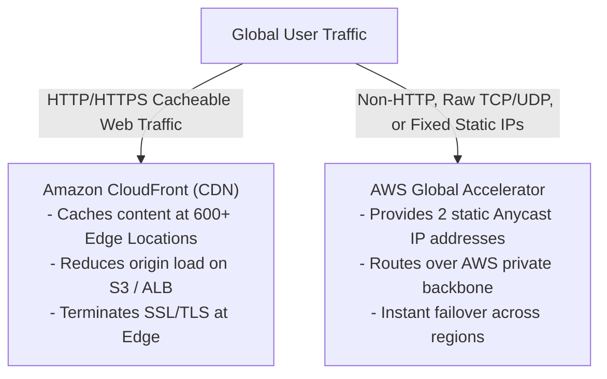

# Amazon CloudFront & AWS Global Accelerator

> **Service Category:** Networking & Content Delivery  
> **Relevant Certifications:** [[CLF-C02_Master_Blueprint|CLF-C02]], SAA-C03, DVA-C02  
> **Tags:** `#aws/services` `#aws/networking` `#clf-c02`

---

## 1. Overview: Accelerating Content and Network Traffic

AWS provides two distinct global edge acceleration services that route traffic over the AWS private global fiber network. Choosing between them depends entirely on whether your application traffic is **cacheable HTTP/HTTPS web content** or **non-cacheable, raw IP/TCP/UDP traffic**:

---

## 2. Amazon CloudFront (Content Delivery Network)

* **What it is:** A fast, highly secure Content Delivery Network (CDN) service that securely delivers data, videos, applications, and APIs to users globally with low latency and high transfer speeds.
* **Origins Supported:** Amazon S3 buckets, Elastic Load Balancers (ALB), Amazon EC2 instances, or any custom HTTP web server on-premises.
* **Security Integration:**
  - Natively integrates with **AWS WAF** to filter malicious web requests at edge locations before they reach origin servers.
  - Automatically protected by **AWS Shield Standard** for Layer 3/4 DDoS mitigation.
  - Enforces HTTPS connections and custom SSL/TLS certificates via **AWS Certificate Manager (ACM)**.
* **Origin Access Control (OAC):** Restricts direct public access to Amazon S3 buckets, forcing users to access files only through CloudFront URLs.

---

## 3. AWS Global Accelerator

* **What it is:** A networking service that improves the availability and performance of applications with local or global users.
* **How it Works:**
  - Assigns **two static Anycast IPv4 addresses** that serve as single fixed entry points for your application.
  - Ingress traffic enters the AWS global network at the Edge Location closest to the user.
  - Traffic is routed over the congestion-free **AWS private fiber backbone** directly to the optimal regional endpoint (ALB, NLB, EC2, or Elastic IP).
* **Protocols Supported:** Both HTTP/HTTPS and **non-HTTP protocols (TCP and UDP)** such as gaming servers, voice over IP (VoIP), IoT telemetry, and financial trading platforms.
* **Disaster Recovery & Failover:** Continuously monitors endpoint health and redirects traffic to the next healthiest regional endpoint in **under 30 seconds** without requiring DNS TTL propagation.

---

## 4. CloudFront vs. Global Accelerator: Side-by-Side Comparison

| Feature | Amazon CloudFront | AWS Global Accelerator |
|---|---|---|
| **Core Acceleration Mechanism** | **Caching content at Edge Locations** | **Routing traffic over AWS private global fiber backbone** |
| **Supported Protocols** | **HTTP / HTTPS / WebSockets** | **TCP / UDP** (including HTTP/HTTPS) |
| **IP Addresses** | Dynamic IP addresses (DNS CNAME aliases) | **2 Static Anycast IP addresses** |
| **Content Caching** | **YES** (caches static and dynamic assets) | **NO** (proxies packets; never caches content) |
| **DDoS Mitigation** | Built-in via AWS Shield & AWS WAF | Built-in via AWS Shield Standard |
| **Best Used For** | Web applications, video streaming, S3 media downloads, static websites. | Gaming, VoIP, live IoT telemetry, multi-region IP failover, enterprise firewalls requiring whitelisted static IPs. |

---

## 5. Exam Tip Matrix

| Question Scenario | Correct Service |
|---|---|
| *"Cache images and video files globally to reduce latency and origin server load"* | **Amazon CloudFront** |
| *"Provide two static IP addresses that clients can whitelist in corporate firewalls while routing traffic over AWS private network"* | **AWS Global Accelerator** |
| *"Accelerate non-HTTP UDP network traffic for a multi-region online multiplayer gaming app"* | **AWS Global Accelerator** |
| *"Restrict public internet access to an S3 bucket so users can only access files via a CDN distribution"* | **Amazon CloudFront** + **Origin Access Control (OAC)** |
