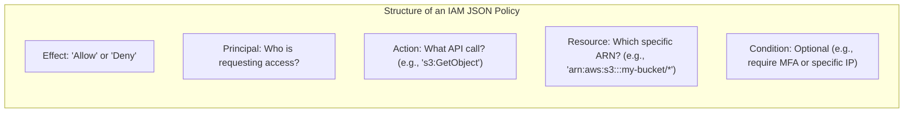

# AWS Identity & Access Management (IAM) & Directory Services

> **Service Category:** Security, Identity & Compliance (Domain 2.3)  
> **Relevant Certifications:** [[CLF-C02_Master_Blueprint|CLF-C02]], SAA-C03, DVA-C02, SOA-C02  
> **Tags:** `#aws/services` `#aws/security` `#aws/iam` `#clf-c02`

---

## 1. AWS IAM Core Concepts

**AWS Identity and Access Management (IAM)** is a web service that helps you securely control access to AWS resources. IAM is a **global service** (you do not select a region when configuring IAM).

```mermaid
graph TD
    IAM[AWS IAM Service (Global)]
    
    IAM --> Root["1. Root User\nComplete unrestricted admin access\nLock away after setup!"]
    IAM --> Users["2. IAM Users\nIndividual human identity\n(e.g., Alice, Bob)"]
    IAM --> Groups["3. User Groups\nCollection of users with shared permissions\n(e.g., Developers, Admins)"]
    IAM --> Roles["4. IAM Roles\nTemporary credentials (STS)\nFor EC2, Lambda, or cross-account access"]
    IAM --> Policies["5. IAM Policies\nJSON permission documents\n(Allow / Deny statements)"]
```

---

## 2. Root User vs. IAM Users vs. IAM Roles

| Identity Type | Long-Lived vs. Temporary | Best Practice / When to Use |
|---|---|---|
| **AWS Account Root User** | Long-Lived (Email + Password) | **DO NOT USE FOR DAILY TASKS!** Only use to create your first administrative IAM user, change account settings, close the account, or change support plans. **Must have Multi-Factor Authentication (MFA) enabled!** |
| **IAM User** | Long-Lived (Password for Console, Access Keys for CLI/SDK) | Individual employees within an organization. Best practice is to assign permissions via **User Groups**, not directly to individual users. |
| **IAM Role** | **Temporary Credentials (via AWS STS)** | Used by AWS services (e.g., EC2 instance needing to access S3), applications, or users needing temporary cross-account access. **Eliminates hardcoded access keys!** |

---

## 3. The Principle of Least Privilege & JSON Policies

* **Principle of Least Privilege:** Grant only the minimum permissions required to perform a specific job, and nothing more.



### Critical IAM Policy Evaluation Rules:
1. **Default Deny:** By default, all requests are denied.
2. **Explicit Allow:** An explicit Allow in any policy grants permission.
3. **Explicit Deny ALWAYS Trumps Allow:** If any policy contains an explicit `Deny`, the request is **DENIED**, even if ten other policies grant an explicit `Allow`!

---

## 4. Multi-Account Workforce: AWS IAM Identity Center

* **Formerly known as:** AWS Single Sign-On (AWS SSO).
* **What it is:** A centralized identity service that connects to your corporate Identity Provider (IdP) like Microsoft Entra ID (Azure AD), Okta, or Google Workspace.
* **Functionality:** Provides employees with a **single sign-on portal** to access multiple AWS accounts across an AWS Organization with predefined **Permission Sets**.

---

## 5. External Customers: Amazon Cognito

While IAM handles internal employees and AWS services, **Amazon Cognito** handles customer-facing mobile and web applications:

```mermaid
flowchart TD
    User[External Mobile / Web App User]
    
    subgraph Cognito ["Amazon Cognito Architecture"]
        UP["1. Cognito User Pools (CUP)\nAuthentication Directory\n(Sign-up, sign-in, MFA, Social Login via Google/Apple)"]
        IP["2. Cognito Identity Pools (Federated Identities)\nAuthorization Engine\n(Exchanges user token for temporary AWS STS credentials)"]
    end
    
    subgraph Backend ["AWS Backend Services"]
        S3["Amazon S3 User Folder"]
        DDB["Amazon DynamoDB Table"]
    end
    
    User -->|Sign in / Sign up| UP
    UP -->|JWT Token| IP
    IP -->|Temporary AWS Credentials (STS)| User
    User -->|Secure Direct Access| S3
    User -->|Secure Direct Access| DDB
```

---

## 6. Enterprise Microsoft AD: AWS Directory Service

Enables your AWS resources to connect to and use Microsoft Active Directory:
1. **AWS Managed Microsoft AD:** A real Microsoft Windows Server Active Directory hosted in the AWS Cloud. Supports Group Policies (GPOs), Kerberos, and trusts to on-premises AD domains.
2. **AD Connector:** A directory gateway / proxy to redirect directory requests directly to your existing on-premises Microsoft Active Directory without caching credentials in AWS.
3. *Simple AD:* (Lifecycle Update: AWS closed Simple AD to new customers as of mid-2026, transitioning customers to Managed Microsoft AD or AD Connector).

---

## 7. Credential Management: Secrets Manager vs. Parameter Store

| Feature | AWS Secrets Manager | Systems Manager Parameter Store |
|---|---|---|
| **Primary Use Case** | Managing database credentials, API keys, OAuth tokens. | Managing configuration parameters (URLs, license keys, strings). |
| **Automatic Rotation** | **YES (Built-in automated rotation via Lambda)** for RDS, Aurora, DocumentDB. | No native automated rotation (requires custom scripting). |
| **Cross-Account Secret Access**| Supported natively. | Limited. |
| **Cost** | Paid per secret per month + API requests. | Standard parameters are **FREE**; Advanced tiers have small fee. |

---

## 8. Exam Tip Matrix

| Question Scenario | Correct Choice |
|---|---|
| *"Give an EC2 instance permission to read and write files to an Amazon S3 bucket without storing access keys on the instance"* | **Attach an IAM Role to the EC2 instance (Instance Profile)** |
| *"Best practice for securing the AWS account root user"* | **Enable Multi-Factor Authentication (MFA) and do not use for everyday tasks** |
| *"Centrally manage single sign-on access across multiple AWS accounts for corporate employees"* | **AWS IAM Identity Center** |
| *"Customer-facing mobile application requiring social sign-in (Google, Facebook, Apple) and access to S3"* | **Amazon Cognito** |
| *"Store database passwords and automatically rotate them every 30 days without application downtime"* | **AWS Secrets Manager** |
| *"An IAM policy has an explicit Allow for S3, but another policy attached to the user has an explicit Deny"* | **Access is DENIED (Explicit Deny always overrides Allow)** |
