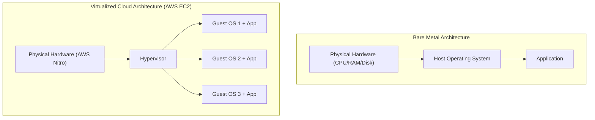

# 01. Operating Systems & Virtualization Prerequisite

## 1. Traditional Computing vs. Virtualization
Before cloud computing, applications ran directly on dedicated physical servers ("bare-metal"):
- **Underutilization:** Servers typically operated at 5% to 15% CPU utilization.
- **Slow Provisioning:** Procuring, racking, stacking, and cabling hardware took weeks to months.
- **Hardware Dependency:** Operating systems and apps were coupled directly to specific server chipsets.

## 2. Hypervisors & The Virtual Machine (VM)
A **Hypervisor** (Virtual Machine Monitor) is a layer of software, firmware, or hardware that creates and runs virtual machines by abstracting physical CPU, memory, and storage:
1. **Type-1 (Bare-Metal):** Runs directly on the host hardware (e.g., AWS Nitro System, VMware ESXi, Xen). High efficiency, low overhead.
2. **Type-2 (Hosted):** Runs on top of a host OS (e.g., VirtualBox). Higher overhead.

## 3. Virtual Machines vs. Containers (Docker)
- **Virtual Machine (EC2):** Virtualizes the **hardware**. Each VM includes a complete Guest OS (kernel, binaries, libraries). Isolation is strong, but boot time takes seconds to minutes and resource footprint is gigabytes.
- **Container (ECS / EKS / Fargate):** Virtualizes the **operating system kernel**. Containers share the underlying host OS kernel, packaging only application code and runtime dependencies. Boot time is sub-second, footprint is megabytes.

## 4. How AWS Implements This: The AWS Nitro System
Modern AWS EC2 instances use the **AWS Nitro System**:
- Offloads networking (ENA), storage (NVMe), and hypervisor management to dedicated hardware cards.
- Leaves nearly 100% of host CPU and memory available for customer instances.
- Guarantees complete hardware-enforced isolation between tenants.
