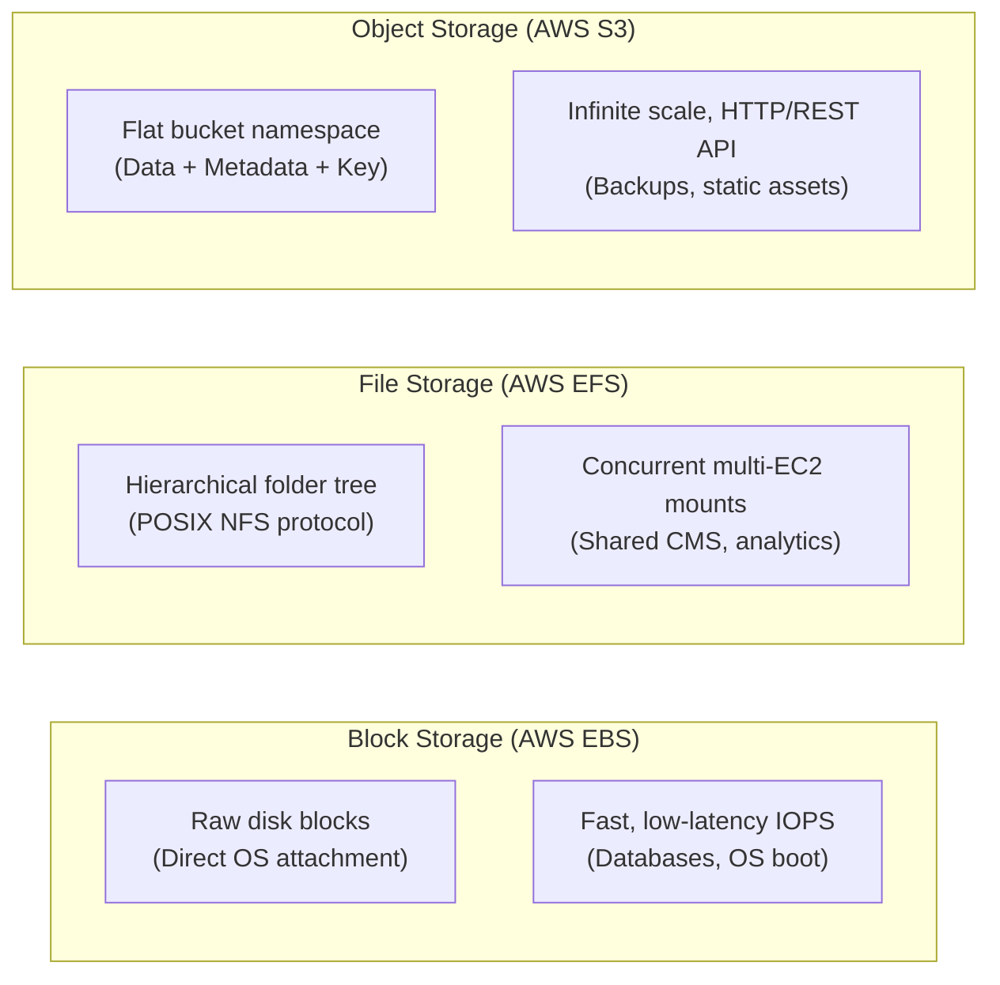

# 03. Storage Paradigms Prerequisite: Block, File, and Object

## 1. The Three Storage Paradigms

### A. Block Storage (Amazon EBS)
- Behaves like a virtual hard drive attached to a single physical computer.
- Reads and writes raw sectors/blocks directly with lowest latency.
- Bound to a **single Availability Zone**. If AZ-A fails, EBS volumes in AZ-A cannot attach to instances in AZ-B without restoring from a snapshot.

### B. File Storage (Amazon EFS)
- Implements standard network file protocols (**NFSv4**).
- Supports concurrent read/write from **hundreds of EC2 instances across multiple Availability Zones**.
- Automatically expands and shrinks on demand.

### C. Object Storage (Amazon S3)
- Stores data as distinct, immutable objects inside buckets.
- Each object contains the binary payload, metadata, and a globally unique Key (URI).
- Accessible over HTTPS via REST APIs (`GET`, `PUT`, `DELETE`).
- Offers $99.999999999\%$ (11 9s) data durability replicated automatically across at least 3 physical Availability Zones.
