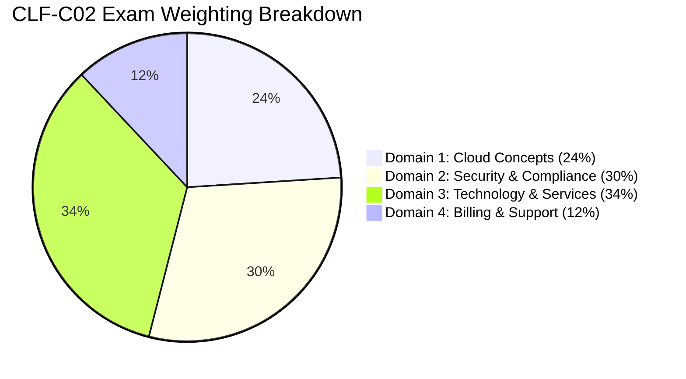
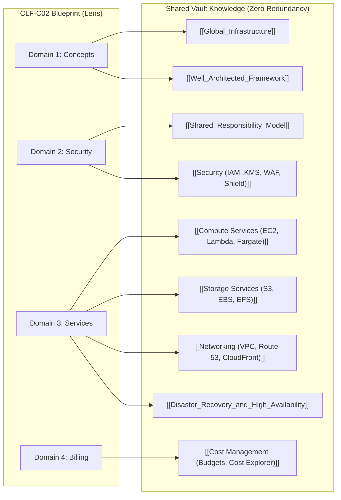

# AWS Certified Cloud Practitioner (CLF-C02) Master Blueprint

> **Exam Code:** CLF-C02  
> **Target Audience:** Overall foundational knowledge of AWS Cloud independent of specific job roles (0–6 months experience).  
> **Passing Score:** 700 / 1000 (Scaled score, compensatory scoring model)  
> **Questions:** 65 total (50 scored + 15 unscored evaluation questions)  
> **Time Limit:** 90 minutes  
> **Question Types:** Multiple choice (1 of 4) & Multiple response (2+ of 5+)

---

## 📊 Exam Domain Weighting

| Domain | Focus Area | Weighting | Target Question Count |
|:---|:---|:---:|:---:|
| [[Domain_1_Cloud_Concepts\|Domain 1]] | Cloud Concepts & Architecture Principles | **24%** | ~16 Questions |
| [[Domain_2_Security_Compliance\|Domain 2]] | Security, Identity, Governance & Compliance | **30%** | ~20 Questions |
| [[Domain_3_Cloud_Technology\|Domain 3]] | Cloud Technology, Services & Deployment | **34%** | ~22 Questions |
| [[Domain_4_Billing_Pricing\|Domain 4]] | Billing, Pricing Models, Support & Economics | **12%** | ~7 Questions |
| **Total** | | **100%** | **65 Questions** |

---

## 🧭 Zero-Redundancy Knowledge Navigation

This blueprint serves as your **Map of Content (MOC)**. All underlying technical concepts and services are maintained as atomic single-source-of-truth notes in the vault:

---

## 🎯 High-Yield Master Cheat Sheet & Trap Matrix

Before sitting the exam or teaching a review session, master the quick distinctions in [[Exam_Distinction_CheatSheet]]:
* **Edge vs Routing:** Amazon CloudFront (Content Caching) vs AWS Global Accelerator (Anycast IP Network Routing).
* **Cost Estimating vs Analysis:** AWS Pricing Calculator (*Before deployment / "What-if"*) vs AWS Cost Explorer (*After deployment / Historical trends*).
* **Identity Solutions:** IAM Users/Roles (Internal infra) vs Amazon Cognito (External end-users) vs IAM Identity Center (Multi-account workforce SSO).
* **Infrastructure Tiers:** Outposts (On-premises hardware) vs Local Zones (Single-digit ms latency to urban centers) vs Wavelength (5G telco edge).
