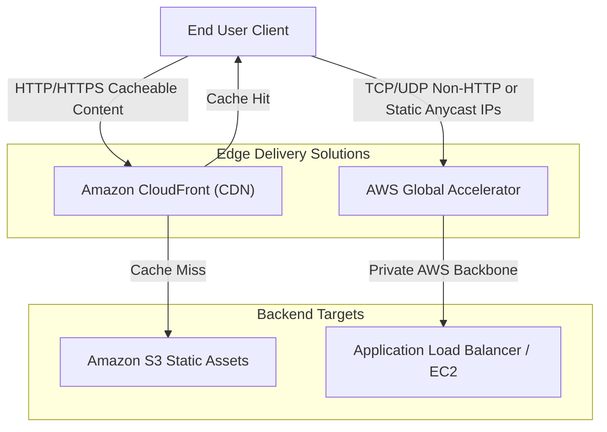
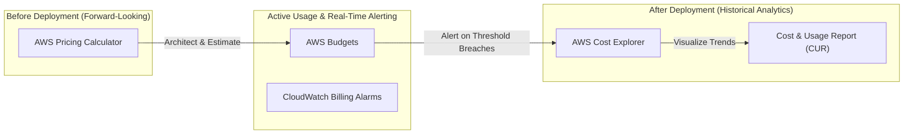
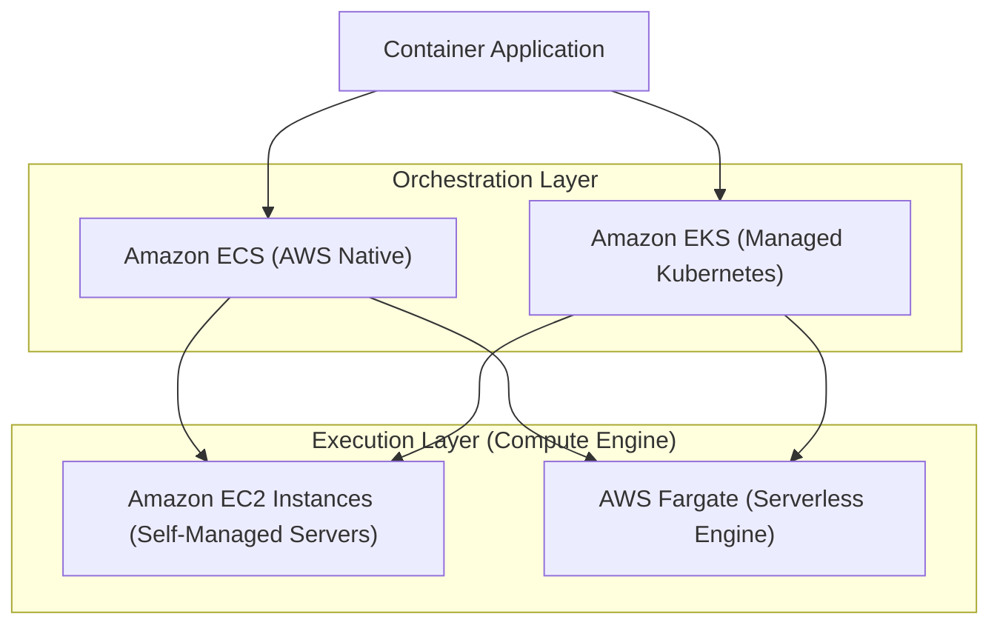
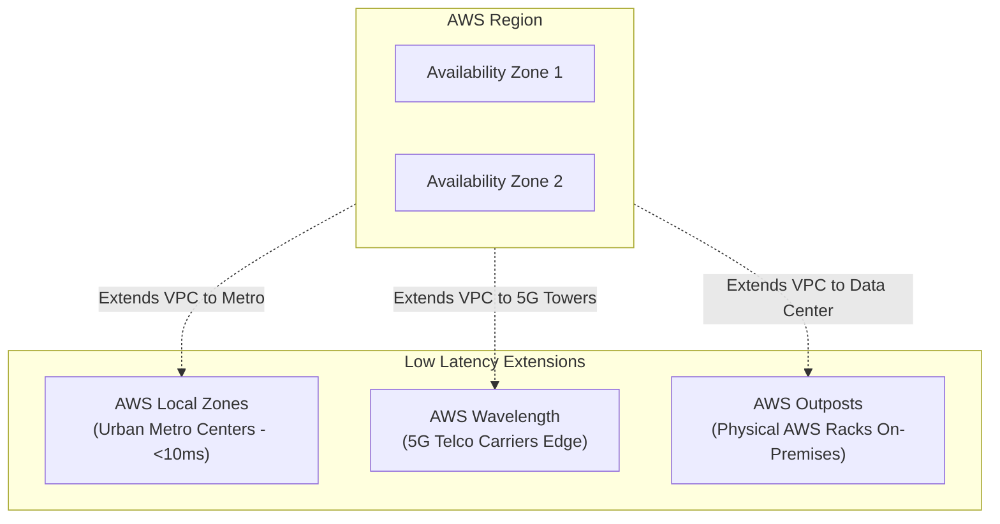

# CLF-C02 Exam Distinction Cheat Sheet (High-Yield "X vs Y")

> **Purpose:** Differentiates easily confused AWS services and concepts. Whenever you encounter a question that seems to have two correct answers, consult this distinction matrix.

---

## 1. Networking & Content Delivery Distinctions

| Service | Primary Mechanism | Best Used For | Key Exam Trigger Words |
|---|---|---|---|
| **Amazon CloudFront** | **Caching** at Edge Locations worldwide. | Caching video, static web pages, API responses (HTTP/HTTPS). | *"Cache content closer to users"*, *"Reduce load on origin S3 bucket"*, *"CDN"*. |
| **AWS Global Accelerator** | **Static Anycast IP addresses** routing traffic over AWS private global fiber network. | Non-HTTP/HTTPS protocols (gaming, VoIP, IoT, UDP), disaster recovery IP failover. | *"Two static anycast IPs"*, *"Non-HTTP protocol"*, *"Direct traffic over AWS global network"*, *"Instant IP failover"*. |
| **AWS Route 53** | Global DNS (Domain Name System) resolution and traffic routing. | Domain registration, DNS record management, health check routing policies (latency, weighted, failover). | *"DNS resolution"*, *"Domain registration"*, *"Health check failover routing"*. |
| **AWS Direct Connect (DX)** | Dedicated physical fiber link directly from on-premises to AWS. | Predictable high-speed bandwidth, bypasses the public internet completely. | *"Consistent, dedicated throughput"*, *"Bypass public internet"*, *"Private fiber line"*. |
| **AWS Site-to-Site VPN** | Encrypted IPsec tunnel over the public internet. | Rapid setup, low cost, encrypted transport over standard internet connection. | *"Encrypted tunnel over public internet"*, *"Quick hybrid setup"*. |

---

## 2. Cost Management & Billing Tool Distinctions

| Tool | Timing | Primary Purpose | Key Exam Trigger Words |
|---|---|---|---|
| **AWS Pricing Calculator** | **BEFORE** deployment | "What-if" cost modeling for planned architectures; no AWS account required. | *"Estimate costs before deploying"*, *"Plan architecture budget"*, *"Web-based estimation"*. |
| **AWS Budgets** | **DURING** deployment (Proactive) | Set custom cost/usage limits; send automated alerts (email/SNS) when forecasted or actual spend breaches thresholds. | *"Alert when spending exceeds threshold"*, *"Track Savings Plans / RI utilization"*, *"Proactive notifications"*. |
| **AWS Cost Explorer** | **AFTER** deployment (Historical) | Visual, interactive tool to analyze past 12+ months and forecast spending 12 months ahead. | *"Visualize historical cost trends"*, *"Identify spending patterns"*, *"Forecast future spend based on past usage"*. |
| **Cost & Usage Report (CUR)** | **AFTER** deployment (Raw Data) | The most granular metadata file exported to Amazon S3 (hourly/daily per resource). | *"Most detailed breakdown"*, *"Export metadata to S3 for Athena analysis"*, *"Raw CSV/Parquet reports"*. |

---

## 3. Identity, Directory & Access Distinctions

| Service | Scope & Target User | Key Functionality | Key Exam Trigger Words |
|---|---|---|---|
| **AWS IAM** | Internal AWS administrators, developers, and services. | Users, User Groups, Policies, and Roles for managing AWS resources. | *"Least privilege"*, *"Temporary credentials via Roles"*, *"MFA on root account"*. |
| **AWS IAM Identity Center** *(formerly AWS SSO)* | Multi-account enterprise workforce. | Central portal login, federation with Okta/Azure AD, permission sets across AWS Organizations. | *"Single sign-on across multiple AWS accounts"*, *"Workforce portal"*, *"Integrate with corporate IdP"*. |
| **Amazon Cognito** | External application end-users (Mobile & Web apps). | User Pools (Sign-up, sign-in, MFA for users) & Identity Pools (exchange login tokens for temporary AWS STS credentials). | *"Customer-facing app authentication"*, *"Social login (Google, Facebook, Apple)"*, *"Guest/federated access to S3/DynamoDB"*. |
| **AWS Directory Service** | Microsoft Windows Active Directory integration. | AWS Managed Microsoft AD (real Windows AD), AD Connector (proxy to on-prem AD). *(Note: Simple AD closed to new customers in 2026)*. | *"Join EC2 to Active Directory"*, *"Group Policies (GPOs)"*, *"Connect to on-premises Microsoft AD"*. |

---

## 4. Compute & Container Distinctions

| Service | Abstraction Level | Management Overhead | Key Exam Trigger Words |
|---|---|---|---|
| **Amazon EC2** | Infrastructure as a Service (IaaS) | Full OS control, patching, configuration, kernel choice. | *"Full OS access"*, *"Custom kernel or legacy software"*, *"Specific instance type requirements"*. |
| **AWS Fargate** | Serverless compute engine for containers | No server provisioning, patching, or scaling of underlying EC2 hosts. Works with ECS and EKS. | *"Run containers without managing servers"*, *"Serverless container execution"*. |
| **Amazon ECS** | AWS-native container orchestrator | Simple, deeply integrated with AWS IAM, CloudWatch, ALB. | *"AWS-native container management"*, *"Simpler Docker orchestration"*. |
| **Amazon EKS** | Managed Kubernetes orchestrator | Open-source Kubernetes compatibility, multi-cloud container portability. | *"Kubernetes compatibility"*, *"Portability across cloud and on-prem"*. |
| **AWS Lambda** | Event-driven serverless code execution | Runs code up to 15 minutes per invocation in response to events; pay-per-millisecond. | *"Event-driven execution"*, *"No servers to manage"*, *"Short-lived background tasks"*, *"Microservices"*. |
| **AWS Elastic Beanstalk** | Platform as a Service (PaaS) | Developer uploads code; AWS provisions EC2, ASG, ELB, and RDS automatically. | *"Quickly deploy web apps without configuring infrastructure"*, *"PaaS"*. |

---

## 5. Global Infrastructure Tiers: Edge vs. Outposts vs. Local Zones

| Deployment Model | Physical Location | Primary Latency / Use Case | Key Exam Trigger Words |
|---|---|---|---|
| **Availability Zone (AZ)** | Within an AWS Region (isolated data centers). | Standard cloud deployment; redundant power/networking (<1–2 ms latency between AZs). | *"High availability within a Region"*, *"Fault isolation"*. |
| **AWS Local Zones** | Major urban metropolitan centers (e.g., Los Angeles, Chicago). | Single-digit millisecond latency for video rendering, gaming, CAD, local financial apps. | *"Single-digit millisecond latency to local urban users"*, *"Extend VPC closer to a city"*. |
| **AWS Wavelength** | 5G telecommunication carrier data centers. | Ultra-low latency for mobile 5G devices, connected vehicles, live AR/VR streaming. | *"5G network edge"*, *"Ultra-low mobile latency"*, *"Telecommunications carrier integration"*. |
| **AWS Outposts** | Customer's on-premises physical data center. | Runs AWS compute, storage, and database services on physical AWS hardware inside customer racks. | *"Run AWS services on-premises"*, *"Strict data residency in customer facility"*, *"AWS hardware in on-prem data center"*. |
