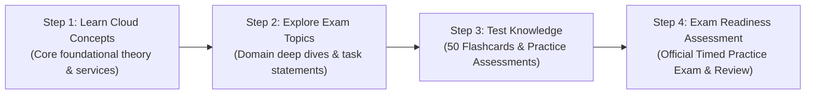

# AWS Official SkillBuilder Exam Prep Framework & Delivery Roadmap

> **Course:** AWS Certified Cloud Practitioner (CLF-C02)  
> **Source:** AWS SkillBuilder Learning Plan (`8UUCEZGNX4`) & Official Blueprint  
> **Role:** Structured student roadmap, milestone tracking, and lecture delivery timeline.

---

## 🧭 The Official 4-Step Exam Preparation Plan

AWS SkillBuilder organizes candidates' journey from zero knowledge to exam success into **4 progressive steps**:

---

## 📅 4-Week Student Milestone Schedule

| Week / Stage | Target Focus | Covered Domains | Recommended Student Labs | Target Exit Criteria |
|:---:|:---|:---:|:---|:---|
| **Week 1** | **Cloud Concepts & Global Infrastructure** | Domain 1 (24%) | Lab 01 (VPC Setup) Lab 02 (EC2 Web Server) | Score 85%+ on Domain 1 Quiz; explain 6 advantages of AWS Cloud. |
| **Week 2** | **Security, Governance & Compliance** | Domain 2 (30%) | Lab 03 (IAM & MFA) Lab 04 (S3 Security & Encryption) | Master Shared Responsibility matrix; distinguish IAM, KMS, WAF, GuardDuty. |
| **Week 3** | **Cloud Technology, Databases & Networking** | Domain 3 (34%) | Lab 05 (RDS & Multi-AZ) Lab 06 (ALB & Auto Scaling) | Differentiate RDS vs DynamoDB vs Aurora; understand Transit Gateway and Direct Connect. |
| **Week 4** | **Economics, Billing, Support & Final Polish** | Domain 4 (12%) | Lab 07 (AWS Budgets & Alarms) Lab 08 (CloudWatch Monitoring) | Master the 4 Support Plans, Cost Explorer vs Budgets, pass full mock exams. |

---

## 📇 Official 50 High-Yield Flashcard Topics

Students should review these 50 flashcard topics to guarantee instant recall during the timed exam:

### Group A: Cloud Concepts & Architecture (1–12)
1. Definition of Cloud Computing & 6 Advantages
2. CapEx vs. OpEx & Pay-As-You-Go
3. Economies of Scale & Virtuous Cycle
4. AWS Global Infrastructure: Regions vs. Availability Zones vs. Edge Locations
5. AWS Local Zones vs. AWS Wavelength vs. AWS Outposts
6. High Availability vs. Fault Tolerance vs. Scalability vs. Elasticity
7. AWS Well-Architected Framework: 6 Pillars
8. General Design Principles of the Well-Architected Framework
9. AWS Well-Architected Tool & Risk Reports (HRIs/MRIs)
10. AWS Cloud Adoption Framework (CAF 3.0): 6 Perspectives
11. The 7 Rs of Cloud Migration (Rehost, Replatform, Refactor, Repurchase, Retain, Retire, Relocate)
12. Disaster Recovery Strategies: Backup & Restore vs. Pilot Light vs. Warm Standby vs. Multi-Region Active-Active

### Group B: Security, Identity & Governance (13–26)
13. Shared Responsibility Model: Customer vs. AWS
14. Responsibility Shift: IaaS (EC2) vs. PaaS (RDS) vs. Serverless (Lambda)
15. AWS IAM: Users vs. Groups vs. Roles vs. Policies
16. Least Privilege Principle & Multi-Factor Authentication (MFA)
17. AWS IAM Identity Center (AWS SSO)
18. AWS Organizations & Service Control Policies (SCPs)
19. Consolidated Billing & Volume Discounts
20. AWS KMS (Key Management Service) vs. AWS CloudHSM
21. AWS Secrets Manager vs. Systems Manager Parameter Store
22. AWS Shield (Standard vs. Advanced) & DDoS Mitigation
23. AWS WAF (Web Application Firewall - Layer 7)
24. Amazon GuardDuty (Intelligent threat detection from logs)
25. Amazon Inspector (Vulnerability scanning of EC2/ECR/Lambda)
26. Amazon Macie (PII discovery in S3 using ML) & AWS Artifact

### Group C: Technology & Core Services (27–42)
27. Amazon EC2 Instance Types & Purchasing Options (On-Demand, Spot, Reserved, Savings Plans)
28. Amazon EC2 Auto Scaling & Elastic Load Balancing (ALB vs. NLB vs. CLB vs. GLB)
29. AWS Lambda (Serverless execution limits: 15 min, 10 GB RAM)
30. Containers: Amazon ECS vs. Amazon EKS vs. AWS Fargate vs. Amazon ECR
31. Storage: Amazon S3 vs. Amazon EBS vs. Amazon EFS
32. S3 Storage Classes: Standard, Intelligent-Tiering, Standard-IA, One Zone-IA, Glacier, Deep Archive
33. AWS Storage Gateway (Volume, File, Tape) & AWS DataSync
34. AWS Snow Family: Snowcone vs. Snowball Edge vs. Snowmobile
35. Amazon RDS vs. Amazon Aurora (6 copies across 3 AZs)
36. Amazon DynamoDB (Serverless NoSQL key-value store)
37. In-Memory Caching: Amazon ElastiCache (Redis/Memcached) vs. Amazon MemoryDB
38. Amazon VPC, Subnets (Public vs. Private), Route Tables, Internet Gateway & NAT Gateway
39. VPC Endpoints: Gateway (S3/DynamoDB) vs. Interface (PrivateLink)
40. Amazon Route 53 (Routing policies: Simple, Weighted, Latency, Failover, Geolocation)
41. Amazon CloudFront (CDN caching) vs. AWS Global Accelerator (Anycast IP network routing)
42. AWS Direct Connect vs. AWS Site-to-Site VPN vs. AWS Transit Gateway

### Group D: Monitoring, Analytics, Management & Billing (43–50)
43. Monitoring Trio: CloudWatch (Metrics/Alarms/Logs) vs. CloudTrail (API Auditing) vs. AWS Config (Compliance rules)
44. AWS Trusted Advisor (5 pillars) vs. AWS Health Dashboard (Global vs. Account)
45. AWS Systems Manager (Run Command, Patch Manager, Session Manager)
46. Application Integration: Amazon SQS (Queue) vs. Amazon SNS (Push) vs. Amazon EventBridge (Event Bus)
47. AWS Pricing Calculator (Estimates before deployment) vs. AWS Cost Explorer (Analysis after deployment)
48. AWS Budgets (Custom alerts for cost/usage/reservations)
49. AWS Cost and Usage Reports (CUR - most granular raw data in S3)
50. The 4 AWS Support Plans: Basic, Developer, Business, Enterprise (Response times & TAM)
