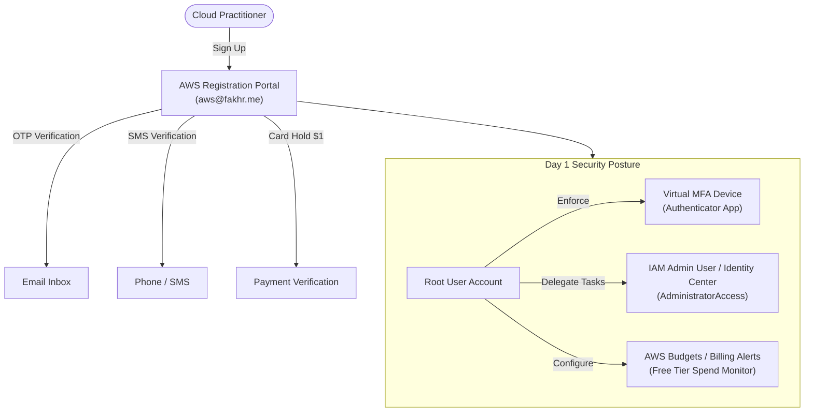

# Tutorial 00: AWS Account Creation & Security Baseline

This tutorial walks through the foundational process of creating a new AWS Free Tier account, securing the root user with Multi-Factor Authentication (MFA), and creating an administrative identity for day-to-day operations.

---

## 📌 Associated Notes & Blueprints
- [[Shared_Responsibility_Model]]
- [[AWS_IAM]]
- [[Cloud_Economics_and_Billing_Models]]
- [[CLF-C02_Master_Blueprint]]

---

## 🏗️ Architecture Overview



---

## 🚀 Execution Steps

### Step 1: Account Creation Walkthrough
Follow the complete registration walkthrough documented in the work repository:
👉 `work/labs/00_Account_Creation_Walkthrough.md`

### Step 2: Essential Day-1 Security Configurations

#### 1. Enable Root Multi-Factor Authentication (MFA)
Under the AWS Shared Responsibility Model, customer security starts with locking down the root credentials:
1. Navigate to the **IAM Console**.
2. Click **Security Credentials** on the top right account dropdown.
3. In the **Multi-factor authentication (MFA)** section, click **Assign MFA**.
4. Select **Authenticator app** and scan the QR code using Google Authenticator or 1Password.
5. Enter two consecutive 6-digit MFA codes and click **Add MFA**.

#### 2. Configure AWS Free Tier Spend Alerts
1. Open the **Billing and Cost Management Console**.
2. Under **Preferences**, select **Billing Preferences**.
3. Enable:
   - **Receive Free Tier Usage Alerts**
   - **Receive Billing Alerts**
4. Set email to receive alerts: `aws@fakhr.me`.

---

## 💻 CLI Verification Commands

Once your credentials are authenticated with your profile (`aws-notes`):

```bash
# Verify caller identity and account number
aws sts get-caller-identity --profile aws-notes

# Verify default region assignment
aws configure get region --profile aws-notes

# Confirm CloudWatch alarms or billing metric accessibility
aws cloudwatch list-metrics --namespace "AWS/Billing" --region us-east-1 --profile aws-notes
```
