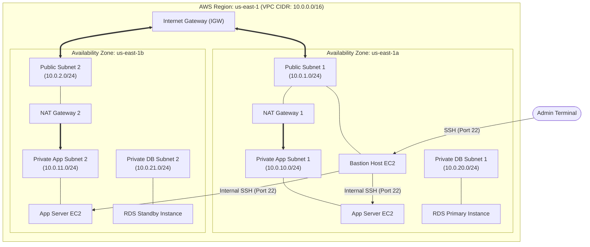

# Tutorial 01: Multi-Tier VPC Network Architecture & Bastion Host

> **Vault Section:** `04_Tutorials/`  
> **Topic:** Networking & Infrastructure Isolation  
> **Source Reference:** Rajesh Daswani (*Packt, 2026*), Project Tasks 7.1–7.3; Tom Taulli (*O'Reilly, 2026*), Ch 12.  
> **Associated Certifications:** [[CLF-C02_Master_Blueprint|CLF-C02]], SAA-C03

---

## 1. Architectural Blueprint & Scenario

In this tutorial, you build a production-grade, multi-tier Amazon VPC designed for high availability and zero-trust perimeter isolation across two Availability Zones (`us-east-1a` and `us-east-1b`).



---

## 2. Step-by-Step Implementation Guide

### Step 1: Create the Amazon VPC
1. Open the Amazon VPC Console.
2. Select **Create VPC** -> **VPC only**.
3. Configure settings:
   - **Name tag:** `Production-VPC`
   - **IPv4 CIDR block:** `10.0.0.0/16` (provides 65,536 private IP addresses)
   - **Tenancy:** Default
4. Choose **Create VPC**.
5. Under **Actions**, select **Edit VPC settings**, enable **Enable DNS hostnames**, and save changes.

### Step 2: Provision Subnets Across Availability Zones
Create 6 distinct subnets:

| Subnet Name | Availability Zone | IPv4 CIDR Block | Role |
| :--- | :--- | :--- | :--- |
| `Public-Subnet-1a` | `us-east-1a` | `10.0.1.0/24` | Public Ingress / ALBs / NAT Gateway 1 / Bastion |
| `Public-Subnet-1b` | `us-east-1b` | `10.0.2.0/24` | Public Ingress / ALBs / NAT Gateway 2 |
| `Private-App-1a` | `us-east-1a` | `10.0.10.0/24` | Application Backend Fleet (EC2 / Containers) |
| `Private-App-1b` | `us-east-1b` | `10.0.11.0/24` | Application Backend Fleet (EC2 / Containers) |
| `Private-DB-1a` | `us-east-1a` | `10.0.20.0/24` | Database Subnet Group (RDS / Aurora Primary) |
| `Private-DB-1b` | `us-east-1b` | `10.0.21.0/24` | Database Subnet Group (RDS / Aurora Standby) |

*(Note: In each `/24` subnet, AWS reserves 5 IP addresses: `.0` Network, `.1` VPC router, `.2` DNS server, `.3` Future use, `.255` Broadcast. Net usable IPs = 251).*

### Step 3: Attach Internet Gateway & Configure Public Route Table
1. Under **Internet Gateways**, choose **Create internet gateway** (`Prod-IGW`).
2. Attach `Prod-IGW` to `Production-VPC`.
3. Create Route Table `Public-RT`:
   - Add Route: Destination `0.0.0.0/0` -> Target `Prod-IGW`.
   - Associate with `Public-Subnet-1a` and `Public-Subnet-1b`.

### Step 4: Deploy NAT Gateways for Private Egress
1. Navigate to **NAT Gateways** -> **Create NAT gateway**.
2. Name: `NAT-GW-1a`. Subnet: `Public-Subnet-1a`. Allocate an **Elastic IP**.
3. Create Route Table `Private-RT-1a`:
   - Add Route: Destination `0.0.0.0/0` -> Target `NAT-GW-1a`.
   - Associate with `Private-App-1a`.
4. *(Repeat for AZ 1b for full Multi-AZ egress redundancy).*

### Step 5: Configure Layered Security Groups
1. **Bastion-SG:**
   - Inbound: SSH (Port 22) -> Source: `YOUR_OFFICE_PUBLIC_IP/32` (Never `0.0.0.0/0`).
   - Outbound: All traffic.
2. **App-SG:**
   - Inbound: SSH (Port 22) -> Source: `Bastion-SG` (Security Group reference!).
   - Inbound: HTTP (Port 80) -> Source: `ALB-SG`.
   - Outbound: All traffic (reaches internet via NAT Gateway).
3. **Database-SG:**
   - Inbound: MySQL (Port 3306) or PostgreSQL (Port 5432) -> Source: `App-SG`.
   - Outbound: None.

### Step 6: Launch and Test Bastion Connectivity
1. Launch an Amazon Linux 2023 EC2 instance in `Public-Subnet-1a` attached to `Bastion-SG` and assign a public IP.
2. Launch a private backend EC2 instance in `Private-App-1a` attached to `App-SG` with **no public IP**.
3. From your local terminal:
   ```bash
   # Connect to the private instance using SSH Agent Forwarding through the Bastion
   ssh -A -i my-key.pem ec2-user@<BASTION_PUBLIC_IP>
   
   # From Bastion terminal, connect to the private backend IP
   ssh ec2-user@10.0.10.X
   
   # Test outbound internet connectivity from the private instance via NAT Gateway
   curl -I https://aws.amazon.com
   ```

---

## 3. Key Takeaways & Exam Distinctions
- **NAT Gateways MUST reside in a Public Subnet** and require an **Elastic IP address**.
- **Private instances communicate with NAT Gateways via private RFC 1918 IPs.** The NAT Gateway translates this to its public Elastic IP before forwarding packets to the Internet Gateway.
- **Security Group Chaining:** By referencing `Bastion-SG` as the source in `App-SG`, access is restricted to authenticated bastion traffic regardless of whether instances are replaced or scale out.
