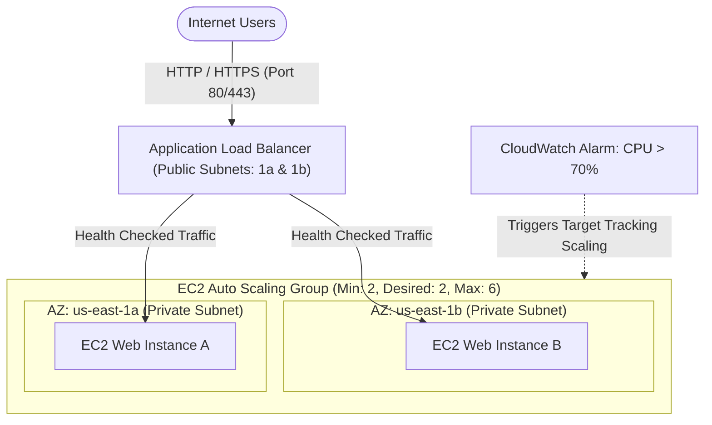

# Tutorial 02: Highly Available Auto Scaling Web Tier with Application Load Balancer

> **Vault Section:** `04_Tutorials/`  
> **Topic:** Elasticity & High Availability  
> **Source Reference:** Rajesh Daswani (*Packt, 2026*), Project Tasks 10.1–10.4; Tom Taulli (*O'Reilly, 2026*), Ch 9.  
> **Associated Certifications:** [[CLF-C02_Master_Blueprint|CLF-C02]], SAA-C03

---

## 1. Architectural Blueprint & Scenario

In this tutorial, you deploy a fault-tolerant web application tier that automatically scales up during traffic surges and contracts during idle periods across two Availability Zones, fronted by an Application Load Balancer (ALB).



---

## 2. Step-by-Step Implementation Guide

### Step 1: Create an EC2 Launch Template
1. Open the Amazon EC2 Console -> **Launch Templates** -> **Create launch template**.
2. **Template name:** `WebTier-LaunchTemplate`.
3. **AMI:** Amazon Linux 2023 AMI.
4. **Instance type:** `t3.micro` (Free-Tier eligible).
5. **Key pair:** Optional (or select your management key pair).
6. **Network settings:**
   - Security Group: `Web-Instance-SG` (Allows inbound HTTP port 80 only from `ALB-SG`).
7. **Advanced Details -> User Data Script:**
   ```bash
   #!/bin/bash
   dnf update -y
   dnf install -y httpd
   systemctl start httpd
   systemctl enable httpd
   
   # Extract instance metadata to display dynamic Availability Zone on web page
   TOKEN=`curl -s -X PUT "http://169.254.169.254/latest/api/token" -H "X-aws-ec2-metadata-token-ttl-seconds: 21600"`
   AZ=`curl -s -H "X-aws-ec2-metadata-token: $TOKEN" http://169.254.169.254/latest/meta-data/placement/availability-zone`
   INSTANCE_ID=`curl -s -H "X-aws-ec2-metadata-token: $TOKEN" http://169.254.169.254/latest/meta-data/instance-id`
   
   echo "<h1>Hello from AWS High-Availability Web Tier</h1>" > /var/www/html/index.html
   echo "<p>Serving from <b>Availability Zone:</b> $AZ</p>" >> /var/www/html/index.html
   echo "<p>Instance ID: $INSTANCE_ID</p>" >> /var/www/html/index.html
   ```
8. Choose **Create launch template**.

### Step 2: Create ALB Target Group & Health Check
1. Under **Target Groups**, choose **Create target group**.
2. Target type: **Instances**.
3. Name: `WebTier-TargetGroup`. Protocol: **HTTP**, Port: **80**, VPC: `Production-VPC`.
4. Health check settings:
   - Protocol: `HTTP`, Path: `/index.html`
   - Healthy threshold: `3`, Unhealthy threshold: `2`, Timeout: `5s`, Interval: `15s`.
5. Select **Create target group** (instances will be registered dynamically by the Auto Scaling Group).

### Step 3: Provision the Application Load Balancer
1. Navigate to **Load Balancers** -> **Create load balancer** -> **Application Load Balancer**.
2. Name: `WebTier-ALB`. Scheme: **Internet-facing**. IP address type: IPv4.
3. Network mapping: Select `Production-VPC` and both public subnets (`Public-Subnet-1a` and `Public-Subnet-1b`).
4. Security Group: Select `ALB-SG` (Allows inbound HTTP 80 and HTTPS 443 from `0.0.0.0/0`).
5. Listeners and routing:
   - Protocol: `HTTP`, Port: `80` -> Default action: Forward to `WebTier-TargetGroup`.
6. Choose **Create load balancer**.

### Step 4: Configure the EC2 Auto Scaling Group (ASG)
1. Navigate to **Auto Scaling Groups** -> **Create Auto Scaling group**.
2. Name: `WebTier-ASG`. Select `WebTier-LaunchTemplate`.
3. Network: Select `Production-VPC` and the **Private App Subnets** (`Private-App-1a` and `Private-App-1b`).
4. Load balancing: Attach to an existing load balancer -> Select `WebTier-TargetGroup`.
5. Health checks: Enable **ELB Health Checks** (ensures ASG replaces instances that fail ALB HTTP checks, not just EC2 hypervisor crashes).
6. Group size:
   - Desired capacity: `2`
   - Minimum capacity: `2`
   - Maximum capacity: `6`
7. Scaling policies: Choose **Target Tracking Scaling Policy**:
   - Metric type: **Average CPU utilization**
   - Target value: `70%`
8. Review and choose **Create Auto Scaling group**.

### Step 5: Verification & Load Testing
1. Wait 2 minutes for instances to initialize. In the Target Group console, verify that both EC2 instances show a health status of **Healthy**.
2. Copy the **DNS Name** of the ALB (`WebTier-ALB-xxx.us-east-1.elb.amazonaws.com`) into your browser.
3. Refresh the page multiple times. Observe that the reported **Availability Zone** alternates between `us-east-1a` and `us-east-1b`, proving active load balancing.
4. Simulate instance failure: Manually terminate one EC2 instance in the console. Observe that the ALB immediately routes 100% of traffic to the remaining healthy instance, while the Auto Scaling Group automatically launches a replacement instance to maintain the desired capacity of 2.

---

## 3. Key Takeaways & Exam Distinctions
- **Application Load Balancers require at least two subnets in different Availability Zones** to be provisioned.
- **ELB vs. EC2 Health Checks:** EC2 health checks only detect hardware or hypervisor faults. Enabling **ELB health checks** on an Auto Scaling Group ensures that if the Apache web server process crashes or returns HTTP 500 errors, the ASG terminates and replaces the instance.
