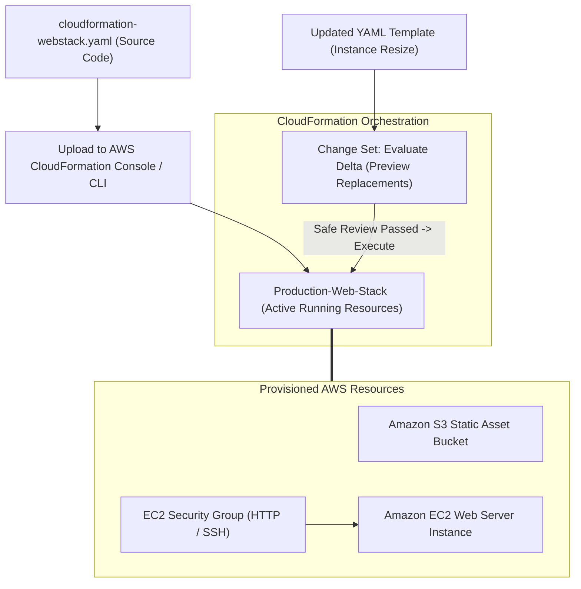

# Tutorial 05: Infrastructure as Code (IaC) with AWS CloudFormation & Change Sets

> **Vault Section:** `04_Tutorials/`  
> **Topic:** Automation & Infrastructure as Code  
> **Source Reference:** Rajesh Daswani (*Packt, 2026*), Project Tasks 15.1–15.4; Tom Taulli (*O'Reilly, 2026*), Ch 14.  
> **Associated Certifications:** [[CLF-C02_Master_Blueprint|CLF-C02]], SAA-C03

---

## 1. Architectural Blueprint & Scenario

In this tutorial, you define and provision a reproducible, version-controlled cloud infrastructure stack using **AWS CloudFormation**. You will author a parameterized YAML template that deploys an Amazon S3 storage bucket and an Amazon EC2 web server inside an isolated security group, and safely evaluate modifications using **CloudFormation Change Sets**.



---

## 2. Step-by-Step Implementation Guide

### Step 1: Author the CloudFormation Template (`webstack.yaml`)
Save the following configuration as `webstack.yaml`:

```yaml
AWSTemplateFormatVersion: '2010-09-09'
Description: 'Production Infrastructure as Code: S3 Asset Bucket and EC2 Web Server'

Parameters:
  EnvironmentName:
    Description: 'Target environment prefix (e.g. dev, staging, prod)'
    Type: String
    Default: 'prod'
    AllowedValues:
      - 'dev'
      - 'staging'
      - 'prod'

  InstanceTypeParameter:
    Description: 'EC2 Instance Type'
    Type: String
    Default: 't3.micro'
    AllowedValues:
      - 't3.micro'
      - 't3.small'
      - 't3.medium'

  LatestAmiId:
    Description: 'Latest Amazon Linux 2023 AMI ID retrieved dynamically via SSM'
    Type: 'AWS::SSM::Parameter::Value<AWS::EC2::Image::Id>'
    Default: '/aws/service/ami-amazon-linux-latest/al2023-ami-kernel-default-x86_64'

Resources:
  # Resource 1: Encrypted Amazon S3 Bucket
  AppAssetBucket:
    Type: 'AWS::S3::Bucket'
    Properties:
      BucketName: !Sub '${EnvironmentName}-app-assets-${AWS::AccountId}-${AWS::Region}'
      BucketEncryption:
        ServerSideEncryptionConfiguration:
          - ServerSideEncryptionByDefault:
              SSEAlgorithm: 'AES256'
      PublicAccessBlockConfiguration:
        BlockPublicAcls: true
        BlockPublicPolicy: true
        IgnorePublicAcls: true
        RestrictPublicBuckets: true
      VersioningConfiguration:
        Status: 'Enabled'

  # Resource 2: Dedicated EC2 Security Group
  WebServerSecurityGroup:
    Type: 'AWS::EC2::SecurityGroup'
    Properties:
      GroupDescription: 'Allow inbound HTTP and restricted SSH access'
      SecurityGroupIngress:
        - IpProtocol: 'tcp'
          FromPort: 80
          ToPort: 80
          CidrIp: '0.0.0.0/0'
          Description: 'Allow public HTTP traffic'
      SecurityGroupEgress:
        - IpProtocol: '-1'
          CidrIp: '0.0.0.0/0'
          Description: 'Allow all outbound traffic'

  # Resource 3: Amazon EC2 Web Instance
  WebServerInstance:
    Type: 'AWS::EC2::Instance'
    Properties:
      InstanceType: !Ref InstanceTypeParameter
      ImageId: !Ref LatestAmiId
      SecurityGroupIds:
        - !GetAtt WebServerSecurityGroup.GroupId
      UserData:
        Fn::Base64: !Sub |
          #!/bin/bash
          dnf update -y
          dnf install -y httpd
          systemctl start httpd
          systemctl enable httpd
          echo "<h1>Provisioned via AWS CloudFormation Stack: ${EnvironmentName}</h1>" > /var/www/html/index.html
          echo "<p>Asset Bucket: ${AppAssetBucket}</p>" >> /var/www/html/index.html
      Tags:
        - Key: 'Name'
          Value: !Sub '${EnvironmentName}-web-server'
        - Key: 'ManagedBy'
          Value: 'CloudFormation'

Outputs:
  WebServerPublicIP:
    Description: 'Public IP address of the provisioned web server'
    Value: !GetAtt WebServerInstance.PublicIp
  WebServerPublicDNS:
    Description: 'Public DNS URL to access the web server'
    Value: !Sub 'http://${WebServerInstance.PublicDnsName}'
  AssetBucketArn:
    Description: 'ARN of the provisioned S3 asset bucket'
    Value: !GetAtt AppAssetBucket.Arn
    Export:
      Name: !Sub '${EnvironmentName}-AssetBucketArn'
```

### Step 2: Deploy the Stack via AWS Management Console
1. Open the **AWS CloudFormation** Console -> **Create stack** -> **With new resources (standard)**.
2. Specify template: Select **Upload a template file** and upload `webstack.yaml`.
3. Specify stack details:
   - **Stack name:** `Production-Web-Stack`.
   - **EnvironmentName:** `prod`.
   - **InstanceTypeParameter:** `t3.micro`.
4. Configure stack options: Leave defaults and choose **Submit**.
5. Monitor Stack Events:
   - Observe the `Events` tab. CloudFormation initiates resource creation in order of mathematical dependency (Security Group first, followed by EC2 Instance and S3 Bucket).
   - Once the stack status reaches `CREATE_COMPLETE`, switch to the **Outputs** tab.
   - Click the `WebServerPublicDNS` link to verify your running web server!

### Step 3: Perform Safe Updates Using CloudFormation Change Sets
Imagine business requirements mandate upgrading the EC2 instance type from `t3.micro` to `t3.small` and adding SSH port 22 access:
1. Modify `webstack.yaml` locally:
   - Change `InstanceTypeParameter` default to `t3.small`.
2. In the CloudFormation Console, select `Production-Web-Stack` -> **Stack actions** -> **Create change set for current stack**.
3. Upload the modified template.
4. Name the Change Set: `UpgradeInstanceTypeToSmall`.
5. Under **Changes**, inspect the preview:
   - CloudFormation indicates that `WebServerInstance` will be **Modified** with `Replacement: True` or `False` depending on AWS API capability.
   - If `Replacement: True`, CloudFormation alerts you that the existing instance will be terminated and replaced with a new instance, resulting in a new IP address!
6. Once validated, choose **Execute change set** to apply updates safely.

### Step 4: Clean Up & Atomic Teardown
1. Select `Production-Web-Stack` -> **Delete**.
2. CloudFormation automatically tears down the EC2 instance, security group, and outputs in reverse dependency order, ensuring zero orphaned or lingering resources.
3. *(Note: S3 buckets containing objects will prevent stack deletion until emptied, preventing accidental data loss).*

---

## 3. Key Takeaways & Exam Distinctions
- **Intrinsic Functions:**
  - `!Ref`: References a parameter or the primary physical ID of a resource.
  - `!GetAtt`: Retrieves an attribute of a resource (such as `PublicIp`, `Arn`, or `GroupId`).
  - `!Sub`: Performs string substitution using variables (`${EnvironmentName}`).
- **Change Sets prevent unintended outages:** Always review a Change Set before executing an update on production infrastructure.
- **Drift Detection:** Identifies if an engineer made out-of-band manual changes directly in the console, violating IaC governance.
