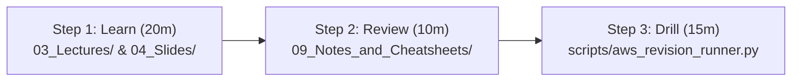
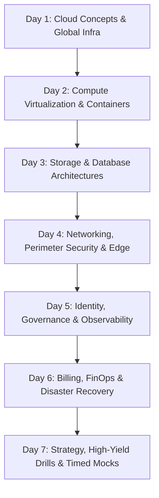

# 🚀 AWS Certified Cloud Practitioner (CLF-C02) — Student Study Dashboard

> **Target Exam:** AWS Certified Cloud Practitioner (`CLF-C02`)  
> **Passing Score:** `700 / 1000` (Scaled Scoring)  
> **Exam Format:** 65 Questions | 90 Minutes  
> **Course Mission:** Zero-to-Certified in 1 to 2 Weeks with high-yield concepts, hands-on labs, and verified question drills.

---

## 🧭 Your Study Roadmap: The 3-Step Daily Routine

Follow this cycle every day for rapid, stress-free retention:



---

## ⚡ 7-Day Structured Day-by-Day Study Roadmap

Follow the links below **file by file in sequential order**. Check off each item as you complete it:



---

### 📅 Day 1: Cloud Concepts, Global Infrastructure & Architecture (Domain 1 — 24%)
*Master the definition of cloud computing, six advantages of cloud, AWS global infrastructure hierarchy, and the Well-Architected Framework.*

- [ ] **Step 1 (Orientation):** Read [`01_Syllabus/CLF-C02_Master_Blueprint.md`](./01_Syllabus/CLF-C02_Master_Blueprint.md) & [`01_Syllabus/Domain_1_Cloud_Concepts.md`](./01_Syllabus/Domain_1_Cloud_Concepts.md)
- [ ] **Step 2 (Foundations):** Read [`02_Prerequisites/01_Operating_Systems_and_Virtualization.md`](./02_Prerequisites/01_Operating_Systems_and_Virtualization.md)
- [ ] **Step 3 (Core Lecture):** Study [`03_Lectures/Lecture_01_Introduction_to_Cloud_and_Global_Infra.md`](./03_Lectures/Lecture_01_Introduction_to_Cloud_and_Global_Infra.md)
- [ ] **Step 4 (Slide Deck):** Review [`04_Slides/Module_01_Cloud_Concepts_and_Architecture_Slides.md`](./04_Slides/Module_01_Cloud_Concepts_and_Architecture_Slides.md)
- [ ] **Step 5 (Architecture Diagrams):**
  - [ ] [`05_Diagrams/Diagram_01_Global_Infrastructure_Map.md`](./05_Diagrams/Diagram_01_Global_Infrastructure_Map.md) (Regions vs AZs vs Edge Locations)
  - [ ] [`05_Diagrams/Diagram_02_Shared_Responsibility_Matrix.md`](./05_Diagrams/Diagram_02_Shared_Responsibility_Matrix.md) (Security "OF" vs "IN" the Cloud)
  - [ ] [`05_Diagrams/Diagram_03_Well_Architected_Six_Pillars.md`](./05_Diagrams/Diagram_03_Well_Architected_Six_Pillars.md) (Operational Excellence, Security, Reliability, Performance, Cost, Sustainability)
- [ ] **Step 6 (Deep-Dive Guides):**
  - [ ] [`06_Explanations/01_Cloud_Concepts/Global_Infrastructure.md`](./06_Explanations/01_Cloud_Concepts/Global_Infrastructure.md)
  - [ ] [`06_Explanations/01_Cloud_Concepts/Shared_Responsibility_Model.md`](./06_Explanations/01_Cloud_Concepts/Shared_Responsibility_Model.md)
  - [ ] [`06_Explanations/01_Cloud_Concepts/Well_Architected_Framework.md`](./06_Explanations/01_Cloud_Concepts/Well_Architected_Framework.md)
  - [ ] [`06_Explanations/01_Cloud_Concepts/Cloud_Economics_and_TCO.md`](./06_Explanations/01_Cloud_Concepts/Cloud_Economics_and_TCO.md)
- [ ] **Step 7 (Hands-On Setup):** Follow [`08_Tutorials/Tutorial_00_AWS_Account_Creation_and_Security_Baseline.md`](./08_Tutorials/Tutorial_00_AWS_Account_Creation_and_Security_Baseline.md)
- [ ] **Step 8 (Review & Summary):** Read [`09_Notes_and_Cheatsheets/Rapid_Review_Cheatsheet.md`](./09_Notes_and_Cheatsheets/Rapid_Review_Cheatsheet.md)
- [ ] **Step 9 (Knowledge Check):** Test yourself with [`10_Knowledge_Checks/Module_01_Cloud_Foundations_Knowledge_Check.md`](./10_Knowledge_Checks/Module_01_Cloud_Foundations_Knowledge_Check.md)
- [ ] **Step 10 (Exam Question Drill):**
  - Read [`11_Practice_Exams/Domain_1_Cloud_Concepts_Revision_Questions.md`](./11_Practice_Exams/Domain_1_Cloud_Concepts_Revision_Questions.md)
  - Run interactive CLI drill:
    ```bash
    python3 scripts/aws_revision_runner.py --cert CLF --mode practice --domain 1 -n 15 --tricks
    ```

---

### 📅 Day 2: Compute Virtualization, Containers & Serverless (Domain 3 — 34%)
*Master EC2 instance purchasing options, Auto Scaling Groups, Elastic Load Balancing, Lambda serverless mechanics, and container options (ECS, EKS, Fargate).*

- [ ] **Step 1 (Orientation):** Read [`01_Syllabus/Domain_3_Cloud_Technology.md`](./01_Syllabus/Domain_3_Cloud_Technology.md) (Compute focus)
- [ ] **Step 2 (Core Lecture):** Study [`03_Lectures/Lecture_02_Compute_Virtualization_and_Containers.md`](./03_Lectures/Lecture_02_Compute_Virtualization_and_Containers.md)
- [ ] **Step 3 (Slide Deck):** Review [`04_Slides/Module_02_Compute_Storage_and_Databases_Slides.md`](./04_Slides/Module_02_Compute_Storage_and_Databases_Slides.md) (Compute sections)
- [ ] **Step 4 (Architecture Diagram):** Study [`05_Diagrams/Diagram_04_Resilient_Three_Tier_Web_Architecture.md`](./05_Diagrams/Diagram_04_Resilient_Three_Tier_Web_Architecture.md)
- [ ] **Step 5 (Deep-Dive Guides):**
  - [ ] [`06_Explanations/03_Technology_and_Services/Compute_Services.md`](./06_Explanations/03_Technology_and_Services/Compute_Services.md)
  - [ ] [`09_Notes_and_Cheatsheets/services/Compute/Amazon_EC2.md`](./09_Notes_and_Cheatsheets/services/Compute/Amazon_EC2.md)
  - [ ] [`09_Notes_and_Cheatsheets/services/Compute/Containers_ECS_EKS_Fargate.md`](./09_Notes_and_Cheatsheets/services/Compute/Containers_ECS_EKS_Fargate.md)
  - [ ] [`09_Notes_and_Cheatsheets/services/Compute/Serverless_AWS_Lambda.md`](./09_Notes_and_Cheatsheets/services/Compute/Serverless_AWS_Lambda.md)
- [ ] **Step 6 (Visual Guided Labs):**
  - [ ] [`07_Hands_On_Labs/lab_03_ec2_compute_bootstrap.md`](./07_Hands_On_Labs/lab_03_ec2_compute_bootstrap.md) (EC2 User Data & Instance Launch)
  - [ ] [`07_Hands_On_Labs/lab_04_alb_autoscaling_ha.md`](./07_Hands_On_Labs/lab_04_alb_autoscaling_ha.md) (ALB + ASG High Availability)
  - [ ] [`07_Hands_On_Labs/lab_05_serverless_lambda_apigateway.md`](./07_Hands_On_Labs/lab_05_serverless_lambda_apigateway.md) (Lambda + API Gateway)
  - [ ] [`07_Hands_On_Labs/lab_06_containers_ecr_ecs_fargate.md`](./07_Hands_On_Labs/lab_06_containers_ecr_ecs_fargate.md) (Docker on ECS Fargate)
- [ ] **Step 7 (Distinction Tables):** Consult [`01_Syllabus/Exam_Distinction_CheatSheet.md`](./01_Syllabus/Exam_Distinction_CheatSheet.md) (EC2 On-Demand vs Reserved vs Spot vs Savings Plans)
- [ ] **Step 8 (Knowledge Check):** Complete [`10_Knowledge_Checks/Module_02_Compute_and_Networking_Knowledge_Check.md`](./10_Knowledge_Checks/Module_02_Compute_and_Networking_Knowledge_Check.md)
- [ ] **Step 9 (Exam Question Drill):**
  - Practice Compute scenarios in [`11_Practice_Exams/Domain_3_Cloud_Technology_and_Services_Revision_Questions.md`](./11_Practice_Exams/Domain_3_Cloud_Technology_and_Services_Revision_Questions.md)
  - Run interactive CLI drill:
    ```bash
    python3 scripts/aws_revision_runner.py --cert CLF --mode practice --domain 3 -n 20 --tricks
    ```

---

### 📅 Day 3: Storage Paradigms & Database Architectures (Domain 3 — 34%)
*Master S3 tiers and lifecycle rules, EBS volume types, EFS shared file systems, RDS relational engines, Aurora clusters, and DynamoDB NoSQL tables.*

- [ ] **Step 1 (Foundations):** Read [`02_Prerequisites/03_Storage_Paradigms.md`](./02_Prerequisites/03_Storage_Paradigms.md) (Block vs File vs Object vs Database)
- [ ] **Step 2 (Core Lecture):** Study [`03_Lectures/Lecture_03_Storage_and_Database_Architectures.md`](./03_Lectures/Lecture_03_Storage_and_Database_Architectures.md)
- [ ] **Step 3 (Slide Deck):** Review [`04_Slides/Module_02_Compute_Storage_and_Databases_Slides.md`](./04_Slides/Module_02_Compute_Storage_and_Databases_Slides.md) (Storage & DB sections)
- [ ] **Step 4 (Architecture Diagram):** Study [`05_Diagrams/Diagram_05_S3_Storage_Classes_and_Lifecycle_Flow.md`](./05_Diagrams/Diagram_05_S3_Storage_Classes_and_Lifecycle_Flow.md)
- [ ] **Step 5 (Deep-Dive Guides):**
  - [ ] [`06_Explanations/03_Technology_and_Services/Storage_Services.md`](./06_Explanations/03_Technology_and_Services/Storage_Services.md)
  - [ ] [`06_Explanations/03_Technology_and_Services/Database_Services.md`](./06_Explanations/03_Technology_and_Services/Database_Services.md)
  - [ ] [`09_Notes_and_Cheatsheets/services/Storage/Amazon_S3.md`](./09_Notes_and_Cheatsheets/services/Storage/Amazon_S3.md)
  - [ ] [`09_Notes_and_Cheatsheets/services/Storage/Block_and_File_Storage_EBS_EFS.md`](./09_Notes_and_Cheatsheets/services/Storage/Block_and_File_Storage_EBS_EFS.md)
  - [ ] [`09_Notes_and_Cheatsheets/services/Database/AWS_Databases_Overview.md`](./09_Notes_and_Cheatsheets/services/Database/AWS_Databases_Overview.md)
- [ ] **Step 6 (Visual Guided Labs & Tutorials):**
  - [ ] [`07_Hands_On_Labs/lab_07_s3_storage_lifecycle.md`](./07_Hands_On_Labs/lab_07_s3_storage_lifecycle.md) (S3 Versioning, SSE-S3 & Lifecycle Rules)
  - [ ] [`07_Hands_On_Labs/lab_08_ebs_efs_storage.md`](./07_Hands_On_Labs/lab_08_ebs_efs_storage.md) (EBS Snapshots vs EFS Multi-Instance Mounts)
  - [ ] [`07_Hands_On_Labs/lab_09_rds_database_ha.md`](./07_Hands_On_Labs/lab_09_rds_database_ha.md) (RDS Multi-AZ Failover & Read Replicas)
  - [ ] [`07_Hands_On_Labs/lab_10_dynamodb_nosql_dax.md`](./07_Hands_On_Labs/lab_10_dynamodb_nosql_dax.md) (DynamoDB Keys, Items & DAX Caching)
  - [ ] [`08_Tutorials/Tutorial_03_Secure_Multi_AZ_RDS_with_Secrets_Manager.md`](./08_Tutorials/Tutorial_03_Secure_Multi_AZ_RDS_with_Secrets_Manager.md)
- [ ] **Step 7 (Distinction Tables):**
  - [ ] [`09_Notes_and_Cheatsheets/distinctions/Storage_and_Hybrid_AWS_Backup_vs_DataSync_vs_StorageGateway.md`](./09_Notes_and_Cheatsheets/distinctions/Storage_and_Hybrid_AWS_Backup_vs_DataSync_vs_StorageGateway.md)
  - [ ] Consult [`01_Syllabus/Exam_Distinction_CheatSheet.md`](./01_Syllabus/Exam_Distinction_CheatSheet.md) (S3 Classes & RDS vs DynamoDB)
- [ ] **Step 8 (Knowledge Check):** Complete [`10_Knowledge_Checks/Module_03_Storage_and_Databases_Knowledge_Check.md`](./10_Knowledge_Checks/Module_03_Storage_and_Databases_Knowledge_Check.md)
- [ ] **Step 9 (Exam Question Drill):**
  - Practice Storage & DB questions in [`11_Practice_Exams/Domain_3_Cloud_Technology_and_Services_Revision_Questions.md`](./11_Practice_Exams/Domain_3_Cloud_Technology_and_Services_Revision_Questions.md)
  - Run interactive CLI drill:
    ```bash
    python3 scripts/aws_revision_runner.py --cert CLF --mode practice --domain 3 -n 20 --tricks
    ```

---

### 📅 Day 4: Networking, Perimeter Security & Edge Delivery (Domain 3 & Domain 2)
*Master VPC subnets, Internet Gateways, NAT Gateways, Security Groups vs NACLs, Route 53 DNS, CloudFront CDN, and Global Accelerator.*

- [ ] **Step 1 (Foundations):** Read [`02_Prerequisites/02_Networking_and_OSI_Model.md`](./02_Prerequisites/02_Networking_and_OSI_Model.md) (OSI 7 Layers, TCP/IP, CIDR math)
- [ ] **Step 2 (Core Lecture):** Study [`03_Lectures/Lecture_04_Networking_Perimeter_Security_and_Identity.md`](./03_Lectures/Lecture_04_Networking_Perimeter_Security_and_Identity.md)
- [ ] **Step 3 (Slide Deck):** Review [`04_Slides/Module_03_Networking_Security_and_Identity_Slides.md`](./04_Slides/Module_03_Networking_Security_and_Identity_Slides.md)
- [ ] **Step 4 (Architecture Diagrams):**
  - [ ] [`05_Diagrams/Diagram_06_Hybrid_Network_Connectivity_Topology.md`](./05_Diagrams/Diagram_06_Hybrid_Network_Connectivity_Topology.md) (Direct Connect vs VPN vs Transit Gateway)
  - [ ] [`05_Diagrams/Diagram_07_Security_Defense_in_Depth_Pipeline.md`](./05_Diagrams/Diagram_07_Security_Defense_in_Depth_Pipeline.md) (Edge -> VPC -> Host Security)
- [ ] **Step 5 (Deep-Dive Guides):**
  - [ ] [`06_Explanations/03_Technology_and_Services/Networking_and_Content_Delivery.md`](./06_Explanations/03_Technology_and_Services/Networking_and_Content_Delivery.md)
  - [ ] [`06_Explanations/02_Security_and_Compliance/Shield_and_WAF.md`](./06_Explanations/02_Security_and_Compliance/Shield_and_WAF.md)
  - [ ] [`09_Notes_and_Cheatsheets/services/Networking_ContentDelivery/Amazon_VPC_and_Networking.md`](./09_Notes_and_Cheatsheets/services/Networking_ContentDelivery/Amazon_VPC_and_Networking.md)
  - [ ] [`09_Notes_and_Cheatsheets/services/Networking_ContentDelivery/Amazon_CloudFront_and_Global_Accelerator.md`](./09_Notes_and_Cheatsheets/services/Networking_ContentDelivery/Amazon_CloudFront_and_Global_Accelerator.md)
- [ ] **Step 6 (Visual Guided Labs & Tutorials):**
  - [ ] [`07_Hands_On_Labs/lab_01_vpc_networking.md`](./07_Hands_On_Labs/lab_01_vpc_networking.md) (Custom VPC, Public/Private Subnets, IGW & NAT)
  - [ ] [`07_Hands_On_Labs/lab_02_vpc_security_controls.md`](./07_Hands_On_Labs/lab_02_vpc_security_controls.md) (Stateful Security Groups vs Stateless NACLs)
  - [ ] [`07_Hands_On_Labs/lab_11_route53_cloudfront_edge.md`](./07_Hands_On_Labs/lab_11_route53_cloudfront_edge.md) (CloudFront OAC + Route 53 Latency Routing)
  - [ ] [`08_Tutorials/Tutorial_01_Multi_Tier_VPC_and_Bastion_Host.md`](./08_Tutorials/Tutorial_01_Multi_Tier_VPC_and_Bastion_Host.md)
- [ ] **Step 7 (Distinction Tables):**
  - [ ] [`09_Notes_and_Cheatsheets/distinctions/Hybrid_Networking_DirectConnect_vs_SiteToSiteVPN_vs_TransitGateway.md`](./09_Notes_and_Cheatsheets/distinctions/Hybrid_Networking_DirectConnect_vs_SiteToSiteVPN_vs_TransitGateway.md)
  - [ ] [`09_Notes_and_Cheatsheets/distinctions/VPC_Endpoints_Gateway_vs_Interface_vs_PrivateLink.md`](./09_Notes_and_Cheatsheets/distinctions/VPC_Endpoints_Gateway_vs_Interface_vs_PrivateLink.md)
  - [ ] Consult [`01_Syllabus/Exam_Distinction_CheatSheet.md`](./01_Syllabus/Exam_Distinction_CheatSheet.md) (CloudFront vs Global Accelerator)
- [ ] **Step 8 (Exam Question Drill):**
  - Practice Networking scenarios in [`11_Practice_Exams/Domain_3_Cloud_Technology_and_Services_Revision_Questions.md`](./11_Practice_Exams/Domain_3_Cloud_Technology_and_Services_Revision_Questions.md)
  - Run interactive CLI drill:
    ```bash
    python3 scripts/aws_revision_runner.py --cert CLF --mode practice --domain 3 -n 15 --tricks
    ```

---

### 📅 Day 5: Identity, Security, Governance & Observability (Domain 2 — 30%)
*Master IAM users/roles/policies, MFA, AWS Organizations & SCPs, KMS encryption keys, CloudWatch metrics/alarms, CloudTrail API auditing, and AWS Config compliance.*

- [ ] **Step 1 (Orientation & Blueprint):** Read [`01_Syllabus/Domain_2_Security_Compliance.md`](./01_Syllabus/Domain_2_Security_Compliance.md)
- [ ] **Step 2 (Foundations):** Read [`02_Prerequisites/04_Security_and_Cryptography.md`](./02_Prerequisites/04_Security_and_Cryptography.md) (Symmetric vs Asymmetric, Least Privilege, RBAC)
- [ ] **Step 3 (Core Lecture):** Study [`03_Lectures/Lecture_05_Observability_Auditing_and_Governance.md`](./03_Lectures/Lecture_05_Observability_Auditing_and_Governance.md)
- [ ] **Step 4 (Slide Deck):** Review [`04_Slides/Module_04_Monitoring_Governance_and_DevOps_Slides.md`](./04_Slides/Module_04_Monitoring_Governance_and_DevOps_Slides.md)
- [ ] **Step 5 (Deep-Dive Guides):**
  - [ ] [`06_Explanations/02_Security_and_Compliance/AWS_IAM_and_Identity.md`](./06_Explanations/02_Security_and_Compliance/AWS_IAM_and_Identity.md)
  - [ ] [`06_Explanations/02_Security_and_Compliance/Encryption_and_Secrets_Management.md`](./06_Explanations/02_Security_and_Compliance/Encryption_and_Secrets_Management.md)
  - [ ] [`06_Explanations/02_Security_and_Compliance/Threat_Detection_and_Compliance.md`](./06_Explanations/02_Security_and_Compliance/Threat_Detection_and_Compliance.md)
  - [ ] [`06_Explanations/03_Technology_and_Services/Management_and_Observability.md`](./06_Explanations/03_Technology_and_Services/Management_and_Observability.md)
  - [ ] [`09_Notes_and_Cheatsheets/services/Security_Identity_Compliance/AWS_IAM_and_Identity.md`](./09_Notes_and_Cheatsheets/services/Security_Identity_Compliance/AWS_IAM_and_Identity.md)
  - [ ] [`09_Notes_and_Cheatsheets/services/Security_Identity_Compliance/AWS_Security_Services.md`](./09_Notes_and_Cheatsheets/services/Security_Identity_Compliance/AWS_Security_Services.md)
  - [ ] [`09_Notes_and_Cheatsheets/services/Management_Governance/AWS_Organizations_and_Governance.md`](./09_Notes_and_Cheatsheets/services/Management_Governance/AWS_Organizations_and_Governance.md)
- [ ] **Step 6 (Visual Guided Labs & Tutorials):**
  - [ ] [`07_Hands_On_Labs/fast_track/Lab_01_AWS_IAM_Least_Privilege_and_MFA.md`](./07_Hands_On_Labs/fast_track/Lab_01_AWS_IAM_Least_Privilege_and_MFA.md) (Root Account Lock & IAM Roles)
  - [ ] [`07_Hands_On_Labs/lab_13_observability_cloudwatch_cloudtrail_config.md`](./07_Hands_On_Labs/lab_13_observability_cloudwatch_cloudtrail_config.md) (Auditing with CloudTrail & Config)
  - [ ] [`08_Tutorials/Tutorial_06_Enterprise_Governance_Organizations_and_SCPs.md`](./08_Tutorials/Tutorial_06_Enterprise_Governance_Organizations_and_SCPs.md) (Multi-Account SCP Boundaries)
- [ ] **Step 7 (Distinction Tables):**
  - [ ] [`09_Notes_and_Cheatsheets/distinctions/Security_Services_Four_Guardians_Shield_WAF_GuardDuty_Inspector_Macie.md`](./09_Notes_and_Cheatsheets/distinctions/Security_Services_Four_Guardians_Shield_WAF_GuardDuty_Inspector_Macie.md)
  - [ ] [`09_Notes_and_Cheatsheets/distinctions/Monitoring_Governance_Trio_CloudWatch_vs_CloudTrail_vs_Config.md`](./09_Notes_and_Cheatsheets/distinctions/Monitoring_Governance_Trio_CloudWatch_vs_CloudTrail_vs_Config.md)
  - [ ] [`09_Notes_and_Cheatsheets/distinctions/KMS_vs_CloudHSM_vs_SecretsManager_vs_ParameterStore.md`](./09_Notes_and_Cheatsheets/distinctions/KMS_vs_CloudHSM_vs_SecretsManager_vs_ParameterStore.md)
- [ ] **Step 8 (Knowledge Check):** Complete [`10_Knowledge_Checks/Module_04_Security_and_IAM_Knowledge_Check.md`](./10_Knowledge_Checks/Module_04_Security_and_IAM_Knowledge_Check.md)
- [ ] **Step 9 (Exam Question Drill):**
  - Practice Security questions in [`11_Practice_Exams/Domain_2_Security_and_Compliance_Revision_Questions.md`](./11_Practice_Exams/Domain_2_Security_and_Compliance_Revision_Questions.md)
  - Run interactive CLI drill:
    ```bash
    python3 scripts/aws_revision_runner.py --cert CLF --mode practice --domain 2 -n 20 --tricks
    ```

---

### 📅 Day 6: Billing, FinOps, Support Plans & Disaster Recovery (Domain 4 — 12%)
*Master AWS Pricing Calculator, Cost Explorer, Budgets, Compute Optimizer, Support Plan SLAs (Basic, Developer, Business, Enterprise), and DR strategies (Backup/Restore, Pilot Light, Warm Standby, Multi-Site Active/Active).*

- [ ] **Step 1 (Orientation & Blueprint):** Read [`01_Syllabus/Domain_4_Billing_Pricing.md`](./01_Syllabus/Domain_4_Billing_Pricing.md)
- [ ] **Step 2 (Foundations):** Read [`02_Prerequisites/05_Cloud_Economics_and_FinOps.md`](./02_Prerequisites/05_Cloud_Economics_and_FinOps.md) (CapEx vs OpEx, TCO, Unit Economics)
- [ ] **Step 3 (Core Lecture):** Study [`03_Lectures/Lecture_06_Billing_FinOps_and_Exam_Strategy.md`](./03_Lectures/Lecture_06_Billing_FinOps_and_Exam_Strategy.md)
- [ ] **Step 4 (Slide Deck):** Review [`04_Slides/Module_05_Billing_Pricing_and_Support_Slides.md`](./04_Slides/Module_05_Billing_Pricing_and_Support_Slides.md)
- [ ] **Step 5 (Architecture Diagrams):**
  - [ ] [`05_Diagrams/Diagram_08_Disaster_Recovery_Spectrum.md`](./05_Diagrams/Diagram_08_Disaster_Recovery_Spectrum.md) (RTO vs RPO trade-offs)
  - [ ] [`05_Diagrams/Diagram_10_Enterprise_Billing_and_Governance_Hierarchy.md`](./05_Diagrams/Diagram_10_Enterprise_Billing_and_Governance_Hierarchy.md) (Consolidated Billing)
- [ ] **Step 6 (Deep-Dive Guides):**
  - [ ] [`06_Explanations/04_Billing_and_Pricing/Pricing_Models_and_Billing_Tools.md`](./06_Explanations/04_Billing_and_Pricing/Pricing_Models_and_Billing_Tools.md)
  - [ ] [`06_Explanations/04_Billing_and_Pricing/Support_Plans_and_Marketplace.md`](./06_Explanations/04_Billing_and_Pricing/Support_Plans_and_Marketplace.md)
  - [ ] [`06_Explanations/01_Cloud_Concepts/Disaster_Recovery_and_High_Availability.md`](./06_Explanations/01_Cloud_Concepts/Disaster_Recovery_and_High_Availability.md)
  - [ ] [`09_Notes_and_Cheatsheets/services/Billing_CostManagement/AWS_Billing_and_Pricing_Tools.md`](./09_Notes_and_Cheatsheets/services/Billing_CostManagement/AWS_Billing_and_Pricing_Tools.md)
  - [ ] [`09_Notes_and_Cheatsheets/concepts/Cloud_Economics_and_Billing_Models.md`](./09_Notes_and_Cheatsheets/concepts/Cloud_Economics_and_Billing_Models.md)
- [ ] **Step 7 (Visual Guided Lab):** Complete [`07_Hands_On_Labs/lab_14_billing_cost_management.md`](./07_Hands_On_Labs/lab_14_billing_cost_management.md) (Budgets & Cost Anomaly Detection)
- [ ] **Step 8 (Distinction Tables):**
  - [ ] [`09_Notes_and_Cheatsheets/distinctions/AWS_Support_Plans_Comparison_Matrix.md`](./09_Notes_and_Cheatsheets/distinctions/AWS_Support_Plans_Comparison_Matrix.md) (Response times, TAM, Concierge)
  - [ ] [`09_Notes_and_Cheatsheets/distinctions/Disaster_Recovery_Strategies_Comparison.md`](./09_Notes_and_Cheatsheets/distinctions/Disaster_Recovery_Strategies_Comparison.md)
  - [ ] [`09_Notes_and_Cheatsheets/distinctions/AWS_Health_Dashboard_Global_vs_Account.md`](./09_Notes_and_Cheatsheets/distinctions/AWS_Health_Dashboard_Global_vs_Account.md)
- [ ] **Step 9 (Knowledge Check):** Complete [`10_Knowledge_Checks/Module_05_Billing_and_Support_Knowledge_Check.md`](./10_Knowledge_Checks/Module_05_Billing_and_Support_Knowledge_Check.md)
- [ ] **Step 10 (Exam Question Drill):**
  - Practice Billing questions in [`11_Practice_Exams/Domain_4_Billing_and_Pricing_Revision_Questions.md`](./11_Practice_Exams/Domain_4_Billing_and_Pricing_Revision_Questions.md)
  - Run interactive CLI drill:
    ```bash
    python3 scripts/aws_revision_runner.py --cert CLF --mode practice --domain 4 -n 15 --tricks
    ```

---

### 📅 Day 7: Final Strategy, High-Yield Pools & Timed Mock Simulations
*Review exam trap patterns, memorize high-yield distinction triggers, complete verified authentic questions, and achieve $\ge 85\%$ on the full-length timed mock simulation.*

- [ ] **Step 1 (Strategy & Traps):** Study [`09_Notes_and_Cheatsheets/Exam_Decryption_Playbook_and_Mnemonics.md`](./09_Notes_and_Cheatsheets/Exam_Decryption_Playbook_and_Mnemonics.md)
- [ ] **Step 2 (Cheat Sheet Cram):** Review [`01_Syllabus/Exam_Distinction_CheatSheet.md`](./01_Syllabus/Exam_Distinction_CheatSheet.md) & [`09_Notes_and_Cheatsheets/Rapid_Review_Cheatsheet.md`](./09_Notes_and_Cheatsheets/Rapid_Review_Cheatsheet.md)
- [ ] **Step 3 (High-Yield Authentic Practice):**
  - Read [`11_Practice_Exams/Community_High_Yield_Focus_Set.md`](./11_Practice_Exams/Community_High_Yield_Focus_Set.md)
  - Read [`11_Practice_Exams/November_2026_Actual_Exam_Release_393Q.md`](./11_Practice_Exams/November_2026_Actual_Exam_Release_393Q.md)
  - Run the November 2026 release drill:
    ```bash
    python3 scripts/aws_revision_runner.py --cert CLF --mode practice --release-2026 -n 30
    ```
- [ ] **Step 4 (Candidate Consensus Drills):** Browse [`11_Practice_Exams/CLF_C02_Community_Practice_Pool_718Q.md`](./11_Practice_Exams/CLF_C02_Community_Practice_Pool_718Q.md)
  - Run community practice pool drill:
    ```bash
    python3 scripts/aws_revision_runner.py --cert CLF --mode practice --community -n 25
    ```
- [ ] **Step 5 (Full Timed Mock Simulation):**
  - Read [`11_Practice_Exams/CLF_C02_Full_Length_Mock_Revision_Exam.md`](./11_Practice_Exams/CLF_C02_Full_Length_Mock_Revision_Exam.md)
  - Run the full timed simulation (65 questions, 90-minute timer):
    ```bash
    python3 scripts/aws_revision_runner.py --cert CLF --mode mock
    ```
- [ ] **Step 6 (Targeted Weakness Elimination):**
  - Automatically drill missed topics:
    ```bash
    python3 scripts/aws_revision_runner.py --cert CLF --mode weakness
    ```
- [ ] **Step 7 (Final Exam Readiness Sign-Off):** Achieved $\ge 85\%$ in mock simulation. You are ready to ace the real exam!

---

## 🎯 Progress Checklist

Track your completion by checking off each module as you study:

- [ ] **Day 1 (Cloud Concepts):** Read Lecture 01 & Drill 15 Domain 1 Questions
- [ ] **Day 2 (Compute Services):** Read Lecture 02 & Complete Lab 03 (EC2)
- [ ] **Day 3 (Storage & DBs):** Read Lecture 03 & Review S3 Storage Classes
- [ ] **Day 4 (Networking & VPC):** Read Lecture 04 & Review Security Groups vs NACLs
- [ ] **Day 5 (Security & Identity):** Read Lecture 05 & Complete Lab 01 (IAM & MFA)
- [ ] **Day 6 (Billing & Support):** Read Lecture 06 & Review Support Plan SLAs
- [ ] **Day 7 (Authentic Practice Pool):** Completed 25 questions from the November 2026 Release (`--release-2026`)
- [ ] **Day 7 (Mock Simulation):** Scored $\ge 85\%$ on the 65-question timed mock exam (`--mode mock`)

---

## 📂 Clean Directory Quick-Index

| Directory | What You Will Find | Best For |
|:---|:---|:---|
| **[`01_Syllabus/`](./01_Syllabus/)** | Official exam blueprint, scoring rubric, domain weightings | Exam alignment & requirements |
| **[`02_Prerequisites/`](./02_Prerequisites/)** | Foundational computer science, networking & virtualization | Refreshing foundational basics |
| **[`03_Lectures/`](./03_Lectures/)** | 6 Classroom lesson plans with embedded practice scenarios | **Core daily study (Start Here!)** |
| **[`04_Slides/`](./04_Slides/)** | Presentation slides in Marp format | Quick visual overview |
| **[`05_Diagrams/`](./05_Diagrams/)** | Standalone production Mermaid architecture blueprints | Visual architecture mental models |
| **[`06_Explanations/`](./06_Explanations/)** | In-depth service and framework guides across all domains | Deep reference & concept clarification |
| **[`07_Hands_On_Labs/`](./07_Hands_On_Labs/)** | 14 Guided Free-Tier labs with real console screenshots & CLI runbooks | Building practical muscle memory |
| **[`08_Tutorials/`](./08_Tutorials/)** | 7 End-to-end multi-service production architectural builds | Understanding how services connect |
| **[`09_Notes_and_Cheatsheets/`](./09_Notes_and_Cheatsheets/)** | High-yield distinction tables ("X vs Y"), mnemonics & exam traps | Quick review & cramming |
| **[`10_Knowledge_Checks/`](./10_Knowledge_Checks/)** | Rapid diagnostic retention quizzes per domain | Checking retention after each lecture |
| **[`11_Practice_Exams/`](./11_Practice_Exams/)** | 2,716 Canonical Questions, 718Q Community Pool, 393Q Nov 2026 Release | Final exam drills & full simulations |
| **[`12_Sources/`](./12_Sources/)** | Reference textbooks, study guides & literature index | Deep academic reading |
