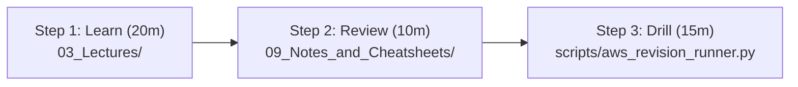

# 🚀 AWS Certified Cloud Practitioner (CLF-C02) — Student Study Dashboard

> **Target Exam:** AWS Certified Cloud Practitioner (`CLF-C02`)  
> **Passing Score:** `700 / 1000` (Scaled Scoring)  
> **Exam Format:** 65 Questions | 90 Minutes  
> **Course Mission:** Zero-to-Certified in 1 to 2 Weeks with high-yield concepts, hands-on labs, and verified question drills.

---

## 🧭 Your Study Roadmap: The 3-Step Daily Routine

Follow this cycle every day for rapid, stress-free retention:

---

## ⚡ Fast-Track 7-Day Study Timetable

| Day | Focus Area | 📖 Study Materials | 💻 Practice Command |
|:---:|:---|:---|:---|
| **Day 1** | **Cloud Concepts & Global Infra** (Domain 1 - 24%) | [Lecture 01](./03_Lectures/Lecture_01_Introduction_to_Cloud_and_Global_Infra.md) [Rapid Review](./09_Notes_and_Cheatsheets/Rapid_Review_Cheatsheet.md) | `python3 scripts/aws_revision_runner.py --cert CLF --mode practice --domain 1 -n 15 --tricks` |
| **Day 2** | **Compute: EC2, Lambda, Fargate** (Domain 3 - 34%) | [Lecture 02](./03_Lectures/Lecture_02_Compute_Virtualization_and_Containers.md) [Lab 03: EC2 Bootstrap](./07_Hands_On_Labs/lab_03_ec2_compute_bootstrap.md) | `python3 scripts/aws_revision_runner.py --cert CLF --mode practice --domain 3 -n 15 --tricks` |
| **Day 3** | **Storage & Databases: S3, EBS, RDS, DynamoDB** | [Lecture 03](./03_Lectures/Lecture_03_Storage_and_Database_Architectures.md) [S3 Cheatsheet](./09_Notes_and_Cheatsheets/distinctions/S3_Storage_Classes_Comparison.md) | `python3 scripts/aws_revision_runner.py --cert CLF --mode practice --domain 3 -n 20 --tricks` |
| **Day 4** | **Networking & Security Perimeter: VPC, Route 53, WAF** | [Lecture 04](./03_Lectures/Lecture_04_Networking_Perimeter_Security_and_Identity.md) [SGs vs NACLs](./09_Notes_and_Cheatsheets/distinctions/Security_Groups_vs_NACLs_Comparison.md) | `python3 scripts/aws_revision_runner.py --cert CLF --mode practice --domain 2 -n 15 --tricks` |
| **Day 5** | **Identity, KMS, Governance & Artifact** (Domain 2 - 30%) | [Lecture 05](./03_Lectures/Lecture_05_Observability_Auditing_and_Governance.md) [Lab 01: IAM MFA](./07_Hands_On_Labs/fast_track/Lab_01_AWS_IAM_Least_Privilege_and_MFA.md) | `python3 scripts/aws_revision_runner.py --cert CLF --mode practice --domain 2 -n 20 --tricks` |
| **Day 6** | **Billing, Pricing Models & Support Plans** (Domain 4 - 12%) | [Lecture 06](./03_Lectures/Lecture_06_Billing_FinOps_and_Exam_Strategy.md) [Support Plans Table](./09_Notes_and_Cheatsheets/distinctions/AWS_Support_Plans_Comparison.md) | `python3 scripts/aws_revision_runner.py --cert CLF --mode practice --domain 4 -n 15 --tricks` |
| **Day 7** | **Final Timed Mock & Weakness Elimination** | [Exam Decryption Playbook](./09_Notes_and_Cheatsheets/Exam_Decryption_Playbook_and_Mnemonics.md) | `python3 scripts/aws_revision_runner.py --cert CLF --mode mock` `python3 scripts/aws_revision_runner.py --cert CLF --mode weakness` |

---

## 🎯 Progress Checklist

Track your completion by checking off each module as you study:

- [ ] **Module 1 (Cloud Concepts):** Read Lecture 01 & Drill 15 Domain 1 Questions
- [ ] **Module 2 (Compute Services):** Read Lecture 02 & Complete Lab 03 (EC2)
- [ ] **Module 3 (Storage & DBs):** Read Lecture 03 & Review S3 Storage Classes
- [ ] **Module 4 (Networking & VPC):** Read Lecture 04 & Review Security Groups vs NACLs
- [ ] **Module 5 (Security & Identity):** Read Lecture 05 & Complete Lab 01 (IAM & MFA)
- [ ] **Module 6 (Billing & Support):** Read Lecture 06 & Review Support Plan SLAs
- [ ] **Authentic Practice Pool:** Completed 25 questions from the November 2026 Release (`--release-2026`)
- [ ] **Mock Simulation:** Scored $\ge 85\%$ on the 65-question timed mock exam (`--mode mock`)

---

## 📂 Clean Directory Quick-Index

| Directory | What You Will Find | Best For |
|:---|:---|:---|
| **[`01_Syllabus/`](./01_Syllabus/)** | Official exam blueprint, scoring rubric, domain weightings | Exam alignment & requirements |
| **[`02_Prerequisites/`](./02_Prerequisites/)** | Foundational computer science, networking & virtualization | Refreshing foundational basics |
| **[`03_Lectures/`](./03_Lectures/)** | 6 Classroom lesson plans with embedded practice scenarios | **Core daily study (Start Here!)** |
| **[`04_Slides/`](./04_Slides/)** | Presentation slides in Marp format | Quick visual overview |
| **[`05_Diagrams/`](./05_Diagrams/)** | Standalone production Mermaid architecture blueprints | Visual architecture mental models |
| **[`06_Explanations/`](./06_Explanations/)** | In-depth service and framework guides across all domains | Deep reference & concept clarification |
| **[`07_Hands_On_Labs/`](./07_Hands_On_Labs/)** | 14 Guided Free-Tier labs with real console screenshots & CLI runbooks | Building practical muscle memory |
| **[`08_Tutorials/`](./08_Tutorials/)** | 7 End-to-end multi-service production architectural builds | Understanding how services connect |
| **[`09_Notes_and_Cheatsheets/`](./09_Notes_and_Cheatsheets/)** | High-yield distinction tables ("X vs Y"), mnemonics & exam traps | Quick review & cramming |
| **[`10_Knowledge_Checks/`](./10_Knowledge_Checks/)** | Rapid diagnostic retention quizzes per domain | Checking retention after each lecture |
| **[`11_Practice_Exams/`](./11_Practice_Exams/)** | 2,716 Canonical Questions, 718Q Community Pool, 393Q Nov 2026 Release | Final exam drills & full simulations |
