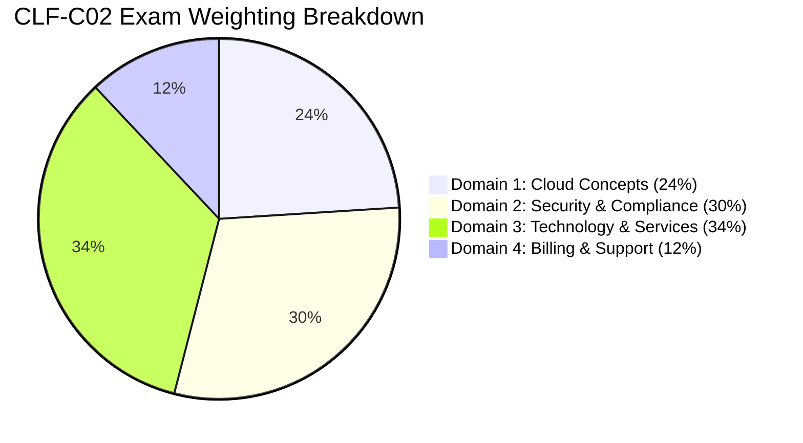
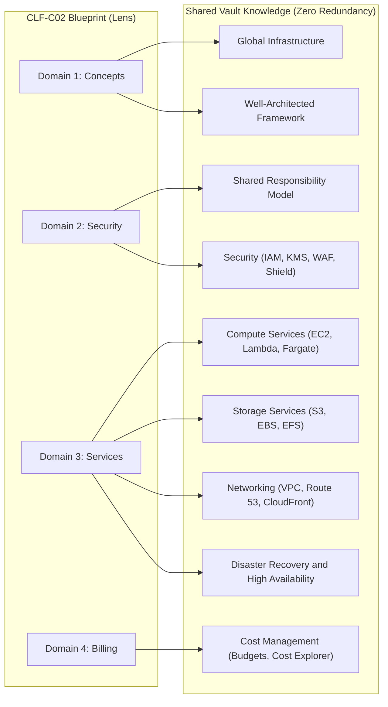

# AWS Certified Cloud Practitioner (CLF-C02) Master Blueprint

> **Exam Code:** CLF-C02  
> **Target Audience:** Overall foundational knowledge of AWS Cloud independent of specific job roles (0–6 months experience).  
> **Passing Score:** 700 / 1000 (Scaled score, compensatory scoring model)  
> **Questions:** 65 total (50 scored + 15 unscored evaluation questions)  
> **Time Limit:** 90 minutes  
> **Question Types:** Multiple choice (1 of 4) & Multiple response (2+ of 5+)

---

## 📊 Exam Domain Weighting

| Domain | Focus Area | Weighting | Target Question Count |
|:---|:---|:---:|:---:|
| [Domain 1](Domain_1_Cloud_Concepts.md) | Cloud Concepts & Architecture Principles | **24%** | ~16 Questions |
| [Domain 2](Domain_2_Security_Compliance.md) | Security, Identity, Governance & Compliance | **30%** | ~20 Questions |
| [Domain 3](Domain_3_Cloud_Technology.md) | Cloud Technology, Services & Deployment | **34%** | ~22 Questions |
| [Domain 4](Domain_4_Billing_Pricing.md) | Billing, Pricing Models, Support & Economics | **12%** | ~7 Questions |
| **Total** | | **100%** | **65 Questions** |

---

## 📚 Prescribed Canonical Textbooks & Primary Sources (2026 Editions)

All course materials, lectures, and revision sets in this repository are strictly grounded in canonical 2026 literature:
1. **Rajesh Daswani (*Packt Publishing, 2026*):**  
   *AWS Certified Cloud Practitioner (CLF-C02) Certification* (ISBN: 978-1-83546-429-8).  
   *Core focus: Well-Architected Framework, CAF 3.0 perspectives, 7 Rs migration taxonomy, and modern Graviton price-performance.*
2. **Tom Taulli (*O'Reilly Media, 2026*):**  
   *AWS Certified Cloud Practitioner (CLF-C02) Study Guide* (ISBN: 978-8-341-64022-2).  
   *Core focus: Service distinction matrices, Compute Savings Plans vs RIs, S3 lifecycle pricing rules, and security perimeter defense.*
3. **Gaurav Kankaria (*Orange Education, 2026*):**  
   *Ultimate AWS Certified Cloud Practitioner (CLF-C02)* (ISBN: 978-93-6152-302-1).  
   *Core focus: Enterprise billing views, Consolidated Billing mechanics, and shared governance models.*

---

## 🧭 Zero-Redundancy Knowledge Navigation

This blueprint serves as your **Map of Content (MOC)**. All underlying technical concepts and services are maintained as atomic single-source-of-truth notes in the vault:

---

## 🎯 High-Yield Master Cheat Sheet & Trap Matrix

Before sitting the exam or teaching a review session, master the quick distinctions in [Exam_Distinction_CheatSheet](../09_Notes_and_Cheatsheets/Rapid_Review_Cheatsheet.md):
* **Edge vs Routing:** Amazon CloudFront (Content Caching) vs AWS Global Accelerator (Anycast IP Network Routing).
* **Cost Estimating vs Analysis:** AWS Pricing Calculator (*Before deployment / "What-if"*) vs AWS Cost Explorer (*After deployment / Historical trends*).
* **Identity Solutions:** IAM Users/Roles (Internal infra) vs Amazon Cognito (External end-users) vs IAM Identity Center (Multi-account workforce SSO).
* **Infrastructure Tiers:** Outposts (On-premises hardware) vs Local Zones (Single-digit ms latency to urban centers) vs Wavelength (5G telco edge).

---

## ⚖️ Dedicated "X vs. Y" Pairwise Distinction Suite

Review all 10 pairwise comparison guides in `notes/distinctions/`:
1. `AWS_Support_Plans_Comparison_Matrix.md` (Basic vs Developer vs Business vs Enterprise On-Ramp vs Enterprise)
2. `Disaster_Recovery_Strategies_Comparison.md` (Backup & Restore vs Pilot Light vs Warm Standby vs Multi-Site Active/Active)
3. `Security_Services_Four_Guardians_Shield_WAF_GuardDuty_Inspector_Macie.md`
4. `Monitoring_Governance_Trio_CloudWatch_vs_CloudTrail_vs_Config.md`
5. `KMS_vs_CloudHSM_vs_SecretsManager_vs_ParameterStore.md`
6. `VPC_Endpoints_Gateway_vs_Interface_vs_PrivateLink.md`
7. `Hybrid_Networking_DirectConnect_vs_SiteToSiteVPN_vs_TransitGateway.md`
8. `Storage_and_Hybrid_AWS_Backup_vs_DataSync_vs_StorageGateway.md`
9. `Developer_and_Mobile_Amplify_vs_DeviceFarm_vs_AppSync.md`
10. `AWS_Health_Dashboard_Global_vs_Account.md`

---

## 🎯 Master Unique Revision Question Banks

Drill with the **2,350 unique questions** deduplicated across 18 source banks in the Vault:
- [Domain 1: Cloud Concepts](../11_Practice_Exams/Domain_1_Cloud_Concepts_Revision_Questions.md) (353 Unique Questions)
- [Domain 2: Security & Compliance](../11_Practice_Exams/Domain_2_Security_and_Compliance_Revision_Questions.md) (552 Unique Questions)
- [Domain 3: Cloud Technology & Services](../11_Practice_Exams/Domain_3_Cloud_Technology_and_Services_Revision_Questions.md) (909 Unique Questions)
- [Domain 4: Billing, Pricing & Support](../11_Practice_Exams/Domain_4_Billing_and_Pricing_Revision_Questions.md) (536 Unique Questions)

