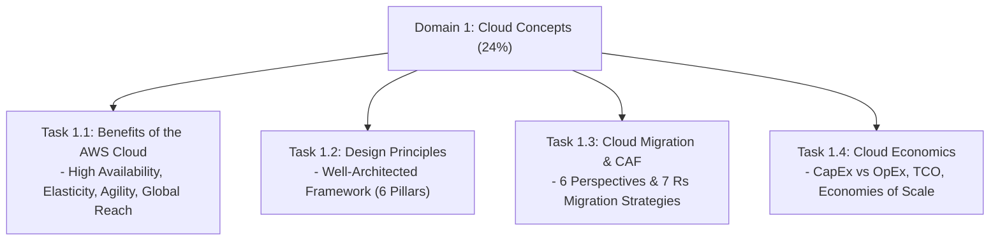

# Domain 1: Cloud Concepts (24% Exam Weighting)

> **Certification:** [AWS Certified Cloud Practitioner (CLF-C02)](CLF-C02_Master_Blueprint.md)  
> **Exam Weighting:** **24%** (~16 questions)  
> **Tags:** `#aws/certification` `#clf-c02` `#domain1`

---

## 🎯 Domain Overview & Official Task Statements

Domain 1 tests your fundamental understanding of why businesses adopt the AWS Cloud, how cloud architecture differs from on-premises hosting, cloud financial economics, and the core architectural design principles of the AWS Well-Architected Framework and Cloud Adoption Framework (AWS CAF).

---

## 📚 Linked Knowledge Base Study Notes (Single Source of Truth)

To study for Domain 1 without redundancy, review these atomic concept notes:

1. **Global Infrastructure & Value Proposition:**
   - Review [Global_Infrastructure](../09_Notes_and_Cheatsheets/concepts/Global_Infrastructure.md): Regions, Availability Zones, Edge Locations, Local Zones, Wavelength, Outposts.
   - Core Value: Agility (speed of experimentation), Elasticity (scale up/down with demand), High Availability (Multi-AZ fault tolerance), Global Reach in minutes.
2. **Cloud Architecture Principles:**
   - Review [Well_Architected_Framework](../09_Notes_and_Cheatsheets/concepts/Well_Architected_Framework.md): The 6 Pillars (Operational Excellence, Security, Reliability, Performance Efficiency, Cost Optimization, Sustainability) and the AWS Well-Architected Tool.
3. **Migration & Digital Transformation:**
   - Review [Cloud_Adoption_Framework_CAF](../09_Notes_and_Cheatsheets/concepts/Cloud_Adoption_Framework_CAF.md): The 6 Perspectives (Business, People, Governance, Platform, Security, Operations) and the 7 Rs of Migration (Rehost, Replatform, Refactor, Repurchase, Retain, Retire, Relocate).
4. **Cloud Economics & TCO:**
   - Review [Cloud_Economics_and_Billing_Models](../09_Notes_and_Cheatsheets/concepts/Cloud_Economics_and_Billing_Models.md): Trading CapEx for OpEx, Total Cost of Ownership (TCO) direct and indirect cost eliminations, Economies of Scale, and Data Transfer pricing rules.

---

## ⚠️ Domain 1 High-Yield Trap Checklist

* [ ] **Agility vs Elasticity:**
  * *Agility:* Speed of innovation and experimentation (e.g., spin up a server in 60 seconds instead of waiting 3 months for procurement).
  * *Elasticity:* Automatically provisioning or de-provisioning resources to match fluctuating load (scale out during Black Friday, scale in after).
* [ ] **High Availability vs Fault Tolerance:**
  * *High Availability (HA):* Minimizes downtime using redundant components across multiple AZs.
  * *Fault Tolerance (FT):* Zero downtime failover; system continues running without a second of degradation.
* [ ] **Fixed vs Variable Costs:**
  * Cloud replaces fixed capital overhead (data center leases, hardware purchases) with flexible, variable operational costs that scale with revenue.
* [ ] **CAF Perspectives Ownership:**
  * *People Perspective:* Overcoming organizational inertia, cloud training, bridging skills gaps.
  * *Business Perspective:* Business value, ROI, customer outcomes.
  * *Governance Perspective:* Portfolio management and program prioritization.

---

## 📚 Canonical Literature & Framework Citations

- **Daswani & Kankaria (Packt, 2026), Chapter 1 & 2:**
  - In-depth breakdown of the 6 Cloud Adoption Framework (CAF 3.0) perspectives and the 7 Rs migration matrix, highlighting the 7th R ("Relocate" for VMware Cloud on AWS).
  - High Availability vs Fault Tolerance architectural boundaries and trade-offs.
- **Tom Taulli (O'Reilly, 2026), Chapter 1 & 2:**
  - CapEx vs. OpEx economic transformation, TCO direct and indirect cost eliminations, and speed-to-market agility benefits.

---

## 🎯 Master Unique Practice Questions

- **Practice Set:** [Domain 1 Unique Revision Bank](../11_Practice_Exams/Domain_1_Cloud_Concepts_Revision_Questions.md) (353 unique, deduplicated questions across 18 source providers with interactive checkboxes and explanations).

