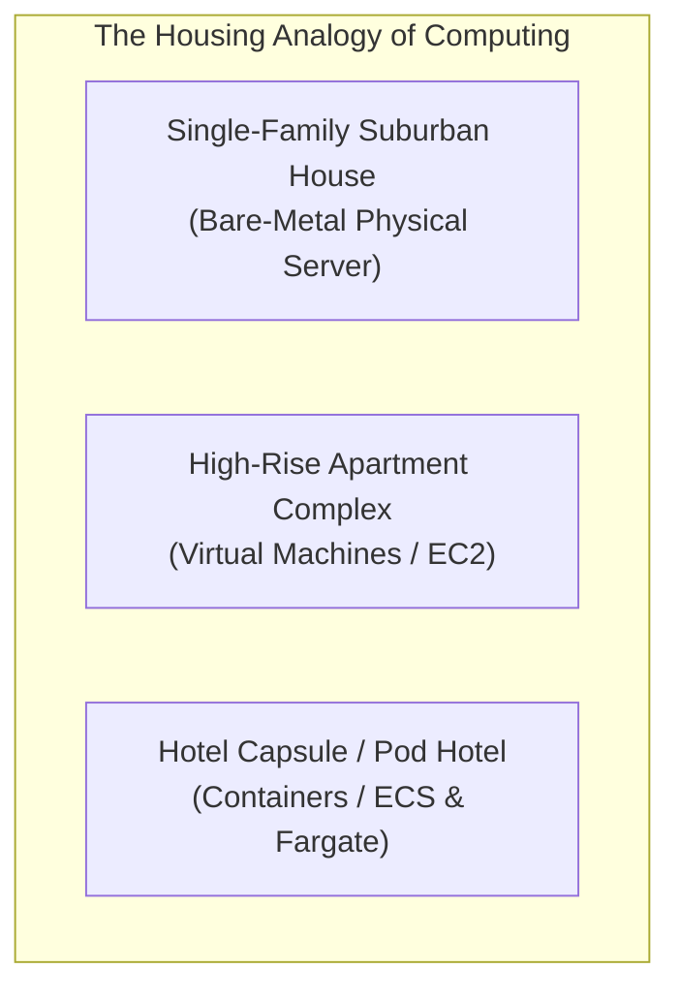
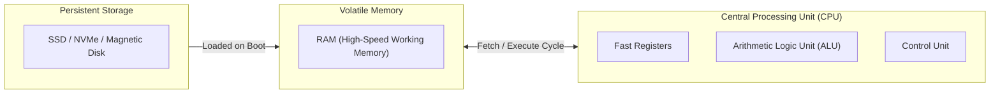
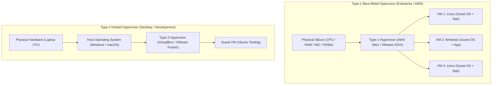
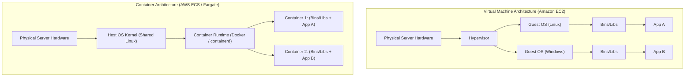
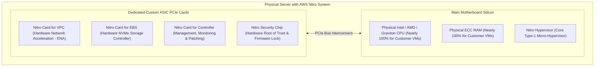

# 01. Operating Systems & Virtualization Prerequisite

> **Module:** Prerequisites & Foundational Computer Science Concepts  
> **Course:** AWS Certified Cloud Practitioner (`CLF-C02`)  
> **Target Audience:** Trainees, students, and career switchers entering cloud computing without prior systems engineering background.

---

## 🧭 Executive Summary & Core Objective

Before you can understand Amazon Elastic Compute Cloud (**Amazon EC2**), serverless containers (**AWS Fargate**), or why cloud instances boot in 30 seconds instead of 3 months, you must understand how physical computers execute software, how **virtualization** broke software free from physical silicon, and how the **AWS Nitro System** powers millions of virtual servers worldwide.

---

## 🏛️ Pillar 1: The Intuitive Real-World Analogy

Imagine housing accommodations:

1. **Bare-Metal Server = A Single-Family House:**
   - You own the foundation, the roof, the plumbing, and the land.
   - If only one person lives in a 6-bedroom house, 85% of the space is completely wasted (empty bedrooms, unused bathrooms), yet you still pay 100% of the mortgage, property tax, and heating bill.
   - Building a new house takes 6 to 12 months from groundbreaking to move-in.
2. **Virtual Machine (VM / EC2) = A High-Rise Apartment Building:**
   - One large physical concrete structure (the physical server hardware) is carved up into private, fully self-contained apartment units.
   - Each apartment has its own front door, lock, kitchen, bathroom, and utility meter (its own **Guest Operating System**).
   - The building management company (the **Hypervisor**) distributes electricity, water, and gas from central mains to each unit. If Apartment 3B floods its sink, Apartment 4B remains dry and secure.
3. **Container (Docker / Fargate) = A Micro-Studio / Capsule Hotel:**
   - Instead of duplicating a full kitchen, bathroom, and living room for every occupant, residents share the building's central infrastructure (the host operating system kernel) and only bring their clothes and personal laptop (the application code and dependencies).
   - Moving in or out takes seconds rather than signing a long-term lease.

---

## ⚙️ Pillar 2: First-Principles Computer Science Mechanics

### 1. The Von Neumann Architecture
Every physical computer, whether an iPhone, a laptop, or an enterprise AWS rack server, consists of three core components:

- **CPU (The Brain):** Executes instructions billions of times per second. It holds immediate operational values in tiny, blazing-fast memory slots called **registers** and processes math in the **Arithmetic Logic Unit (ALU)**.
- **RAM (The Scratchpad):** Fast, volatile temporary storage. When power is lost, everything in RAM evaporates. Operating systems and active programs load from disk into RAM so the CPU can access them with single-digit nanosecond latency.
- **Persistent Storage (The Filing Cabinet):** Non-volatile magnetic disks or NAND flash SSDs. Slower than RAM, but retains files, databases, and operating systems indefinitely when powered off.

### 2. The Operating System Kernel & Privilege Rings
Hardware cannot be directly controlled by every user program; if two applications attempted to write to the exact same physical memory cell at the exact same time, the computer would instantly crash.

The **Operating System (OS)** acts as the traffic cop between software and physical hardware:
- **The Kernel:** The central core of the OS that has complete control over the entire system. It manages process scheduling (who gets CPU time), memory allocation (paging and virtual memory), system calls, and device drivers.
- **CPU Privilege Rings:** Modern x86 and ARM processors enforce hardware privilege boundaries:
  - **Ring 0 (Supervisor / Kernel Space):** Highest privilege. Only the OS kernel executes here. It can issue raw instructions to the CPU, access raw RAM, and talk to hardware controllers.
  - **Ring 3 (User Space):** Lowest privilege. Your web browsers, text editors, and user applications run here. A user application cannot touch hardware directly; it must request the kernel's permission via a **system call** (`syscall`).

---

## 📜 Pillar 3: The Historical IT Problem (The Bare-Metal Era)

In the 1990s and early 2000s, before virtualization became enterprise-standard:

### 1. The Single-Workload Dilemma & "Dependency Hell"
If Company X needed to run an Oracle payroll database and an Apache public web server, systems engineers were terrified of installing both on the same physical server. If the web server crashed, ran out of memory, or required a conflicting software library, the payroll database went down with it. As a result, the industry rule was: **One physical server per enterprise application.**

### 2. The Catastrophic 10% Utilization Trap
Because servers had to be sized for the absolute worst-case traffic spike (e.g., annual tax season or holiday sales), typical physical servers operated at only **5% to 15% average CPU utilization**. Companies were burning massive capital on electricity, cooling, and rack space for hardware that spent 85% of its life doing nothing.

### 3. The 6-Month Procurement Nightmare
When an engineering team wanted to launch a new internal application:
1. They submitted a hardware requisition form to finance.
2. Procurement negotiated contracts with hardware vendors (Dell, HP, IBM).
3. The server was manufactured, shipped, and delivered weeks later.
4. Datacenter technicians unboxed, racked, stacked, and cabled power and fiber.
5. Systems administrators installed the OS, patched drivers, and configured storage.
- **Total Elapsed Time:** **3 to 6 months** before a single line of business code could run.

---

## 🚀 Pillar 4: The Virtualization Revolution & Hypervisors

### 1. What is a Hypervisor?
A **Hypervisor** (also called a **Virtual Machine Monitor / VMM**) is a specialized software or firmware layer that abstracts physical hardware, allowing multiple completely independent **Virtual Machines (VMs)** to run simultaneously on a single physical host.

- **Type-1 Hypervisor (Bare-Metal):** Runs directly on the physical host hardware with no intermediary host OS. It intercepts CPU instructions and allocates physical memory pages with maximum performance and minimal overhead. This is the model used by AWS and enterprise datacenters.
- **Type-2 Hypervisor (Hosted):** Runs as an application inside an existing host operating system (like running VirtualBox on your MacBook). Great for local testing, but introduces massive performance penalties.

### 2. What Actually is a Virtual Machine (VM)?
When you launch an Amazon EC2 instance, you are launching a **Virtual Machine**. 
To the software inside the VM, it believes it is running on real, dedicated physical hardware:
- **vCPU (Virtual CPU):** A slice of time on a physical hardware execution thread (hyperthread).
- **vRAM:** A designated block of physical RAM isolated by hardware memory virtualization tables (Extended Page Tables / EPT).
- **vNIC (Virtual Network Card):** A virtualized network interface mapped to a physical network adapter.
- **Virtual Disk:** A virtual block storage device formatted with a file system.

### 3. The "Noisy Neighbor" Problem & Hardware Isolation
In a shared multi-tenant environment, what prevents Tenant A from running an infinite CPU loop that starves Tenant B?
- The hypervisor enforces strict hardware resource quotas (CPU scheduling time-slices, memory limits, and I/O throttling).
- Modern CPU silicon includes hardware virtualization instructions (Intel VT-x, AMD-V) that intercept unauthorized attempts by a guest VM to access memory or hardware outside its designated sandbox.

---

## 🐳 Pillar 5: Virtual Machines vs. Containers

Modern cloud architectures heavily utilize **Containers** (Docker, Kubernetes, AWS ECS, AWS EKS, AWS Fargate). Understanding how containers differ from virtual machines is a critical foundational concept:

### Deep Architectural Comparison

| Dimension | Virtual Machine (Amazon EC2) | Container (AWS ECS / Fargate / EKS) |
|:---|:---|:---|
| **What is Virtualized?** | **Hardware** (CPU, RAM, NIC, BIOS, Disks) | **Operating System Kernel** |
| **Guest OS Included?** | **Yes.** Every VM runs its own complete guest OS kernel, system utilities, and drivers. | **No.** All containers share the host machine's Linux kernel; they only package application code and specific libraries. |
| **Isolation Level** | **Hardware-Level Isolation** (strongest boundary; hypervisor enforced). | **Process-Level Isolation** (uses Linux `namespaces` and `cgroups`). |
| **Image Size** | **Gigabytes (GBs).** Full OS images (AMIs). | **Megabytes (MBs).** Lightweight application bundles. |
| **Startup / Boot Time** | **Seconds to Minutes** (full OS kernel boot cycle). | **Milliseconds to Sub-Seconds** (spawns like a normal OS process). |
| **Best Used For** | Monolithic apps, full OS customization, long-running services, enterprise legacy software. | Microservices, rapid autoscaling, batch jobs, CI/CD build runners. |

---

## ⚡ Pillar 6: How AWS Implements Virtualization: The AWS Nitro System

In early cloud history, AWS used the open-source **Xen Hypervisor**. In the legacy Xen model, a master management domain called **Dom0** ran on the host CPU alongside customer VMs, handling networking, storage I/O, and security checks.
- **The Problem:** Dom0 consumed 10% to 20% of the physical server's CPU and memory capacity. This overhead was known as the **"Hypervisor Tax"**.

### The Breakthrough: The AWS Nitro System
Beginning in 2017, AWS completely redesigned cloud server architecture by creating the **AWS Nitro System**:

1. **Nitro Cards (Specialized Hardware ASICs):**
   - **Nitro Card for VPC:** Directly processes all network traffic, encryption, and Security Group rules in hardware, delivering network speeds up to 400 Gbps.
   - **Nitro Card for EBS:** Directly connects EBS volumes as native NVMe storage drives, offloading encryption and storage transport.
   - **Nitro Card for Controller:** Manages instance provisioning, telemetry, and live firmware updates without disturbing running instances.
2. **Nitro Security Chip:**
   - A dedicated security chip on the motherboard that enforces cryptographic validation of firmware every time the system boots, preventing unauthorized tampering.
3. **Nitro Hypervisor:**
   - A stripped-down, ultra-fast Type-1 micro-hypervisor that only manages CPU core scheduling and memory page allocation.
   - **Result:** Nearly **100% of the physical server's CPU and memory** is delivered directly to the customer.

### Bare-Metal Instances in AWS (`*.metal`)
Because the Nitro System completely handles storage, networking, and security on dedicated cards, AWS can bypass the Nitro Hypervisor entirely:
- **Amazon EC2 Bare Metal Instances** (e.g., `c5.metal`, `m6i.metal`) give the customer direct, exclusive access to the raw physical Intel, AMD, or Graviton processors and memory.
- **Why would an enterprise need Bare Metal?**
  - Applications that do not permit hypervisors due to strict legacy licensing.
  - Workloads that require hardware virtualization within the OS (**nested virtualization** like VMware Cloud on AWS).
  - Specialized low-level hardware performance profiling.

---

## ⚖️ Tenancy Architecture Comparison in AWS

When provisioning compute on AWS, you choose between three distinct tenancy models:

| Tenancy Model | How It Works Under the Hood | Hardware Sharing | Compliance & Licensing | Cost Impact |
|:---|:---|:---|:---|:---|
| **Shared Tenancy (Default)** | Your EC2 VM runs on a physical server alongside VMs owned by other AWS customers. Nitro guarantees isolation. | **Shared with other AWS accounts.** | Standard commercial workloads. | **Lowest Cost** (pay only for instance hours). |
| **Dedicated Instances** | Your EC2 VMs run on physical hardware that is dedicated exclusively to your AWS account. | **Shared ONLY with instances in your own account.** (Zero external tenants). | Meets corporate policies requiring physical tenant separation. | **Moderate Surcharge** ($2/hr flat fee per region + instance pricing). |
| **Dedicated Hosts** | You rent an entire physical bare-metal server. You have full visibility into physical sockets and core counts. | **100% Dedicated to you.** You control VM placement on the host. | Required for **BYOL (Bring Your Own License)** software bound to physical socket/core counts (e.g. Oracle, Microsoft SQL Server). | **Highest Cost** (pay for the full physical server regardless of how many VMs you run). |

---

## 🎯 Exam Scenario Decryption & Traps (CLF-C02)

### 1. Key Exam Trigger Phrases
When reading CLF-C02 question stems, look for these telltale phrases:

| Exam Trigger Phrase | Correct AWS Architecture / Service | Why Candidates Get Confused |
|:---|:---|:---|
| *"Run applications without managing servers or operating systems"* | **Serverless (AWS Lambda / AWS Fargate)** | Candidates mistakenly pick EC2; remember EC2 requires patching and managing the OS. |
| *"Bring Your Own License (BYOL) bound to physical CPU sockets"* | **Amazon EC2 Dedicated Hosts** | Candidates confuse Dedicated Hosts with Dedicated Instances. Dedicated Hosts allow socket/core visibility. |
| *"Run Docker containers without provisioning or managing EC2 instances"* | **AWS Fargate** | Candidates often pick ECS on EC2, which still requires managing underlying virtual machines. |
| *"Hardware-isolated physical tenant separation without socket-level control"* | **Dedicated Instances** | Contrasted with Dedicated Hosts. |

### 2. Sample Exam Question Walkthrough

> **Scenario Question:**  
> A financial services company needs to migrate a legacy licensing-constrained database to AWS. The software vendor requires proof that the software is running on dedicated physical hardware with socket-level core tracking. The company must also maintain complete control over which virtual machines are placed on which physical server.  
> Which EC2 purchasing and tenancy option will satisfy these requirements?
>
> - [A] EC2 Reserved Instances with Default Tenancy
> - [B] EC2 Dedicated Instances
> - [C] EC2 Dedicated Hosts
> - [D] EC2 Spot Instances

**Detailed Answer Rationale:**
- **Correct Answer: [C] EC2 Dedicated Hosts**  
  *Why:* Dedicated Hosts provide a physical server dedicated entirely for your use, giving you complete visibility into the physical sockets and physical cores. This visibility is legally mandatory for Bring Your Own License (BYOL) compliance models. Furthermore, Dedicated Hosts give you affinity control over instance placement.
- **Why [A] is Wrong:** Default tenancy places your VM on a multi-tenant physical host shared with other customers, violating physical isolation and licensing rules.
- **Why [B] is Wrong:** Dedicated Instances guarantee that no *other* AWS accounts share the physical hardware, but they do NOT give you socket-level visibility or control over instance placement on the host.
- **Why [D] is Wrong:** Spot instances are spare compute capacity that AWS can reclaim with a 2-minute warning. They run on shared tenancy and are inappropriate for stateful core databases.

---

## 📝 Retention Self-Check Exercises

1. *In your own words, what is the fundamental difference between what a Virtual Machine virtualizes versus what a Container virtualizes?*
2. *Why did traditional physical datacenters operate at only 5% to 15% CPU utilization, and how did hypervisors solve that problem?*
3. *What are the three core components of the AWS Nitro System, and how do they eliminate the "Hypervisor Tax"?*
4. *If an auditor demands that your company proves that no external AWS customer is running on the same physical silicon as your instances, but you do NOT need physical CPU socket counts for software licensing, which tenancy option should you choose?*

---

*Next Prerequisite Module: [02_Networking_and_OSI_Model.md](./02_Networking_and_OSI_Model.md)*
